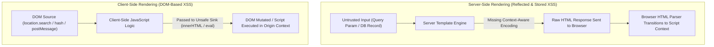
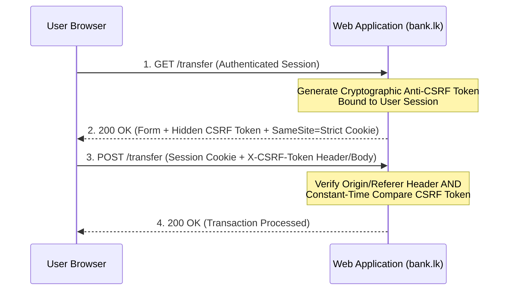
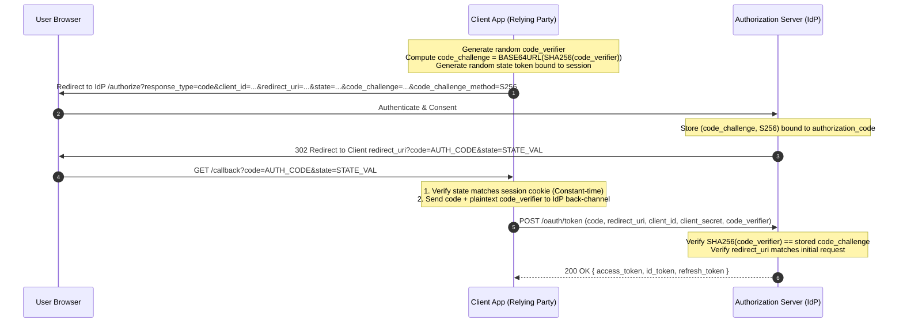
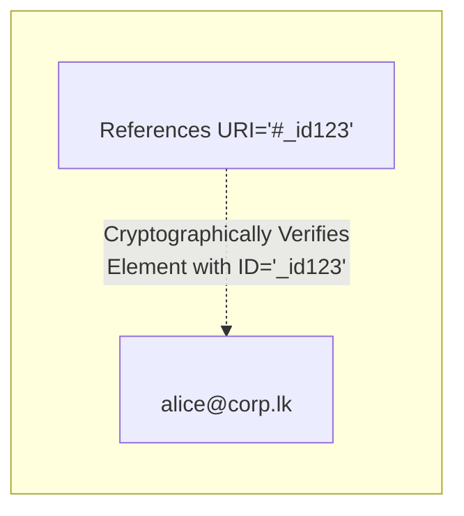
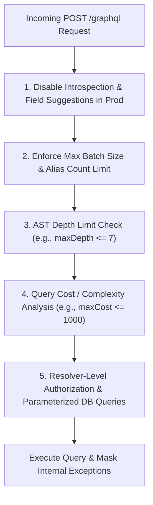
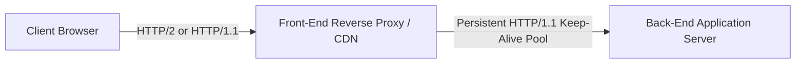
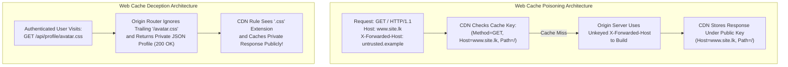
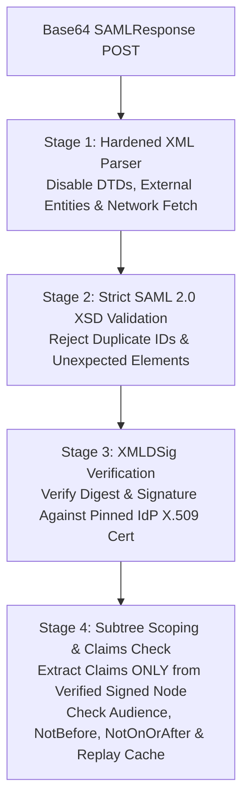
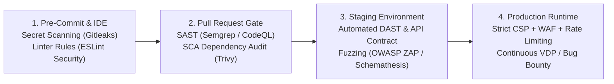

# PART VII: ADVANCED APPLICATION SECURITY ENGINEERING & VULNERABILITY DISCLOSURE

---

## Chapter 31: Client-Side Web Security — XSS Root Causes, Context-Aware Encoding, CSP, CORS & CSRF Defense

Modern web applications execute complex business logic directly inside the user's browser. While shifting state management and rendering to the client improves responsiveness and reduces server load, it expands the browser attack surface. Understanding client-side security requires examining how browsers parse HTML, execute JavaScript, isolate origins under the Same-Origin Policy (SOP), and manage ambient credentials across cross-origin requests.

---

### 31.1 The Same-Origin Policy (SOP) Architecture

The **Same-Origin Policy (SOP)** is the foundational security boundary of the web browser. It restricts how a document or script loaded from one origin can interact with resources from another origin.

#### 1. Defining an Origin
An **origin** is defined strictly by the tuple of three components (RFC 6454):
$$\text{Origin} = (\text{Scheme}, \text{Host}, \text{Port})$$

Consider the base URL `https://app.bank.lk:443/accounts/summary.html`:

| Target URL | Same Origin? | Architectural Reason |
| :--- | :--- | :--- |
| `https://app.bank.lk:443/settings/profile` | **Yes** | Scheme (`https`), Host (`app.bank.lk`), and Port (`443`) match exactly. |
| `http://app.bank.lk:443/accounts/summary.html` | **No** | Scheme differs (`http` vs `https`). |
| `https://api.bank.lk:443/v1/balance` | **No** | Host differs (`api.bank.lk` vs `app.bank.lk`). |
| `https://app.bank.lk:8443/accounts/summary.html` | **No** | Port differs (`8443` vs `443`). |

#### 2. What SOP Permits vs. Restricts
SOP is not a blanket block on all cross-origin network traffic; rather, it distinguishes between *embedding/writes* and *reads*:
1. **Cross-Origin Writes (Generally Permitted):** Forms (`<form action="https://other.origin">`), links, and redirects are allowed by default. (This design legacy is the root cause of Cross-Site Request Forgery, or CSRF).
2. **Cross-Origin Embedding (Generally Permitted):** Browsers allow pages to embed `<script src="...">`, ``, `<link rel="stylesheet">`, `<video>`, and `<iframe>` from external origins.
3. **Cross-Origin Reads (Strictly Blocked):** JavaScript executing in Origin A cannot read the HTTP response body of a `fetch()` or `XMLHttpRequest` made to Origin B, nor can it inspect the DOM of a cross-origin `<iframe>`, unless Origin B explicitly relaxes SOP via Cross-Origin Resource Sharing (CORS) headers.

---

### 31.2 Cross-Site Scripting (XSS): Architectural Root Causes

**Cross-Site Scripting (XSS)** (CWE-79) occurs when an application includes untrusted data in a web page without proper validation or context-aware escaping, or updates the Document Object Model (DOM) using unsafe browser APIs that interpret data as executable code. Because the injected script executes within the victim's browser session under the application's origin, it completely circumvents the Same-Origin Policy.



#### 1. Taxonomy of XSS Flaws

| Category | Execution Location | Data Flow Lifecycle | Primary Defense |
| :--- | :--- | :--- | :--- |
| **Reflected XSS (Type I)** | Server-Side HTML Generation | Untrusted HTTP request input (URL parameters, headers) is immediately echoed in the HTTP response body without encoding. | Context-aware server-side output encoding; strict input validation. |
| **Stored / Persistent XSS (Type II)** | Server-Side or Client-Side | Untrusted input is saved in a backend data store (database, message queue, log file) and rendered later to one or more users (including internal administrators viewing logs or support tickets). | Strict input validation upon ingestion + context-aware encoding at render time. |
| **DOM-Based XSS (Type 0)** | Client-Side Browser Engine | The server response itself is static and benign, but client-side JavaScript reads data from a controllable **Source** and passes it into an unsafe **Sink** that parses HTML or executes code. | Using safe DOM APIs (`textContent`, `setAttribute` on safe attributes), Trusted Types API. |

#### 2. Browser Parser Contexts and Context-Aware Encoding
A common engineering mistake is applying standard HTML entity encoding (`&lt;`, `&gt;`, `&amp;`, `&quot;`, `&#x27;`) universally regardless of where the variable is placed in the document. Browsers utilize multiple state machines (HTML tokenizer, CSS parser, JavaScript lexer, URL parser) that cascade into one another.

1. **HTML Body Context (`<div>UNTRUSTED_DATA</div>`):**
   - The HTML parser looks for `<` to start a new tag or `&` to begin a character reference.
   - **Required Defense:** HTML Entity Encoding (`<` $\rightarrow$ `&lt;`, `>` $\rightarrow$ `&gt;`, `&` $\rightarrow$ `&amp;`, `"` $\rightarrow$ `&quot;`, `'` $\rightarrow$ `&#x27;`).
2. **HTML Attribute Context (`<input value="UNTRUSTED_DATA">`):**
   - Always quote attributes. Unquoted attributes can be broken out of using spaces, tabs, or `/` characters even if `<` and `>` are encoded.
   - **Required Defense:** Aggressive attribute encoding (encoding all non-alphanumeric characters as `&#xHH;`) and ensuring attributes are always enclosed in double or single quotes.
3. **URL Attribute Context (`<a href="UNTRUSTED_URL">` or `<iframe src="UNTRUSTED_URL">`):**
   - HTML entity encoding inside `href` does **not** prevent pseudo-protocol execution because the browser's HTML parser decodes entities *before* handing the attribute string to the URL parser. If the URL begins with `javascript:` or `data:`, the browser executes code when clicked or loaded.
   - **Required Defense:** Parse the URL using a standard URL parser (`new URL()`), explicitly validate that the scheme is in an allowlist (`https:`, `http:`, `mailto:`), and then URL-encode query parameters.
4. **JavaScript Data Context (`<script>const username = "UNTRUSTED_DATA";</script>`):**
   - Standard HTML entity encoding does not protect inline `<script>` blocks because the HTML tokenizer inside a `<script>` element does not decode HTML entities, or worse, allows quote escapes (`\"`) and line terminators. Furthermore, if the untrusted string contains `</script>`, the HTML parser immediately closes the script block regardless of JavaScript string literals.
   - **Required Defense:** Never interpolate untrusted strings directly into code blocks. Instead, serialize data safely using JSON encoding with Unicode escapes for `<`, `>`, `&`, `'`, and `"`, and place it inside a non-executable `<script type="application/json" id="init-data">` data block, reading it via `JSON.parse(document.getElementById('init-data').textContent)`.

#### 3. Vulnerable vs. Remediated Code Examples

**Vulnerable Implementation (Node.js / Express + Client-Side DOM Manipulation):**
```javascript
// VULNERABLE SERVER-SIDE RENDERING
app.get('/search', (req, res) => {
    const query = req.query.q || '';
    // Directly concatenating user input into HTML string without encoding
    res.send(`<html><body><h2>Search results for: ${query}</h2></body></html>`);
});

// VULNERABLE CLIENT-SIDE DOM RENDERING
function renderUserProfile(bioText, websiteUrl) {
    const bioContainer = document.getElementById('user-bio');
    // Unsafe sink: innerHTML parses and renders raw HTML/SVG/event handlers
    bioContainer.innerHTML = `<p>${bioText}</p><a href="${websiteUrl}">Website</a>`;
}
```

**Secure Implementation (Context-Aware Encoding & Safe DOM APIs):**
```javascript
// SECURE SERVER-SIDE RENDERING (Using auto-escaping templates or explicit encoding)
function encodeHTML(str) {
    return String(str)
        .replace(/&/g, '&amp;')
        .replace(/</g, '&lt;')
        .replace(/>/g, '&gt;')
        .replace(/"/g, '&quot;')
        .replace(/'/g, '&#x27;');
}

app.get('/search', (req, res) => {
    const query = encodeHTML(req.query.q || '');
    res.setHeader('Content-Type', 'text/html; charset=utf-8');
    res.send(`<!DOCTYPE html><html><body><h2>Search results for: ${query}</h2></body></html>`);
});

// SECURE CLIENT-SIDE DOM RENDERING (Using textContent and URL Scheme Validation)
function renderUserProfileSecure(bioText, websiteUrl) {
    const bioContainer = document.getElementById('user-bio');
    bioContainer.replaceChildren(); // Clear existing nodes safely

    const p = document.createElement('p');
    p.textContent = bioText; // Safe sink: treated strictly as text, never parsed as HTML

    const a = document.createElement('a');
    a.textContent = 'Website';
    a.rel = 'noopener noreferrer';

    try {
        const parsedUrl = new URL(websiteUrl);
        if (parsedUrl.protocol === 'https:' || parsedUrl.protocol === 'http:') {
            a.href = parsedUrl.href;
        } else {
            a.href = '#'; // Reject non-HTTP(S) schemes like javascript: or data:
        }
    } catch (e) {
        a.href = '#';
    }

    bioContainer.appendChild(p);
    bioContainer.appendChild(a);
}
```

#### 4. DOM Clobbering and Mutation XSS (mXSS) Architecture
Even when scripts avoid explicit `eval()` calls, two subtle browser parsing behaviors can undermine client-side defenses:

1. **DOM Clobbering:**
   - A legacy HTML specification feature maps named HTML elements (`id="..."` or `name="..."` on `<form>`, ``, `<a>`, `<embed>`, `<object>`) directly onto properties of the global `window` and `document` objects.
   - If an application relies on an uninitialized global variable pattern such as `const config = window.APP_CONFIG || { apiEndpoint: '/api' };`, and allows user-supplied HTML (even sanitized to remove `<script>` tags) that includes `id="APP_CONFIG"`, the global variable evaluates to the HTML element reference rather than the fallback object.
   - **Remediation:** Declare variables explicitly with `const`/`let` in module scope rather than relying on `window.*` fallbacks; use `Object.freeze()` on configuration objects; configure HTML sanitizers (such as DOMPurify) with `SANITIZE_DOM: true` (enabled by default in DOMPurify) to strip or prefix `id` and `name` attributes on user-supplied markup.

2. **Mutation XSS (mXSS):**
   - Occurs when user HTML is passed through a client-side sanitizer and then assigned to `element.innerHTML`. When `innerHTML` is invoked, the browser serializes and re-parses the markup. Certain edge cases—such as nested `<math>` or `<svg>` foreign content namespaces, or malformed table/form structures—cause the browser's HTML parser to "mutate" the DOM tree during normalization into a structure that differs from what the sanitizer inspected.
   - **Remediation:** Always keep HTML sanitizers (e.g., DOMPurify) updated to the latest version, return DOM nodes directly rather than serialized strings (`DOMPurify.sanitize(dirty, { RETURN_DOM_FRAGMENT: true })`) so the browser does not re-parse the HTML a second time, and enforce W3C **Trusted Types**.

---

### 31.3 Content Security Policy (CSP) Architecture & Engineering

**Content Security Policy (CSP)** (W3C CSP Level 3) is a defense-in-depth HTTP response header (`Content-Security-Policy`) that instructs the browser which sources of content (scripts, styles, images, frames, network connections) are permitted to load and execute.

#### 1. Core CSP Directives Reference

| Directive | Purpose | Security Engineering Notes |
| :--- | :--- | :--- |
| `default-src` | Fallback directive for fetch directives (`script-src`, `style-src`, `img-src`, `connect-src`, etc.) not explicitly specified. | Does **not** cover non-fetch directives like `base-uri`, `form-action`, or `frame-ancestors`. Always set `default-src 'none'` or `'self'`. |
| `script-src` | Controls allowed sources for JavaScript execution. | Avoid `'unsafe-inline'` and `'unsafe-eval'`. Prefer cryptographic nonces (`'nonce-...'`) or hashes (`'sha256-...'`) with `'strict-dynamic'`. |
| `object-src` | Controls legacy plugin objects (`<object>`, `<embed>`, `<applet>`). | Always set `object-src 'none'` to prevent Flash/plugin-based execution vectors. |
| `base-uri` | Restricts URLs that can be used in a document's `<base href="...">` element. | If omitted, an attacker who can inject a `<base>` tag can hijack relative script paths (`<script src="/js/app.js">`). Always set `base-uri 'none'` or `'self'`. |
| `frame-ancestors` | Specifies which parent origins may embed the page in `<frame>`, `<iframe>`, `<object>`, or `<embed>`. | Modern replacement for `X-Frame-Options` to defend against Clickjacking. Set to `'none'` or `'self'`. |
| `form-action` | Restricts the target URLs to which `<form>` elements can submit data. | Prevents markup injection attacks from redirecting form submissions to external credential-harvesting servers. |
| `require-trusted-types-for` | Enforces W3C Trusted Types on DOM XSS sinks (`'script'`). | Blocks raw strings from being passed to `innerHTML`, `outerHTML`, `document.write`, or `eval`. |

#### 2. Pitfalls of Allowlist-Based CSPs vs. Nonce-Based `strict-dynamic`
Historically, organizations deployed domain-allowlist CSPs such as:
```http
Content-Security-Policy: script-src 'self' https://cdn.example.com https://ajax.googleapis.com;
```
Architectural research by Google security engineers demonstrated that domain allowlists frequently fail to mitigate XSS for three reasons:
1. **JSONP Endpoints on Allowlisted CDNs:** Many public CDNs and domain roots host legacy JSONP endpoints (`?callback=myFunc`) that return arbitrary JavaScript execution under the trusted domain origin.
2. **Hosted Client-Side Frameworks:** If an allowlisted CDN hosts old versions of client-side template libraries that evaluate expressions inside HTML attributes, an attacker can load that library from the trusted CDN and evaluate expressions without violating `script-src`.
3. **Same-Origin User Uploads (`'self'`):** If an application allows users to upload files (even avatar images or CSVs) that are served from the same origin (`'self'`) without strict `Content-Type` and `X-Content-Type-Options: nosniff` headers, `'self'` permits loading the uploaded path as a script.

**The Modern Standard: Strict Nonce-Based CSP with `'strict-dynamic'`**
Instead of maintaining brittle domain allowlists, modern web applications generate a cryptographically random 128-bit Base64 **nonce** (number used once) on every single HTTP response:

```http
Content-Security-Policy:
  script-src 'nonce-r4nd0mCryptoBase64Str1ng==' 'strict-dynamic';
  object-src 'none';
  base-uri 'none';
  frame-ancestors 'none';
  require-trusted-types-for 'script';
```

Every legitimate `<script>` tag rendered by the server must carry the matching `nonce` attribute:
```html
<script nonce="r4nd0mCryptoBase64Str1ng==" src="/static/bundle.js"></script>
```
- Why `'strict-dynamic'` works: It instructs the browser that any script blessed with a valid nonce is permitted to dynamically create and load child scripts via `document.createElement('script')`, while ignoring host-source allowlists (`'self'`, `https:`) and `'unsafe-inline'`.
- **Critical Engineering Rule:** The nonce **must** be regenerated using a CSPRNG on every HTTP request and must never be cached by a CDN or reverse proxy.

---

### 31.4 Cross-Site Request Forgery (CSRF) & State-Change Defense

**Cross-Site Request Forgery (CSRF)** (CWE-352) occurs when a cross-origin website causes a user's web browser to perform an unwanted state-changing action on a trusted site where the user is currently authenticated.

#### 1. Architectural Root Cause: Ambient Credentials
When a user authenticates to `https://bank.lk` and receives a session cookie (`Set-Cookie: session_id=xyz...`), the browser automatically attaches that cookie to subsequent HTTP requests directed to `bank.lk`—even if the request was initiated by an HTML `<form>` or `fetch()` running on `https://unrelated-blog.example`.

#### 2. Defense-in-Depth Against CSRF



1. **Synchronizer Token Pattern (Stateful Anti-CSRF Tokens):**
   - The server generates a high-entropy (at least 128 bits from a CSPRNG), unpredictable secret token bound specifically to the user's current authenticated session.
   - For every state-changing request (`POST`, `PUT`, `DELETE`, `PATCH`), the client must include the token in a custom HTTP header (e.g., `X-CSRF-Token`) or form body field.
   - Because the Same-Origin Policy prevents a cross-origin page from reading the HTML response or custom headers of `bank.lk`, a third-party origin cannot read or guess the synchronizer token.
   - **Common Implementation Pitfalls to Audit:**
     - Failing to bind the CSRF token to the specific user's session ID (allowing any valid token from Account A to validate a request for Account B).
     - Skipping CSRF validation when the request method is changed from `POST` to `GET`. State-changing operations must strictly reject `GET` and `HEAD` requests (RFC 9110 safe methods).
     - Skipping validation when the token parameter is omitted entirely or sent as an empty value.

2. **`SameSite` Cookie Attribute:**
   - Controls whether cookies are sent with cross-site requests:
     - `SameSite=Strict`: The cookie is never sent in cross-site requests, including top-level navigations (clicking a link from an email or external website). Ideal for high-security banking and administrative applications.
     - `SameSite=Lax` (Modern Browser Default): The cookie is withheld on cross-site subrequests (such as ``, `<iframe>`, or background `POST` forms), but **is sent** when a user navigates to the origin via a top-level safe HTTP method (`GET`).
     - `SameSite=None; Secure`: The cookie is sent on all cross-site requests (requires `Secure` flag over HTTPS).
   - **Why `SameSite=Lax` Alone Is Not a Complete CSRF Defense:** If an application erroneously performs state-changing actions via `GET` requests (e.g., `GET /account/delete?confirm=true`), a top-level navigation (`window.location = ...` or `<a href="...">`) from an external site will still carry `SameSite=Lax` cookies. Furthermore, cookies shared across sibling subdomains (`*.example.com`) are considered **same-site** (`example.com` eTLD+1), meaning a compromised marketing subdomain (`promo.example.com`) can still send `SameSite=Strict` cookies to `api.example.com`.

3. **Fetch Metadata Request Headers (`Sec-Fetch-*`):**
   - Modern browsers automatically append forbidden headers that JavaScript cannot spoof:
     - `Sec-Fetch-Site`: `'same-origin'`, `'same-site'`, `'cross-site'`, or `'none'` (user-initiated address bar navigation).
     - `Sec-Fetch-Mode`: `'navigate'`, `'cors'`, `'no-cors'`, `'same-origin'`.
   - Servers can implement a Resource Isolation Policy middleware that rejects incoming state-changing requests where `Sec-Fetch-Site` is `'cross-site'`.

---

### 31.5 Cross-Origin Resource Sharing (CORS) Security Design

**Cross-Origin Resource Sharing (CORS)** is a browser mechanism that uses HTTP response headers to allow a server to explicitly declare which external origins are permitted to read its responses via JavaScript.

#### 1. Simple Requests vs. Preflighted Requests (`OPTIONS`)
- **Simple Requests:** Use `GET`, `HEAD`, or `POST` with standard form Content-Types (`application/x-www-form-urlencoded`, `multipart/form-data`, `text/plain`) and no custom headers. The browser sends the request immediately with an `Origin: https://caller.example` header and checks the response's `Access-Control-Allow-Origin` (ACAO) header before exposing the response body to JavaScript.
- **Preflighted Requests:** Any request using `PUT`, `DELETE`, `PATCH`, `Content-Type: application/json`, or custom headers triggers an automatic browser `OPTIONS` preflight check before the actual request is transmitted.

#### 2. Critical CORS Misconfigurations & Secure Remediation

| Misconfiguration Pattern | Architectural Risk | Secure Remediation |
| :--- | :--- | :--- |
| **Reflecting Arbitrary `Origin` with `Access-Control-Allow-Credentials: true`** | The server dynamically copies whatever value is in the request's `Origin` header into `Access-Control-Allow-Origin` alongside `Allow-Credentials: true`. This completely disables SOP for that endpoint across the entire internet. | Maintain a strict, exact-match server-side allowlist Set of trusted origins (`https://app.company.lk`). Never reflect arbitrary origins when credentials are enabled. |
| **Flawed Regular Expression / Prefix / Suffix Matching** | Using unanchored regexes (`origin.endsWith('company.lk')` or `origin.startsWith('https://app.company.lk')`) allows untrusted domains such as `https://notcompany.lk` or `https://app.company.lk.external.org` to pass validation. | Parse the origin and compare against an exact `Set.has(origin)` lookup rather than substring or regex matching. |
| **Allowing `Origin: null` with Credentials** | Sandboxed iframes (`<iframe sandbox="allow-scripts">`), `file://` URLs, and cross-origin redirects send `Origin: null`. Whitelisting `null` allows any origin to frame a sandboxed document and read authenticated responses. | Never include `"null"` in the origin allowlist. |

**Vulnerable vs. Secure CORS Middleware (Node.js / Express):**
```javascript
// VULNERABLE CORS CONFIGURATION
app.use((req, res, next) => {
    const origin = req.headers.origin;
    // Dangerous flaw 1: Reflecting arbitrary origin or using weak regex
    if (origin && origin.includes('example.com')) {
        res.setHeader('Access-Control-Allow-Origin', origin);
        res.setHeader('Access-Control-Allow-Credentials', 'true');
    }
    next();
});

// SECURE CORS CONFIGURATION
const ALLOWED_ORIGINS = new Set([
    'https://app.example.com',
    'https://portal.example.com'
]);

app.use((req, res, next) => {
    const origin = req.headers.origin;
    if (origin && ALLOWED_ORIGINS.has(origin)) {
        res.setHeader('Access-Control-Allow-Origin', origin);
        res.setHeader('Access-Control-Allow-Credentials', 'true');
        res.setHeader('Access-Control-Allow-Methods', 'GET, POST, PUT, DELETE, OPTIONS');
        res.setHeader('Access-Control-Allow-Headers', 'Content-Type, Authorization, X-CSRF-Token');
        // Crucial for caching: instruct CDNs/caches that response varies by Origin header
        res.setHeader('Vary', 'Origin');
    }
    if (req.method === 'OPTIONS') {
        return res.sendStatus(204);
    }
    next();
});
```

---

### 31.6 Clickjacking (UI Redressing), `postMessage`, and Open Redirects

#### 1. Clickjacking (UI Redressing) Defense
Clickjacking overlays a transparent `<iframe>` containing a sensitive target page (`opacity: 0`) directly above decoy buttons on an external webpage, tricking a user into clicking an authenticated button inside the hidden frame.
- **Defense 1 (Modern Standard):** Set the CSP `frame-ancestors` directive:
  ```http
  Content-Security-Policy: frame-ancestors 'none';
  ```
- **Defense 2 (Legacy Compatibility):** Include the `X-Frame-Options: DENY` (or `SAMEORIGIN`) HTTP response header alongside `frame-ancestors`.

#### 2. Secure `window.postMessage()` Engineering
The `window.postMessage(message, targetOrigin)` API enables controlled cross-origin communication between `Window` objects (such as a parent page and an embedded `<iframe>`).
- **Sender Rule:** Never pass `"*"` as the second argument (`targetOrigin`) when sending sensitive data. Always specify the exact recipient origin (`childWindow.postMessage(sensitiveData, 'https://checkout.partner.lk')`).
- **Receiver Rule:** Always verify `event.origin` against a strict allowlist inside the `message` event listener before processing `event.data`, and never pass `event.data` into unsafe DOM sinks:
```javascript
window.addEventListener('message', (event) => {
    // 1. Strict Origin Verification
    const trustedOrigins = new Set(['https://checkout.partner.lk']);
    if (!trustedOrigins.has(event.origin)) {
        return; // Silently drop messages from untrusted origins
    }

    // 2. Schema Validation of Payload
    if (typeof event.data !== 'object' || event.data === null) return;
    if (event.data.type === 'PAYMENT_STATUS' && typeof event.data.status === 'string') {
        document.getElementById('status-badge').textContent = event.data.status;
    }
});
```

#### 3. Open Redirect Prevention (CWE-601)
Open redirects occur when an application accepts a user-controlled URL parameter (e.g., `?next=/dashboard` or `?returnUrl=...`) and passes it directly into an HTTP `302 Found` `Location` header or client-side `window.location.href` assignment. In identity flows (such as OAuth 2.0), open redirects can leak authorization codes or tokens in URL query parameters/fragments via the `Referer` header or URL forwarding.
- **Remediation:**
  1. Prefer indirect reference maps (e.g., `?redirect_target=dashboard` mapped server-side to `/app/dashboard`).
  2. If relative paths must be accepted, verify that the path starts with a single forward slash (`/`) and is immediately followed by an alphanumeric character (explicitly blocking protocol-relative URLs like `//external.org` or `/\external.org`), and validate using a URL parser against the application's base origin.

---

## Chapter 32: Modern Identity Protocols — OAuth 2.0, OIDC, PKCE & SAML 2.0 Security Architecture

Modern enterprise and consumer systems delegate authentication and authorization to centralized Identity Providers (IdPs) using **OAuth 2.0** (RFC 6749), **OpenID Connect (OIDC)**, and **SAML 2.0**. While centralization eliminates password reuse across relying parties, subtle protocol implementation errors in redirect validation, state binding, or XML signature verification can compromise the entire identity federation.

---

### 32.1 OAuth 2.0 & OpenID Connect (OIDC) Architecture

#### 1. Core Roles and Distinction Between OAuth 2.0 and OIDC
- **OAuth 2.0 is an Authorization Framework:** It enables a **Resource Owner** (user) to grant a **Client** (application) delegated access to a **Resource Server** (API) via an **Authorization Server**, issuing an **Access Token**. OAuth 2.0 by itself does not specify how to authenticate a user's identity.
- **OpenID Connect (OIDC) is an Identity Layer on top of OAuth 2.0:** It introduces the `openid` scope and issues a cryptographically signed JSON Web Token (JWT) called an **ID Token** alongside the Access Token, proving *who* the authenticated user is to the Relying Party (Client).

#### 2. Authorization Code Flow with PKCE (RFC 7636)
The **Authorization Code Flow with Proof Key for Code Exchange (PKCE)** is the current IETF OAuth 2.1 security best practice for **all** clients (including Single-Page Applications, mobile apps, and confidential web servers). The legacy **Implicit Flow** (`response_type=token`, which returned access tokens directly in the URL fragment `#access_token=...`) is deprecated because tokens in URL fragments are exposed to browser history, DOM scripts, and open redirects.



---

### 32.2 Common OAuth 2.0 / OIDC Implementation Pitfalls & Secure Engineering

#### 1. Missing or Unverified `state` Parameter (OAuth Login / Account Linking CSRF)
- **Architectural Flaw:** If a client initiates `/authorize` without a `state` parameter (or fails to verify that the `state` returned at `/callback` matches the user's current browser session), the `/callback?code=...` endpoint is vulnerable to Cross-Site Request Forgery:
  - **Login CSRF:** A user's browser is forced to visit `/callback?code=OTHER_ACCOUNT_CODE`, silently logging the victim into an externally controlled account (so subsequent credit card entries or search histories are saved to that external account).
  - **Account Linking Takeover:** If a logged-in user has a "Connect Social Account" feature that uses `/callback?code=...` without `state` verification, forcing the logged-in user's browser to load `/callback?code=EXTERNAL_IDP_CODE` links the external social profile to the victim's existing account, enabling future login via that social profile.
- **Secure Defense:** Generate a high-entropy (128-bit) random `state` value on every authorization request, store it in an `HttpOnly`, `Secure`, `SameSite=Lax` cookie (or server-side session), and perform a constant-time comparison at `/callback` before exchanging the authorization code.

#### 2. Lax `redirect_uri` Validation and Code/Token Leakage
- **Architectural Flaw:** When the Authorization Server validates `redirect_uri` using prefix matching, wildcard subdomains (`https://*.client.lk`), or path traversal allowance (`https://client.lk/oauth/callback/../../open-redirect`), an authorization request can be crafted so that the IdP redirects the user's browser (along with `?code=...`) to a page on `client.lk` that contains an Open Redirect or loads third-party scripts/images.
  - If the target page loads external subresources (``) or navigates externally without `Referrer-Policy: no-referrer`, the browser transmits the full callback URL—including `?code=...`—in the HTTP `Referer` header.
- **Secure Defense (RFC 9700 - OAuth 2.0 Security Best Current Practice):**
  1. **Strict Character-for-Character Matching:** The Authorization Server must compare the requested `redirect_uri` against a pre-registered static URI using exact byte-for-byte string equality (no wildcards, no regexes, no unnormalized path segments).
  2. **Enforce PKCE (`S256`) Mandatory:** Even if an authorization code is leaked via logs or `Referer` headers, it cannot be exchanged at the `/token` endpoint without the secret `code_verifier` held only by the legitimate client session.
  3. **Single-Use & Short-Lived Codes:** Authorization codes must expire within 60 seconds and be invalidated immediately upon first use. If an authorization code is presented a second time, the Authorization Server must immediately revoke all tokens previously issued from that code.
  4. **Set `Referrer-Policy: no-referrer`** on all `/callback` endpoints.

#### 3. Pre-Account Takeover (Unverified Email Identity Collision)
- **Architectural Flaw:** Many applications allow users to register via two methods: (A) standard email + password (`user@company.lk`), and (B) "Sign in with OIDC Provider" (`user@company.lk`).
  - Scenario 1: An unverified local account is created with `victim@company.lk` before the legitimate owner registers. Later, the real owner clicks "Sign in with Google" using `victim@company.lk`. If the backend blindly merges the OIDC login into the existing unverified local account without invalidating prior sessions or password credentials, the creator of the unverified local account retains password access to the merged account.
  - Scenario 2: An OIDC Identity Provider allows users to register an account without verifying email ownership (`email_verified: false` in the OIDC ID Token), and the Relying Party trusts the `email` claim without checking `email_verified === true`.
- **Secure Defense:**
  1. Never link an OAuth/OIDC identity to an existing local account unless **both** the local account's email address and the OIDC provider's `email_verified` claim are cryptographically verified (`true`).
  2. Require the user to explicitly authenticate with their existing credential before linking a new federated Identity Provider.
  3. Key user identities internally by the immutable pair `(iss, sub)` (Issuer URI + Subject Identifier) from the OIDC ID Token rather than by mutable `email` strings.

---

### 32.3 SAML 2.0 Security Architecture & XML Signature Verification

**Security Assertion Markup Language (SAML) 2.0** is an XML-based standard widely deployed in enterprise Single Sign-On (SSO) between an **Identity Provider (IdP)** (e.g., Okta, Microsoft Entra ID, Keycloak) and a **Service Provider (SP)**.

#### 1. Anatomy of a SAML 2.0 Response
In the SP-Initiated Web SSO profile, the IdP returns a Base64-encoded `<samlp:Response>` via an HTML POST form to the Service Provider's Assertion Consumer Service (ACS) URL. Inside the response is a `<saml:Assertion>` containing:
- `<saml:Issuer>`: The entity ID of the IdP.
- `<ds:Signature>`: An XML Digital Signature (`XMLDSig`) containing `<ds:SignedInfo>` (which holds `<ds:Reference URI="#_assertion_id">` and the cryptographic digest of the canonicalized assertion) and `<ds:SignatureValue>` (signed by the IdP's private X.509 key).
- `<saml:Subject>`: Contains `<saml:NameID>` identifying the authenticated user (e.g., `alice@enterprise.lk`).
- `<saml:Conditions>`: Validity timestamps (`NotBefore`, `NotOnOrAfter`) and `<saml:AudienceRestriction>` (ensuring an assertion issued for SP-A cannot be replayed against SP-B).



#### 2. Critical SAML Implementation Flaws & Defenses

| Vulnerability Class | Architectural Mechanism | Secure Engineering Remediation |
| :--- | :--- | :--- |
| **XML Signature Wrapping (XSW)** | The signature verification module validates the `<ds:Signature>` against the legitimate `<saml:Assertion ID="_id123">` located in one part of the XML tree, while the application business logic extracts the `<saml:NameID>` via an XPath query (e.g., `//Assertion/Subject/NameID`) that resolves to a second, unsigned `<saml:Assertion>` injected elsewhere in the XML document. | 1. Validate the entire XML document against a strict SAML 2.0 XSD schema before processing.<br/>2. Ensure the SAML library returns **only** the exact DOM subtree referenced by `<ds:Reference URI="#...">` that passed cryptographic verification, and read identity claims exclusively from that verified subtree. |
| **Canonicalization Comment Truncation (CVE-2017-11427)** | XML Canonicalization (`http://www.w3.org/2001/10/xml-exc-c14n#`) strips XML comments (`<!-- ... -->`) before computing the signature hash. Thus, `<NameID>user<!-- comment -->@corp.lk</NameID>` hashes identically to `user@corp.lk`. However, if the application reads the user identity via `.firstChild.nodeValue` instead of `.textContent`, the parser stops at the comment node and reads only `user`. | Always use `.textContent` (full text normalization across child text nodes) or canonicalize the verified XML subtree before extracting element text values. |
| **XML External Entity (XXE) Injection in SAML** | Because SAML messages are XML documents decoded from Base64 prior to signature verification, an improperly configured XML parser that permits `<!DOCTYPE>` and `<!ENTITY>` declarations will resolve external entities before checking the signature. | Completely disable DTDs (`disallow-doctype-decl = true`) and external general/parameter entities in the underlying XML parser configuration. |
| **Assertion Replay & Missing Audience Check** | Accepting valid signed assertions intended for a different Service Provider or replaying a captured assertion multiple times within its validity window. | Strictly validate `<saml:Audience>` against the SP's exact Entity ID, enforce `NotBefore`/`NotOnOrAfter` with minimal clock-skew tolerance, and maintain a short-term cache of consumed Assertion `ID`s to prevent replay. |

---

## Chapter 33: API Security Engineering (OWASP API Security Top 10 2023) — REST, GraphQL, gRPC & WebSockets

Modern applications rely on APIs (REST, GraphQL, gRPC, WebSockets) to expose data and business workflows directly to client applications. Unlike traditional server-rendered applications where the server controls view state, APIs expose fine-grained object endpoints and query engines directly to callers.

---

### 33.1 OWASP API Security Top 10 (2023) Architectural Reference

| OWASP ID | Vulnerability Category | Root Cause | Architectural Remediation |
| :--- | :--- | :--- | :--- |
| **API1:2023** | **Broken Object Level Authorization (BOLA / IDOR)** | Endpoints accept an object identifier (`/api/v1/invoices/{id}`) and verify that the caller is authenticated, but fail to verify that the authenticated user owns or is authorized to access `{id}`. | Enforce object-level ownership checks in the data access layer on every read/write query (`WHERE id = $1 AND tenant_id = $2`); use UUIDv4 alongside strict authorization checks. |
| **API2:2023** | **Broken Authentication** | Weak JWT signing keys, missing algorithm pinning (`alg: none` or RS256-to-HS256 confusion), tokens passed in URL query strings, or lack of credential stuffing protection on `/login`. | Pin expected JWT algorithms (`algorithms: ['RS256']`), validate `iss`/`aud`/`exp`, store tokens securely, and enforce rate limiting + MFA. |
| **API3:2023** | **Broken Object Property Level Authorization (BOPLA)** | Combines **Excessive Data Exposure** (returning full database ORM objects including `password_hash` or `ssn` in JSON responses) and **Mass Assignment** (binding raw request JSON directly to internal database models, allowing callers to overwrite `role: "admin"` or `balance`). | Define explicit Data Transfer Objects (DTOs) / ViewModels with strict schema allowlists for both serialization (responses) and deserialization (requests). |
| **API4:2023** | **Unrestricted Resource Consumption** | Missing limits on pagination (`?limit=1000000`), request payload size, GraphQL query depth/batching, or file upload dimensions, leading to Denial of Service or cloud billing exhaustion. | Enforce hard maximum pagination caps, payload size limits (`413 Payload Too Large`), execution timeouts, and per-user/IP token-bucket rate limits. |
| **API5:2023** | **Broken Function Level Authorization (BFLA)** | Standard users can invoke administrative endpoints (`DELETE /api/v1/users/42` or `/api/internal/export`) because RBAC middleware is omitted on specific routes or HTTP methods. | Implement centralized, default-deny Role-Based or Attribute-Based Access Control (RBAC/ABAC) middleware enforced across all controllers and HTTP verbs. |
| **API6:2023** | **Unrestricted Access to Sensitive Business Flows** | Automated abuse of high-value workflows (scalping ticket inventory, automated coupon claiming, referral bonus farming, spam posting) without technical code bugs. | Implement business-flow rate limits, device fingerprinting, behavioral telemetry, CAPTCHA challenges, and atomic domain constraints. |
| **API7:2023** | **Server-Side Request Forgery (SSRF)** | API fetches a user-supplied URI (webhook callback URLs, PDF generators, avatar URL fetchers) without restricting internal network destinations (`169.254.169.254` cloud metadata, `127.0.0.1`, RFC 1918 ranges). | Use an egress proxy on an isolated network segment, resolve DNS once and block private/link-local IP ranges before connecting, and disable HTTP redirects in the HTTP client. |
| **API8:2023** | **Security Misconfiguration** | Verbose stack traces in production, permissive CORS headers, unauthenticated actuator/metrics endpoints (`/actuator/env`), missing TLS or HTTP security headers. | Automate hardening baselines in CI/CD, disable debug modes in production, and restrict management endpoints to internal monitoring interfaces. |
| **API9:2023** | **Improper Inventory Management** | Leaving deprecated API versions (`/api/v1/` alongside `/api/v3/`) or staging/beta hosts connected to production databases without modern security patches. | Maintain an automated OpenAPI/Swagger inventory, decommission legacy API versions on schedule, and isolate non-production environments from production data. |
| **API10:2023** | **Unsafe Consumption of APIs** | Blindly trusting data returned from third-party partner APIs or webhooks without signature verification, schema validation, or output encoding. | Validate all upstream API responses against strict schemas, verify webhook HMAC signatures (`X-Hub-Signature-256`), and treat third-party data as untrusted input. |

---

### 33.2 Eliminating BOLA (API1) and Mass Assignment / BOPLA (API3) in Code

**Vulnerable REST Controller (Node.js / Express + Prisma ORM):**
```javascript
// VULNERABLE TO BOLA (API1) AND MASS ASSIGNMENT / BOPLA (API3)
app.put('/api/v1/users/:userId/profile', authenticateJWT, async (req, res) => {
    // Flaw 1 (BOLA): req.params.userId is never checked against req.user.id!
    // Flaw 2 (BOPLA - Mass Assignment): req.body is passed directly into data,
    // allowing the caller to pass {"role": "admin", "isVerified": true, "accountBalance": 99999}
    const updatedUser = await prisma.user.update({
        where: { id: Number(req.params.userId) },
        data: req.body
    });
    // Flaw 3 (BOPLA - Excessive Data Exposure): returns entire database row including passwordHash
    return res.json(updatedUser);
});
```

**Remediated REST Controller (Strict Ownership + Zod Input DTO + Output Projection):**
```javascript
import { z } from 'zod';

// 1. Explicit Input DTO Schema (Allowlist only user-editable fields)
const UpdateProfileInputSchema = z.object({
    displayName: z.string().min(2).max(60),
    bio: z.string().max(500).optional(),
    timezone: z.enum(['Asia/Colombo', 'UTC', 'Europe/London'])
}).strict(); // Rejects any unexpected fields like "role" or "balance"

app.put('/api/v1/users/:userId/profile', authenticateJWT, async (req, res) => {
    const requestedUserId = Number(req.params.userId);

    // 2. Enforce Object-Level Authorization (BOLA Defense)
    if (requestedUserId !== req.user.id && req.user.role !== 'SUPER_ADMIN') {
        return res.status(403).json({ error: 'Forbidden: Insufficient object permissions' });
    }

    // 3. Validate Request Body against strict DTO schema (Mass Assignment Defense)
    const parsedBody = UpdateProfileInputSchema.safeParse(req.body);
    if (!parsedBody.success) {
        return res.status(400).json({ error: 'Invalid input payload', details: parsedBody.error.issues });
    }

    // 4. Explicit Output Select Projection (Excessive Data Exposure Defense)
    const updatedUser = await prisma.user.update({
        where: { id: requestedUserId },
        data: parsedBody.data,
        select: {
            id: true,
            displayName: true,
            bio: true,
            timezone: true,
            updatedAt: true
            // passwordHash, mfaSecret, role, and internal flags are never selected
        }
    });

    return res.json(updatedUser);
});
```

---

### 33.3 GraphQL Security Architecture & Hardening

**GraphQL** provides a strongly typed query language over a single HTTP endpoint (typically `POST /graphql`), allowing clients to request exact nested fields. While this eliminates over-fetching, it shifts query complexity control from the server to the client.



#### 1. GraphQL Architectural Risk Areas and Defenses

1. **Schema Introspection & Field Suggestions Exposure:**
   - GraphQL includes a built-in `__schema` and `__type` introspection system so development tools (GraphiQL, Apollo Sandbox) can auto-discover every query, mutation, input type, and hidden internal field. Even when introspection is disabled, many GraphQL servers return helpful error messages (`Did you mean "adminResetUserPassword"?`) that allow automated schema reconstruction tools to map the entire schema via Levenshtein distance suggestions.
   - **Defense:** Disable introspection (`introspection: false`) and disable field suggestions in production environments, or use **Persisted Queries** (where clients only send a pre-registered SHA-256 query hash, and arbitrary query strings are rejected entirely).

2. **Circular / Deeply Nested Queries (Resource Exhaustion DoS):**
   - When two GraphQL types reference each other (e.g., `User -> posts -> author -> posts -> author...`), a deeply nested query causes exponential database resolver calls ($O(b^d)$ where $b$ is branching factor and $d$ is depth).
   - **Defense:** Enforce **AST Query Depth Limiting** (e.g., rejecting any query with nesting depth $> 7$) and **Query Cost / Complexity Analysis** (assigning scalar fields a weight of `1` and list/object resolvers a weight multiplied by the `first`/`limit` argument, rejecting queries exceeding a maximum cost budget before execution begins).

3. **Query Batching & Aliasing Abuse (Rate-Limit Evasion):**
   - GraphQL supports sending a JSON array of queries in a single HTTP request (`[{ "query": "..." }, { "query": "..." }]`) or using **GraphQL Aliases** (`login1: login(otp: "0001")`, `login2: login(otp: "0002")...`) to execute hundreds of mutations inside one HTTP request. Standard HTTP-layer rate limiters (which count HTTP requests per minute) see only a single HTTP `POST` request.
   - **Defense:**
     - Disable array batching or cap batch length to a small number (e.g., max 5 operations).
     - Limit the number of aliases permitted per query document via an AST validation rule.
     - Enforce rate limiting inside the **resolver layer** (keyed on user ID / IP / operation name) in addition to the HTTP gateway.

4. **GraphQL Resolver Authorization & Injection:**
   - Because a user can reach a `Document` object either via a top-level `query { document(id: 10) }` or via a nested edge `query { organization { departments { documents { ... } } } }`, enforcing authorization only on top-level controllers leaves nested graph edges unprotected.
   - **Defense:** Enforce authorization inside the **Data Domain / DataLoader layer** so that regardless of how a node is traversed in the graph, the current user's security context (`context.user`) is checked before returning the entity. Always use parameterized queries inside resolvers to prevent SQL/NoSQL injection.

---

### 33.4 gRPC and WebSockets Security Engineering

#### 1. gRPC Security Controls
- **Disable Server Reflection in Production:** Just as GraphQL has introspection, gRPC has the Server Reflection Protocol (`grpc.reflection.v1alpha.ServerReflection`), which allows clients to list all `.proto` services and methods. Disable reflection in production builds.
- **mTLS & Per-RPC Metadata Credentials:** Enforce mutual TLS (mTLS) between internal microservices and validate short-lived JWTs attached to gRPC metadata headers inside a unified **Unary and Stream Server Interceptor**.
- **Message Size & Stream Limits:** Configure explicit `grpc.max_receive_message_length` and `grpc.max_send_message_length` bounds (default 4 MB) and enforce deadlines/timeouts on client and bidirectional streams.

#### 2. WebSockets Security & Cross-Site WebSocket Hijacking (CSWSH) Defense
WebSockets (`wss://`) establish a persistent, full-duplex TCP connection initiated via an HTTP `101 Switching Protocols` Upgrade handshake:
```http
GET /ws/chat HTTP/1.1
Host: app.example.com
Upgrade: websocket
Connection: Upgrade
Origin: https://app.example.com
Sec-WebSocket-Key: dGhlIHNhbXBsZSBub25jZQ==
Sec-WebSocket-Version: 13
Cookie: session_id=xyz...
```
- **Architectural Vulnerability (Cross-Site WebSocket Hijacking - CSWSH):** The Same-Origin Policy does **not** automatically prevent a script on `https://external-site.org` from invoking `new WebSocket('wss://app.example.com/ws/chat')`. If the WebSocket server relies solely on ambient `Cookie` headers during the HTTP Upgrade handshake without inspecting the `Origin` header, the browser attaches the user's session cookies (`SameSite=None` or same-site subdomain contexts) and opens a two-way read/write socket accessible to the external page.
- **Defensive Engineering:**
  1. **Strict `Origin` Header Validation on Handshake:** The WebSocket upgrade handler must explicitly verify that the HTTP `Origin` header matches an exact allowlist of trusted origins (`https://app.example.com`), returning `403 Forbidden` otherwise.
  2. **Token-Based Handshake Authentication:** Require a short-lived, single-use ticket or anti-CSRF token during connection initialization rather than relying solely on ambient cookies.
  3. **Per-Message Schema Validation & Rate Limiting:** Validate every incoming WebSocket frame against a strict JSON schema, enforce maximum frame payload sizes, and rate-limit incoming frames per socket to prevent memory exhaustion.

---

### 33.5 Comprehensive GraphQL & WebSocket Hardening Implementation

Below is a complete, production-ready defensive implementation demonstrating how to enforce GraphQL AST depth limiting, alias counting, query complexity budgeting, disabled introspection, and WebSocket `Origin` + token authentication in Node.js:

```javascript
// SECURE GRAPHQL SERVER CONFIGURATION (Apollo Server / graphql-js)
import { GraphQLError } from 'graphql';

/**
 * Custom GraphQL AST Validation Rule:
 * Enforces maximum query nesting depth and maximum alias count per document.
 */
export function createQuerySecurityValidationRule({ maxDepth = 6, maxAliases = 4 }) {
    return function querySecurityRule(context) {
        let aliasCount = 0;

        function checkDepth(node, currentDepth = 0) {
            if (currentDepth > maxDepth) {
                context.reportError(
                    new GraphQLError(`Query exceeds maximum allowed nesting depth of ${maxDepth}.`)
                );
                return;
            }
            if (node.selectionSet) {
                for (const selection of node.selectionSet.selections) {
                    if (selection.kind === 'Field') {
                        if (selection.alias) {
                            aliasCount++;
                            if (aliasCount > maxAliases) {
                                context.reportError(
                                    new GraphQLError(`Query exceeds maximum allowed alias count of ${maxAliases}.`)
                                );
                                return;
                            }
                        }
                        checkDepth(selection, currentDepth + 1);
                    } else if (selection.kind === 'InlineFragment') {
                        checkDepth(selection, currentDepth);
                    }
                }
            }
        }

        return {
            OperationDefinition(node) {
                checkDepth(node, 0);
            }
        };
    };
}

// SECURE WEBSOCKET UPGRADE HANDLER (ws library)
import { WebSocketServer } from 'ws';

const ALLOWED_WS_ORIGINS = new Set(['https://app.enterprise.lk']);

export function attachSecureWebSocketServer(httpServer, verifyTicketFn) {
    const wss = new WebSocketServer({
        noServer: true,
        maxPayload: 64 * 1024 // Hard cap: 64 KB per frame to prevent memory exhaustion
    });

    httpServer.on('upgrade', async (request, socket, head) => {
        const origin = request.headers.origin;

        // 1. Strict Origin Header Validation (Defends against CSWSH)
        if (!origin || !ALLOWED_WS_ORIGINS.has(origin)) {
            socket.write('HTTP/1.1 403 Forbidden\r\n\r\n');
            socket.destroy();
            return;
        }

        // 2. Verify Short-Lived Single-Use Handshake Ticket
        const url = new URL(request.url, 'https://app.enterprise.lk');
        const ticket = url.searchParams.get('ticket');
        const authenticatedUser = await verifyTicketFn(ticket);

        if (!authenticatedUser) {
            socket.write('HTTP/1.1 401 Unauthorized\r\n\r\n');
            socket.destroy();
            return;
        }

        wss.handleUpgrade(request, socket, head, (ws) => {
            ws.user = authenticatedUser;
            wss.emit('connection', ws, request);
        });
    });

    return wss;
}
```

---

## Chapter 34: Concurrency, HTTP Protocol Parsing, Caching Security & Prototype Safety

Beyond traditional input validation and access control, modern distributed web systems must maintain security invariants across concurrent database executions, multi-tier HTTP reverse proxies, CDN edge caches, and dynamic language object runtimes.

---

### 34.1 Concurrency Flaws: Time-of-Check to Time-of-Use (TOCTOU) & Database Race Conditions

A **Race Condition** (CWE-362) or **Time-of-Check to Time-of-Use (TOCTOU)** flaw (CWE-367) occurs when an application checks a security or business invariant (e.g., "Does the user have $\ge \text{LKR } 10,000$ in their wallet?" or "Has this single-use promo code already been redeemed?") in one step, and modifies the state in a separate step without atomic synchronization.

#### 1. Anatomy of a Non-Atomic Check-Then-Act Flaw
When multiple concurrent requests arrive within the same millisecond window (which can occur naturally under high load or via HTTP/2 multiplexing where multiple streams are packed into a single TCP packet), two worker threads read the database state *before* either worker writes the updated balance:

```mermaid
sequenceDiagram
    participant T1 as Worker Thread A
    participant DB as Relational Database
    participant T2 as Worker Thread B

    Note over DB: Initial Wallet Balance = LKR 10,000
    T1->>DB: 1. SELECT balance FROM wallets WHERE user_id = 5; (Returns 10,000)
    T2->>DB: 2. SELECT balance FROM wallets WHERE user_id = 5; (Returns 10,000)
    Note over T1: Check passes (10,000 >= 10,000)
    Note over T2: Check passes (10,000 >= 10,000)
    T1->>DB: 3. UPDATE wallets SET balance = 0 WHERE user_id = 5;
    T2->>DB: 4. UPDATE wallets SET balance = 0 WHERE user_id = 5;
    Note over T1,T2: Both withdrawals succeed! LKR 20,000 disbursed from a LKR 10,000 balance.
```

#### 2. Architectural Patterns for Eliminating Race Conditions

| Concurrency Strategy | SQL / Architecture Mechanism | Ideal Use Case |
| :--- | :--- | :--- |
| **Pessimistic Row-Level Locking** | `BEGIN; SELECT ... FROM table WHERE id = $1 FOR UPDATE; ... COMMIT;` | Financial ledger transfers, inventory reservations where contention on the same row must serialize strictly. |
| **Atomic Conditional Single-Statement Update** | `UPDATE wallets SET balance = balance - $1 WHERE user_id = $2 AND balance >= $1 RETURNING balance;` | High-throughput balance deductions and counter decrements (avoids separate `SELECT` round-trip entirely). |
| **Unique Constraint Enforcement (Idempotency)** | `UNIQUE (user_id, coupon_id)` or `Idempotency-Key` column with `INSERT ... ON CONFLICT DO NOTHING` | Single-use coupon redemptions, invitation claims, payment gateway webhook deduplication. |
| **Serializable Isolation Level** | `SET TRANSACTION ISOLATION LEVEL SERIALIZABLE;` | Complex multi-table invariants where row locks on existing rows cannot lock non-existent phantom rows. |
| **Distributed Mutex Locks (Redlock / Etcd)** | Short-TTL distributed lock acquired around external API calls (e.g., third-party payment capture). | Coordinating state across microservices that do not share a single ACID relational database. |

#### 3. Vulnerable vs. Remediated Financial Transfer Implementation (PostgreSQL + Node.js)

**Vulnerable Non-Atomic Implementation:**
```javascript
// VULNERABLE TO TOCTOU RACE CONDITION
async function redeemGiftCardVulnerable(dbClient, userId, cardCode) {
    // Step 1: Time-of-Check (Read state without row lock)
    const cardRes = await dbClient.query(
        'SELECT id, amount, is_redeemed FROM gift_cards WHERE code = $1',
        [cardCode]
    );
    const card = cardRes.rows[0];
    if (!card || card.is_redeemed) {
        throw new Error('Gift card invalid or already redeemed');
    }

    // Concurrent requests both pass the check above before either executes Step 2!
    // Step 2: Time-of-Use (Update state)
    await dbClient.query('UPDATE gift_cards SET is_redeemed = true WHERE id = $1', [card.id]);
    await dbClient.query('UPDATE wallets SET balance = balance + $1 WHERE user_id = $2', [card.amount, userId]);
}
```

**Secure Atomic ACID Implementation (Pessimistic Locking + Atomic Update):**
```javascript
// SECURE: ACID TRANSACTION WITH PESSIMISTIC LOCKING & ATOMIC GUARD
async function redeemGiftCardSecure(pool, userId, cardCode) {
    const client = await pool.connect();
    try {
        await client.query('BEGIN');

        // Atomic UPDATE with WHERE is_redeemed = false guard.
        // PostgreSQL acquires an exclusive row lock during UPDATE and re-evaluates the WHERE clause.
        // Only ONE concurrent transaction can match is_redeemed = false; all others get rowCount === 0.
        const redeemRes = await client.query(
            `UPDATE gift_cards
             SET is_redeemed = true, redeemed_by = $1, redeemed_at = NOW()
             WHERE code = $2 AND is_redeemed = false
             RETURNING id, amount`,
            [userId, cardCode]
        );

        if (redeemRes.rowCount === 0) {
            await client.query('ROLLBACK');
            throw new Error('Gift card invalid or already redeemed');
        }

        const { amount } = redeemRes.rows[0];

        // Credit the user's wallet atomically within the same transaction
        await client.query(
            `UPDATE wallets
             SET balance = balance + $1, updated_at = NOW()
             WHERE user_id = $2`,
            [amount, userId]
        );

        await client.query('COMMIT');
        return { status: 'SUCCESS', creditedAmount: amount };
    } catch (err) {
        await client.query('ROLLBACK');
        throw err;
    } finally {
        client.release();
    }
}
```

---

### 34.2 HTTP Request Parsing Consistency & Desynchronization Defense

Modern production deployments rarely expose application servers directly to the internet. Instead, an edge CDN or reverse proxy (Front-End) receives client traffic and forwards requests over persistent keep-alive connections to an origin server (Back-End).



#### 1. Root Cause of HTTP Request Desynchronization (Request Smuggling)
In HTTP/1.1 keep-alive connections, multiple requests from different users travel sequentially over the same underlying TCP socket between the Front-End proxy and the Back-End server. Both servers must agree on **exact message boundaries**—where Request 1 ends and Request 2 begins.

RFC 9112 (HTTP/1.1) specifies two mechanisms for declaring message body length:
1. `Content-Length` (CL): Declares the exact decimal byte count of the request body.
2. `Transfer-Encoding: chunked` (TE): Declares that the body is sent in length-prefixed hexadecimal chunks terminated by a `0\r\n\r\n` chunk.

**Why Desynchronization Occurs:**
- **CL vs. TE Discrepancy (`CL.TE` / `TE.CL`):** If an ambiguous request contains *both* `Content-Length` and `Transfer-Encoding` headers, and the Front-End uses `Content-Length` while the Back-End prioritizes `Transfer-Encoding` (or vice versa), the two servers disagree on how many bytes belong to the first request. Leftover bytes in the TCP buffer are treated by the Back-End as the start of the *next* request on that keep-alive connection.
- **Malformed Header Obfuscation (`TE.TE`):** Both servers support `Transfer-Encoding: chunked`, but one server accepts non-standard whitespace, duplicate headers, or line-folding (e.g., `Transfer-Encoding : chunked`) while the other ignores the malformed header and falls back to `Content-Length`.
- **HTTP/2 to HTTP/1.1 Downgrading (`H2.CL` / `H2.TE`):** HTTP/2 uses binary framing with explicit frame lengths rather than text-based `Content-Length` or `Transfer-Encoding`. However, if an edge proxy terminates HTTP/2 and translates ("downgrades") the request into HTTP/1.1 for the backend without strictly validating or recalculating `content-length` pseudo-headers or stripping forbidden `transfer-encoding` headers, desynchronization occurs during translation.

#### 2. Architectural Remediation (RFC 9112 Compliance)
1. **End-to-End HTTP/2 or HTTP/3:** Disable HTTP/2-to-HTTP/1.1 downgrading between the reverse proxy and backend origin. Configure the reverse proxy (Envoy, NGINX, AWS ALB, Cloudflare) to speak native HTTP/2 all the way to the backend application server.
2. **Strict RFC 9112 Header Validation at the Edge:**
   - Reject (`400 Bad Request`) any incoming HTTP/1.1 request that contains **both** `Content-Length` and `Transfer-Encoding`.
   - Reject any request containing multiple `Content-Length` headers or malformed header names containing whitespace before the colon.
   - Normalize requests at the reverse proxy before forwarding.
3. **Disable Connection Reuse on Ambiguous Errors:** Configure proxies and backend servers (e.g., Gunicorn, Node.js `http`, Tomcat, Go `net/http`) to immediately close the upstream TCP socket (`Connection: close`) whenever any `400 Bad Request` or parsing error occurs.

---

### 34.3 Web Cache Poisoning & Web Cache Deception Defense

Edge caches (CDNs, Varnish, NGINX proxy cache) drastically reduce latency by storing a single HTTP response and serving it to thousands of subsequent visitors whose requests match the same **Cache Key**.

#### 1. Web Cache Poisoning vs. Web Cache Deception

| Attribute | Web Cache Poisoning | Web Cache Deception |
| :--- | :--- | :--- |
| **Core Mechanism** | An unkeyed input (such as an HTTP header like `X-Forwarded-Host` or `X-Original-URL`) alters the generated response (e.g., changing script URLs or redirect locations), and that altered response is stored in the public cache under a normal cache key (`GET /index.html`). | Path confusion between the CDN and the origin server causes the CDN to cache a **dynamic, authenticated private response** (e.g., `/account/profile/nonexistent.css`) as if it were a public static stylesheet. |
| **Primary Impact** | Subsequent visitors loading `/index.html` receive the poisoned response (altered links, scripts, or denial of service). | The authenticated user's sensitive profile data is stored in the public edge cache and becomes readable by unauthenticated requests to that URL. |



#### 2. Defensive Engineering for Web Caches and CDNs
1. **Never Trust Unkeyed Forwarding Headers from Untrusted Clients:**
   - Configure the edge reverse proxy or load balancer to overwrite or strip `X-Forwarded-Host`, `X-Forwarded-Scheme`, `X-Forwarded-Proto`, `X-Original-URL`, and `X-Rewrite-URL` from incoming client requests.
   - Configure the web framework with an explicit list of trusted proxy IPs (`trust proxy`) and enforce an explicit canonical `Host` allowlist (`ALLOWED_HOSTS` in Django, `HostHeaderMiddleware` in ASP.NET Core).
2. **Use the `Vary` Header Accurately:**
   - If an endpoint's response legitimately changes based on a request header (such as `Origin`, `Accept-Language`, or `X-Custom-Theme`), include that header in the `Vary` response header (`Vary: Origin, Accept-Language`) so the CDN includes it in the cache key.
3. **Explicit `Cache-Control` Headers on All Dynamic Responses:**
   - Every authenticated or user-specific endpoint must explicitly return:
     ```http
     Cache-Control: no-store, no-cache, must-revalidate, private
     ```
4. **Configure CDN Caching by `Content-Type` and `Cache-Control`, Never by URL Extension Alone:**
   - Do not configure CDN rules to blindly cache any URL ending in `.css`, `.js`, or `.png` while ignoring origin `Cache-Control: private, no-store` headers.
   - Enforce strict URL routing on the origin server so that `/api/profile/avatar.css` returns `404 Not Found` (which should not be cached as a `200 OK` profile document).
5. **Disable "Fat `GET`" Request Bodies at the Edge:**
   - Configure the CDN and origin server to reject `GET` and `HEAD` requests that contain a request body.

---

### 34.4 JavaScript Prototype Pollution: Runtime Mechanics & Hardening

In JavaScript, almost every object is linked to a prototype object (`Object.prototype`) from which it inherits default properties and methods (`toString`, `valueOf`, `hasOwnProperty`). **Prototype Pollution** (CWE-1321) occurs when an unsafe recursive merge, deep clone, or path-assignment function allows untrusted input containing keys like `__proto__`, `constructor`, or `prototype` to modify the global `Object.prototype` in memory.

#### 1. How Prototype Chain Lookup Works in V8 / JavaScript
When code accesses `userConfig.isAdmin`, the JavaScript engine performs a lookup along the prototype chain:
1. Does `userConfig` have an *own property* named `isAdmin`? If yes, return it.
2. Otherwise, check `Object.getPrototypeOf(userConfig)` (which is `Object.prototype` for standard plain objects `{}`).
3. If an unsafe merge operation previously executed `target["__proto__"]["isAdmin"] = true`, then **every plain object in the entire Node.js process or browser tab** that does not explicitly define its own `isAdmin` property will now evaluate `obj.isAdmin === true`!

In server-side Node.js environments, polluting `Object.prototype` can also pollute configuration options passed to internal Node.js APIs or template engines if those APIs read optional configuration properties (`shell`, `env`, `execArgv`) off plain `{}` option objects.

#### 2. Vulnerable vs. Remediated Deep Merge Code

**Vulnerable Recursive Merge Function:**
```javascript
// VULNERABLE TO PROTOTYPE POLLUTION
function mergeVulnerable(target, source) {
    for (const key in source) {
        // If key is "__proto__", target[key] resolves to Object.prototype!
        if (typeof target[key] === 'object' && typeof source[key] === 'object') {
            mergeVulnerable(target[key], source[key]);
        } else {
            target[key] = source[key];
        }
    }
    return target;
}
```

**Secure Multi-Layered Defense Against Prototype Pollution:**
```javascript
// DEFENSE 1: Safe Recursive Merge with Key Denylist and hasOwn Verification
const DANGEROUS_KEYS = new Set(['__proto__', 'constructor', 'prototype']);

export function safeDeepMerge(target, source) {
    if (typeof target !== 'object' || target === null) return target;
    if (typeof source !== 'object' || source === null) return target;

    for (const key of Object.keys(source)) {
        // Block prototype-modifying keys explicitly
        if (DANGEROUS_KEYS.has(key)) {
            continue;
        }

        const sourceVal = source[key];
        const targetVal = Object.prototype.hasOwnProperty.call(target, key) ? target[key] : undefined;

        if (
            typeof sourceVal === 'object' &&
            sourceVal !== null &&
            !Array.isArray(sourceVal) &&
            typeof targetVal === 'object' &&
            targetVal !== null &&
            !Array.isArray(targetVal)
        ) {
            safeDeepMerge(targetVal, sourceVal);
        } else {
            target[key] = structuredClone(sourceVal);
        }
    }
    return target;
}

// DEFENSE 2: Use Prototype-Less Dictionaries or ES6 Map for User-Keyed Lookups
const safeDictionary = Object.create(null); // Has NO prototype chain (__proto__ is undefined)
const safeKeyValueStore = new Map();        // Immune to Object.prototype pollution

// DEFENSE 3: Freeze Built-in Prototypes at Application Startup
Object.freeze(Object.prototype);
Object.freeze(Array.prototype);
```
> **Node.js Runtime Flag:** In modern Node.js deployments, passing the CLI flag `--disable-proto=delete` or `--disable-proto=throw` removes the `Object.prototype.__proto__` accessor property entirely at the V8 engine level.

---

## Chapter 35: Vulnerability Disclosure Programs (VDPs), Bug Bounty Methodology & Security Reporting

Coordinated Vulnerability Disclosure (CVD) and Bug Bounty programs provide a legal, structured framework for independent security researchers and application security engineers to report security flaws to organizations so they can be remediated before malicious exploitation occurs.

---

### 35.1 Legal Frameworks, Safe Harbor, and VDP vs. Bug Bounty Architecture

#### 1. Coordinated Vulnerability Disclosure (ISO/IEC 29147) & Safe Harbor
Before conducting any security assessment, an engineer must understand the distinction between authorized and unauthorized testing:
- **Computer Crimes Act No. 24 of 2007 (Sri Lanka) & International Equivalents (CFAA, CMA):** Accessing or testing any computer system without explicit authorization from the asset owner is a criminal offense.
- **Gold Standard Safe Harbor:** Modern Vulnerability Disclosure Programs (VDPs) and Bug Bounty programs include an explicit **Legal Safe Harbor** clause stating that good-faith security research conducted strictly within the documented **Program Scope** and **Rules of Engagement (RoE)** is authorized by the organization and will not result in legal action.
- **The `security.txt` Standard (RFC 9116):** Organizations publish their official disclosure policy, contact channels, PGP key, and scope at `https://<domain>/.well-known/security.txt`.

#### 2. VDP vs. Paid Bug Bounty Programs vs. Private Programs

| Program Type | Compensation Model | Scope & Access | Primary Purpose |
| :--- | :--- | :--- | :--- |
| **Vulnerability Disclosure Program (VDP)** | Reputation points, Hall of Fame recognition, swag (no monetary bounty). | Publicly accessible; defined in-scope domains. | Establish a legal Safe Harbor channel for reporting vulnerabilities found in public assets. |
| **Public Bug Bounty Program** | Monetary rewards tiered by severity (P1/Critical to P4/Low). | Open to all registered researchers on platforms (HackerOne, Bugcrowd, Intigriti, YesWeHack) or vendor VRPs (Google, Microsoft, Meta, Apple). | Continuous crowdsourced security validation of production applications. |
| **Private / Invite-Only Bug Bounty** | Monetary rewards (often with bonus multipliers). | Restricted to vetted researchers with high signal-to-noise ratios and strong track records. | Testing pre-production releases, new acquisitions, or specialized APIs with a controlled group of researchers. |

#### 3. Platform Triage Metrics Every Researcher Must Understand
Platforms evaluate researchers not merely by the number of reports submitted, but by **Signal** (average reputation/validity per report) and **Impact** (average severity of valid reports):
- Submitting invalid, out-of-scope, or unverified automated scanner output lowers your Signal score and prevents invitations to private programs.
- **Rules of Engagement (RoE) Invariants:**
  1. Never test out-of-scope domains, third-party SaaS vendors not owned by the organization, or physical/social engineering vectors unless explicitly permitted.
  2. Never access, modify, or download another user's data. Always create two dedicated test accounts (`test_user_a@wearehackerone.com` and `test_user_b@wearehackerone.com`) and demonstrate authorization flaws strictly between your own two test accounts.
  3. Never execute Denial of Service (DoS) load tests against production infrastructure.
  4. Stop immediately upon confirming a vulnerability's existence and report it promptly.

---

### 35.2 Vulnerability Assessment Methodology & Architectural Chaining

#### 1. Wide Recon vs. Deep-Dive Application Architecture Analysis
Security engineers typically balance two complementary methodologies:
1. **Asset Inventory & Attack Surface Management (Wide Scope):** Suitable for large enterprise scopes (`*.corporation.com`). Focuses on identifying forgotten staging environments, misconfigured cloud storage buckets, unauthenticated administrative portals, or legacy API versions (API9:2023).
2. **Deep-Dive Business Logic & State-Machine Analysis (Single App Scope):** Suitable for mature SaaS applications with narrow scopes (`app.saas.com`). Focuses on mapping every user role (Admin, Manager, Billing Read-Only, External Guest), documenting every API endpoint and GraphQL mutation, and auditing multi-step workflows (OAuth linking, tenant isolation, role invitations, checkout concurrency).

#### 2. Architectural Risk Compounding (Vulnerability Chaining Analysis)
In enterprise security assessments, two individual configuration weaknesses that might each be classified as Low or Informational in isolation can interact across component boundaries to create a Critical architectural failure. Understanding how defenses interact allows engineers to prioritize remediation accurately:

| Component Weakness A | Component Weakness B | Compounded Architectural Risk | Remediation Priority |
| :--- | :--- | :--- | :--- |
| Permissive CORS policy on `/api/v1/user/token` allowing `*.company.lk` subdomains | Unpatched XSS or unclaimed subdomain takeover on a legacy marketing site (`blog.company.lk`) | A script executing on `blog.company.lk` is trusted by the API's CORS policy, allowing it to read credentials from `/api/v1/user/token` across subdomains. | **High / Critical**: Restrict CORS to exact required origins (`https://app.company.lk`) AND remediate the subdomain issue. |
| OAuth 2.0 `redirect_uri` validation permits arbitrary subpaths (`https://app.company.lk/*`) | Open Redirect or client-side router path confusion on `https://app.company.lk/redirect?url=...` | The Authorization Server sends the user's authorization `code` to the open redirect path, leaking the `code` via `Referer` or redirect parameters. | **Critical**: Enforce exact byte-for-byte `redirect_uri` matching, require PKCE, and eliminate the open redirect. |
| Verbose API response exposing internal object UUIDs on a public listing endpoint (API3) | Missing Object-Level Authorization check on a state-changing mutation endpoint expecting a UUID (API1) | While UUIDv4 values are unguessable in isolation, exposing them in a secondary read endpoint renders the unauthenticated mutation endpoint reachable. | **High / Critical**: Never rely on UUID secrecy as an access control; enforce strict ownership checks on the mutation endpoint. |

---

### 35.3 Calculating Severity with CVSS v3.1 & v4.0

Triage teams standardize vulnerability severity using the **Common Vulnerability Scoring System (CVSS)**. Accurately calculating CVSS prevents disputes during triage and clearly justifies the risk level.

#### 1. CVSS v3.1 Base Score Metric Breakdown

$$\text{CVSS v3.1 Vector Format: } \texttt{CVSS:3.1/AV:\_/AC:\_/PR:\_/UI:\_/S:\_/C:\_/I:\_/A:\_}$$

| Metric Group | Metric Name | Possible Values | Assessment Criteria |
| :--- | :--- | :--- | :--- |
| **Exploitability** | **Attack Vector (`AV`)** | Network (`N`), Adjacent (`A`), Local (`L`), Physical (`P`) | Web and API vulnerabilities reachable over the internet are `AV:N`. |
| **Exploitability** | **Attack Complexity (`AC`)** | Low (`L`), High (`H`) | `AC:L` if repeatable at will; `AC:H` if dependent on narrow timing windows or non-default configurations. |
| **Exploitability** | **Privileges Required (`PR`)** | None (`N`), Low (`L`), High (`H`) | `PR:N` if unauthenticated; `PR:L` if standard user account required; `PR:H` if administrative privileges required. |
| **Exploitability** | **User Interaction (`UI`)** | None (`N`), Required (`R`) | `UI:N` for direct server-side API flaws (BOLA, SQLi); `UI:R` if a user must click a link or visit a page (XSS, CSRF). |
| **Scope** | **Scope (`S`)** | Unchanged (`U`), Changed (`C`) | `S:C` when the vulnerable component is one security authority (e.g., web server) and the impacted component is another (e.g., victim's browser in XSS, or internal cloud metadata in SSRF). |
| **Impact** | **Confidentiality (`C`), Integrity (`I`), Availability (`A`)** | None (`N`), Low (`L`), High (`H`) | `H` indicates total loss of confidentiality/integrity across the component or arbitrary administrative access; `L` indicates limited or scoped data disclosure/modification. |

**Severity Rating Scale:**
- **None:** `0.0`
- **Low:** `0.1 – 3.9`
- **Medium:** `4.0 – 6.9`
- **High:** `7.0 – 8.9`
- **Critical:** `9.0 – 10.0`

---

### 35.4 Writing World-Class Security Advisory Reports

A high-impact security report allows an engineering or triage team to understand the root cause, verify the issue in under five minutes using self-contained test accounts, assess business risk, and deploy a code fix immediately.

#### 1. The Anatomy of an Elite Report
1. **Clear, Formulaic Title:** `[Vulnerability Type] in [Component / Endpoint] allows [Attacker Capability / Prerequisite] to [Business Impact]`
   - *Poor Title:* `Bug in GraphQL API`
   - *Professional Title:* `Broken Object Level Authorization (BOLA) in restoreBackup Mutation (/graphql) Allows Standard Tenant User to Read Cross-Tenant Invoice Records`
2. **Executive Summary:** 2–3 sentences explaining what the endpoint does, why the validation check fails, and the resulting impact on confidentiality, integrity, or availability.
3. **CVSS v3.1 Vector & Justification:** Explicit vector string plus one sentence per metric explaining why it applies.
4. **Prerequisites & Test Environment Setup:** Clear listing of the two self-owned test accounts (`Tenant_A_User`, `Tenant_B_User`) and their respective IDs.
5. **Step-by-Step Reproduction & Sanitized HTTP Request/Response Pair:** Minimal, deterministic steps with sanitized HTTP messages.
6. **Root Cause Analysis & Actionable Remediation Code:** Explaining the exact architectural oversight and providing a drop-in code patch.

---

#### 2. Complete Real-World Advisory Report Examples

##### Example Report 1: Broken Object Level Authorization (BOLA) in Multi-Tenant REST API

> **Title:** Broken Object Level Authorization (BOLA) in `GET /api/v2/organizations/{org_id}/payroll-exports/{export_id}` Allows Authenticated User to Download Other Organizations' Payroll Summaries
>
> **Severity:** High (8.1) — `CVSS:3.1/AV:N/AC:L/PR:L/UI:N/S:U/C:H/I:L/A:N`
>
> **Executive Summary:**
> The `/api/v2/organizations/{org_id}/payroll-exports/{export_id}` endpoint validates that the caller holds a valid JWT and belongs to the organization specified in the `{org_id}` path parameter. However, the database query retrieves the payroll export record solely by `{export_id}` without verifying that `payroll_exports.organization_id` matches `{org_id}`. Consequently, any authenticated user belonging to Organization B can supply their own valid `{org_id}` alongside an `{export_id}` belonging to Organization A to download Organization A's payroll export metadata.
>
> **Test Accounts Used (Self-Registered in Sandbox):**
> - **Organization A (Target Test Tenant):** `org_id = 1041`, Payroll Export ID = `88219`
> - **Organization B (Auditor Test Tenant):** `org_id = 1042`, Bearer Token = `<REDACTED_ORG_B_JWT>`
>
> **Steps to Reproduce:**
> 1. Authenticate as `Auditor Test Tenant` (`org_id = 1042`).
> 2. Issue the following HTTP `GET` request substituting Organization A's `export_id` (`88219`) while keeping `org_id` set to `1042`:
>
> ```http
> GET /api/v2/organizations/1042/payroll-exports/88219 HTTP/2
> Host: sandbox-api.hrplatform.example
> Authorization: Bearer <REDACTED_ORG_B_JWT>
> Accept: application/json
> ```
>
> 3. Observe that the server responds with `200 OK` and returns the payroll summary belonging to `organization_id: 1041`:
>
> ```http
> HTTP/2 200 OK
> Content-Type: application/json
> Cache-Control: no-store
>
> {
>   "export_id": 88219,
>   "organization_id": 1041,
>   "period": "2026-10",
>   "total_disbursement_lkr": 14500000,
>   "status": "COMPLETED"
> }
> ```
>
> **Business Impact:**
> Any authenticated customer can access confidential financial payroll summaries belonging to other tenant organizations by iterating over sequential `export_id` values.
>
> **Recommended Remediation:**
> Scope the database query by both `id` and `organization_id` (derived from the verified authorization context), and migrate sequential integer IDs to UUIDv4:
> ```sql
> SELECT export_id, organization_id, period, total_disbursement_lkr, status
> FROM payroll_exports
> WHERE export_id = $1 AND organization_id = $2;
> ```

---

##### Example Report 2: Non-Atomic Concurrency Flaw (TOCTOU) in Loyalty Points Transfer

> **Title:** Time-of-Check to Time-of-Use (TOCTOU) Concurrency Flaw in `POST /api/v1/rewards/convert-to-voucher` Allows Duplicate Voucher Generation Exceeding Point Balance
>
> **Severity:** High (7.5) — `CVSS:3.1/AV:N/AC:H/PR:L/UI:N/S:U/C:N/I:H/A:N`
>
> **Executive Summary:**
> When a user converts loyalty points into a gift voucher via `POST /api/v1/rewards/convert-to-voucher`, the backend service reads the user's current `points_balance` in a non-locking `SELECT` query, generates the voucher record, and then deducts the points in a separate `UPDATE` statement without a row-level lock (`FOR UPDATE`) or atomic `WHERE points_balance >= cost` guard. When concurrent requests are processed simultaneously, multiple workers read the same initial balance and issue multiple vouchers for a single point deduction.
>
> **Recommended Remediation:**
> Wrap the deduction and voucher creation in a single ACID database transaction using an atomic conditional `UPDATE`:
> ```sql
> BEGIN;
> UPDATE loyalty_accounts
> SET points_balance = points_balance - $1
> WHERE user_id = $2 AND points_balance >= $1
> RETURNING points_balance;
> -- Only insert voucher if the UPDATE above modified exactly 1 row
> COMMIT;
> ```

---

### 35.5 AppSec Career Paths & Receiving Legitimate Foreign Currency Payouts in Sri Lanka

For computer science undergraduates and security professionals in Sri Lanka, Application Security Engineering and authorized Bug Bounty research offer direct entry into the global cybersecurity market while residing in Sri Lanka.

#### 1. Receiving Bug Bounty & Consulting Remittances in Sri Lanka
Major bug bounty platforms (HackerOne, Bugcrowd, Intigriti, YesWeHack) disburse payouts in USD or EUR through verified international payment processors:
1. **Personal Foreign Currency Accounts (PFCA) in Sri Lankan Commercial Banks:**
   - Under Central Bank of Sri Lanka (CBSL) foreign exchange regulations, individuals residing in Sri Lanka who earn foreign exchange from providing professional/IT/cybersecurity services to overseas clients or platforms can open a **Personal Foreign Currency Account (PFCA)** (formerly NRFC/RFC) in USD, EUR, or GBP at any licensed commercial bank in Sri Lanka.
   - Funds held in a PFCA can be maintained in foreign currency or converted to LKR as needed, and platforms can wire payouts directly via **SWIFT** to your Sri Lankan bank's SWIFT/BIC code.
2. **Platform Payout Gateways:**
   - **HackerOne / Bugcrowd:** Support direct USD SWIFT bank wires, Payoneer, and local currency transfers after completing standard KYC/AML identity verification and tax forms (**IRS Form W-8BEN** for non-US residents, which certifies foreign status so US withholding tax is not erroneously deducted).
3. **Foreign Currency Service Export Tax Regulations (Inland Revenue Act of Sri Lanka):**
   - Under amendments to the Inland Revenue Act (No. 24 of 2017 and subsequent amendments), income earned by a resident individual or company in Sri Lanka in foreign currency for services rendered to persons outside Sri Lanka—provided the funds are remitted to Sri Lanka through a licensed bank—has historically qualified for foreign service export tax exemptions or concessional rates, subject to filing annual income tax returns with the Department of Inland Revenue (IRD) and maintaining official bank inward remittance advice certificates (FIRC) and platform payout statements. *(Always verify current fiscal year schedules with a chartered tax advisor in Sri Lanka.)*

---

### 35.6 Part VII Academic Review Exercises

1. **Architecture Analysis (SOP & CORS):** Explain why setting `Access-Control-Allow-Origin: *` alongside `Access-Control-Allow-Credentials: true` is forbidden by the Fetch specification, and why dynamically reflecting the `Origin` request header into `Access-Control-Allow-Origin` when `Allow-Credentials: true` is set is a critical vulnerability. Write a secure Node.js or Python middleware that enforces an exact origin allowlist with proper `Vary: Origin` caching semantics.
2. **CSP Engineering:** A legacy financial web portal currently deploys `Content-Security-Policy: default-src 'self' https://cdn.jsdelivr.net 'unsafe-inline'`. Identify three distinct architectural weaknesses in this policy and redesign it into a modern CSP Level 3 policy using cryptographic nonces, `'strict-dynamic'`, and W3C Trusted Types.
3. **OAuth 2.0 & OIDC Protocol Verification:** Draw a sequence diagram of the OAuth 2.0 Authorization Code Flow with PKCE (`S256`). Explain mathematically and architecturally how PKCE prevents authorization code interception even if the `code` is leaked via an HTTP `Referer` header or system log.
4. **Database Concurrency Auditing:** Review a microservice endpoint that validates whether an organization has reached its maximum seat limit (`max_seats = 50`) by running `SELECT COUNT(*) FROM members WHERE org_id = $1` before running `INSERT INTO members ...`. Explain why this fails under concurrent requests and write a PostgreSQL solution that guarantees the invariant under high concurrency.

---

## Appendix VII-A: Deep-Dive Engineering Reference & Defensive Code Library (Chapters 31–35)

This appendix provides complete, production-grade reference implementations for the security controls studied across Chapters 31 through 35. Security engineers and university students can use these reference modules when designing secure web platforms or auditing existing codebases during code review.

---

### A.1 Complete W3C Trusted Types & DOM Sanitization Reference (Chapter 31)

Modern Chromium-based browsers support the **W3C Trusted Types API**, which locks down dangerous DOM XSS sinks (`Element.innerHTML`, `Element.outerHTML`, `Document.write`, `HTMLScriptElement.src`, `eval`) at the browser engine level so that passing a raw JavaScript string throws a `TypeError`.

#### 1. HTTP Response Header Configuration
```http
Content-Security-Policy: require-trusted-types-for 'script'; trusted-types dompurify-policy default;
```

#### 2. Client-Side Trusted Types Policy Implementation (`trusted-types-init.js`)
```javascript
import DOMPurify from 'dompurify';

/**
 * Registers a strict W3C Trusted Types policy backed by DOMPurify.
 * Any attempt in application code to assign a raw string to element.innerHTML
 * without passing through this policy will be blocked by the browser runtime.
 */
export function initializeTrustedTypes() {
    if (window.trustedTypes && window.trustedTypes.createPolicy) {
        // 1. Named policy for explicit rich-text rendering
        window.trustedTypes.createPolicy('dompurify-policy', {
            createHTML: (untrustedString) => {
                return DOMPurify.sanitize(untrustedString, {
                    ALLOWED_TAGS: [
                        'b', 'i', 'em', 'strong', 'p', 'br', 'ul', 'ol', 'li', 'code', 'pre', 'blockquote'
                    ],
                    ALLOWED_ATTR: ['class'],
                    FORBID_TAGS: ['style', 'script', 'iframe', 'object', 'embed', 'form', 'svg', 'math'],
                    FORBID_ATTR: ['onerror', 'onload', 'onclick', 'onmouseover', 'style', 'id', 'name'],
                    SANITIZE_DOM: true // Prevents DOM Clobbering by stripping id/name collisions
                });
            },
            createScriptURL: (untrustedUrl) => {
                const parsed = new URL(untrustedUrl, window.location.origin);
                const allowedOrigins = new Set([window.location.origin]);
                if (!allowedOrigins.has(parsed.origin)) {
                    throw new TypeError(`Blocked untrusted script URL origin: ${parsed.origin}`);
                }
                return parsed.href;
            },
            createScript: () => {
                throw new TypeError('Dynamic script evaluation via strings is strictly prohibited.');
            }
        });
    }
}
```

#### 3. Complete Server-Side Double-Submit / Synchronizer HMAC Anti-CSRF Token Engine (Node.js)
In stateless or horizontally scaled microservice architectures where server-side memory sessions are not used, the **Cryptographic HMAC Bound Anti-CSRF Token Pattern** binds the CSRF token directly to the authenticated user's unique session identifier (`sid`) and a timestamp using `HMAC-SHA256`:

```javascript
import crypto from 'node:crypto';

export class HmacCsrfProtection {
    /**
     * @param {Buffer|string} secretKey - High-entropy 256-bit server secret stored in KMS/Vault
     * @param {number} ttlSeconds - Token validity window in seconds (default: 3600s)
     */
    constructor(secretKey, ttlSeconds = 3600) {
        if (!secretKey || Buffer.byteLength(secretKey) < 32) {
            throw new Error('CSRF HMAC secret key must be at least 256 bits (32 bytes).');
        }
        this.secretKey = Buffer.from(secretKey);
        this.ttlSeconds = ttlSeconds;
    }

    /**
     * Generates a session-bound CSRF token:
     * Format: base64url(randomNonce) + "." + timestamp + "." + base64url(HMAC-SHA256)
     */
    generateToken(sessionId) {
        if (!sessionId || typeof sessionId !== 'string') {
            throw new Error('Valid sessionId is required to bind CSRF token.');
        }
        const nonce = crypto.randomBytes(16).toString('base64url');
        const issuedAt = Math.floor(Date.now() / 1000).toString(10);
        const payload = `${sessionId}:${nonce}:${issuedAt}`;

        const mac = crypto
            .createHmac('sha256', this.secretKey)
            .update(payload, 'utf8')
            .digest('base64url');

        return `${nonce}.${issuedAt}.${mac}`;
    }

    /**
     * Verifies the CSRF token using constant-time comparison (crypto.timingSafeEqual)
     */
    verifyToken(token, sessionId) {
        if (!token || typeof token !== 'string' || !sessionId) {
            return false;
        }
        const parts = token.split('.');
        if (parts.length !== 3) {
            return false;
        }

        const [nonce, issuedAtStr, providedMac] = parts;
        const issuedAt = Number.parseInt(issuedAtStr, 10);
        const now = Math.floor(Date.now() / 1000);

        // 1. Check token expiration and clock skew
        if (Number.isNaN(issuedAt) || now - issuedAt > this.ttlSeconds || issuedAt > now + 60) {
            return false;
        }

        // 2. Recompute expected HMAC bound to the caller's actual sessionId
        const expectedPayload = `${sessionId}:${nonce}:${issuedAtStr}`;
        const expectedMac = crypto
            .createHmac('sha256', this.secretKey)
            .update(expectedPayload, 'utf8')
            .digest('base64url');

        // 3. Constant-time comparison to prevent timing side-channel leaks
        const providedBuf = Buffer.from(providedMac, 'utf8');
        const expectedBuf = Buffer.from(expectedMac, 'utf8');

        if (providedBuf.length !== expectedBuf.length) {
            return false;
        }
        return crypto.timingSafeEqual(providedBuf, expectedBuf);
    }

    /**
     * Express Middleware enforcing safe methods, Sec-Fetch-Site metadata, and HMAC token verification
     */
    middleware() {
        const safeMethods = new Set(['GET', 'HEAD', 'OPTIONS', 'TRACE']);

        return (req, res, next) => {
            if (safeMethods.has(req.method)) {
                return next();
            }

            // Defense-in-depth Layer 1: Check Fetch Metadata header if sent by modern browser
            const secFetchSite = req.headers['sec-fetch-site'];
            if (secFetchSite && secFetchSite !== 'same-origin' && secFetchSite !== 'none') {
                return res.status(403).json({
                    error: 'CSRF Defense: Cross-site state-changing request rejected by Fetch Metadata policy.'
                });
            }

            // Defense-in-depth Layer 2: Verify Cryptographic Session-Bound CSRF Token
            const headerToken = req.headers['x-csrf-token'];
            const sessionId = req.session?.id;

            if (!this.verifyToken(headerToken, sessionId)) {
                return res.status(403).json({
                    error: 'CSRF Defense: Missing, expired, or invalid anti-CSRF token.'
                });
            }

            return next();
        };
    }
}
```

---

### A.2 Production OAuth 2.0 + OIDC + PKCE Relying Party Implementation (Chapter 32)

Below is a complete, step-by-step reference implementation of an OAuth 2.0 / OpenID Connect Relying Party in Node.js that enforces:
1. Cryptographically random `state` generation bound to an `HttpOnly`, `Secure`, `SameSite=Lax` cookie.
2. Cryptographically random PKCE `code_verifier` and `S256` `code_challenge`.
3. OIDC `nonce` claim binding inside the ID Token to prevent ID Token replay attacks.
4. Strict asymmetric JWT verification (`RS256` / `ES256` only, rejecting `none` and `HS256` key confusion) and `email_verified === true` enforcement before account linking.

```javascript
import crypto from 'node:crypto';
import * as jose from 'jose';

export class SecureOidcRelyingParty {
    constructor(config) {
        this.clientId = config.clientId;
        this.clientSecret = config.clientSecret;
        this.issuer = config.issuer; // e.g., "https://accounts.google.com"
        this.authorizationEndpoint = config.authorizationEndpoint;
        this.tokenEndpoint = config.tokenEndpoint;
        this.jwksUri = new URL(config.jwksUri);
        this.redirectUri = config.redirectUri; // Strict static URI: "https://app.company.lk/auth/callback"
        this.jwks = jose.createRemoteJWKSet(this.jwksUri);
    }

    /**
     * Step 1: Generate Authorization URL with PKCE (S256), State, and OIDC Nonce
     */
    createAuthorizationRequest() {
        // 1. 256 bits of entropy for PKCE code_verifier (RFC 7636 Section 4.1)
        const codeVerifier = crypto.randomBytes(32).toString('base64url');

        // 2. Compute S256 code_challenge = BASE64URL(SHA256(ASCII(code_verifier)))
        const codeChallenge = crypto
            .createHash('sha256')
            .update(codeVerifier, 'ascii')
            .digest('base64url');

        // 3. 128 bits of entropy for OAuth CSRF state and OIDC ID Token replay nonce
        const state = crypto.randomBytes(16).toString('base64url');
        const oidcNonce = crypto.randomBytes(16).toString('base64url');

        const authUrl = new URL(this.authorizationEndpoint);
        authUrl.searchParams.set('response_type', 'code');
        authUrl.searchParams.set('client_id', this.clientId);
        authUrl.searchParams.set('redirect_uri', this.redirectUri);
        authUrl.searchParams.set('scope', 'openid email profile');
        authUrl.searchParams.set('state', state);
        authUrl.searchParams.set('nonce', oidcNonce);
        authUrl.searchParams.set('code_challenge', codeChallenge);
        authUrl.searchParams.set('code_challenge_method', 'S256');

        return {
            authorizationUrl: authUrl.toString(),
            sessionContext: {
                state,
                oidcNonce,
                codeVerifier,
                createdAt: Date.now()
            }
        };
    }

    /**
     * Step 2: Handle /auth/callback, verify state, exchange code with PKCE verifier,
     * and cryptographically validate the OIDC ID Token.
     */
    async handleCallback(callbackParams, storedSessionContext) {
        const { code, state } = callbackParams;

        if (!code || !state || !storedSessionContext) {
            throw new Error('Missing authorization code, state parameter, or session context.');
        }

        // 1. Enforce strict 10-minute expiration on the login flow context
        if (Date.now() - storedSessionContext.createdAt > 10 * 60 * 1000) {
            throw new Error('OAuth authorization session expired.');
        }

        // 2. Constant-time comparison of OAuth state parameter (Defends against Login/Linking CSRF)
        const stateBuf = Buffer.from(String(state), 'utf8');
        const expectedStateBuf = Buffer.from(String(storedSessionContext.state), 'utf8');
        if (
            stateBuf.length !== expectedStateBuf.length ||
            !crypto.timingSafeEqual(stateBuf, expectedStateBuf)
        ) {
            throw new Error('Invalid OAuth state parameter: Potential CSRF detected.');
        }

        // 3. Back-channel Token Exchange including plaintext PKCE code_verifier
        const tokenParams = new URLSearchParams({
            grant_type: 'authorization_code',
            code: String(code),
            redirect_uri: this.redirectUri,
            client_id: this.clientId,
            client_secret: this.clientSecret,
            code_verifier: storedSessionContext.codeVerifier
        });

        const tokenResponse = await fetch(this.tokenEndpoint, {
            method: 'POST',
            headers: {
                'Content-Type': 'application/x-www-form-urlencoded',
                'Accept': 'application/json'
            },
            body: tokenParams.toString()
        });

        if (!tokenResponse.ok) {
            throw new Error(`Token exchange failed with HTTP status ${tokenResponse.status}`);
        }

        const tokenData = await tokenResponse.json();
        const { id_token: idToken } = tokenData;

        if (!idToken) {
            throw new Error('Authorization Server did not return an OIDC id_token.');
        }

        // 4. Cryptographically verify ID Token signature, algorithm, issuer, audience, and expiry
        const { payload } = await jose.jwtVerify(idToken, this.jwks, {
            issuer: this.issuer,
            audience: this.clientId,
            algorithms: ['RS256', 'ES256'], // Strictly pin asymmetric algorithms!
            clockTolerance: 30              // 30 seconds max clock skew
        });

        // 5. Verify OIDC nonce inside signed ID Token matches session nonce
        if (payload.nonce !== storedSessionContext.oidcNonce) {
            throw new Error('OIDC ID Token nonce mismatch: Potential token replay detected.');
        }

        // 6. Enforce email_verified check before trusting email claim (Prevents Pre-Account Takeover)
        if (payload.email && payload.email_verified !== true) {
            throw new Error('Identity Provider email claim is not verified.');
        }

        return {
            issuer: payload.iss,
            subject: payload.sub, // Immutable unique key: (iss, sub)
            email: payload.email,
            emailVerified: payload.email_verified === true,
            name: payload.name
        };
    }
}
```

---

### A.3 Hardened Reverse Proxy & CDN Edge Configurations (Chapter 34)

#### 1. Hardened NGINX Reverse Proxy Configuration (Preventing Request Desynchronization, Header Spoofing & Cache Deception)
The following `/etc/nginx/conf.d/secure-app.conf` configuration illustrates how to protect an upstream backend server against HTTP/1.1 parsing discrepancies, unkeyed forwarding header injection, and Web Cache Deception:

```nginx
# Drop requests with unrecognized Host headers (Default Catch-All Server Block)
server {
    listen 80 default_server;
    listen 443 ssl default_server;
    server_name _;
    ssl_reject_handshake on;
    return 444;
}

upstream app_backend {
    server 10.20.1.15:8080 max_fails=3 fail_timeout=10s;
    keepalive 32;
}

server {
    listen 443 ssl http2;
    server_name app.enterprise.lk;

    # 1. Reject malformed headers and underscore headers to ensure strict RFC 9112 parsing
    ignore_invalid_headers on;
    underscores_in_headers off;
    client_max_body_size 10M;

    # 2. Security Response Headers (Defense-in-Depth)
    add_header Strict-Transport-Security "max-age=63072000; includeSubDomains; preload" always;
    add_header X-Content-Type-Options "nosniff" always;
    add_header X-Frame-Options "DENY" always;
    add_header Referrer-Policy "no-referrer" always;

    # 3. Static Asset Caching (Scoped strictly to /static/ prefix, never arbitrary URLs ending in .css/.js)
    location ^~ /static/ {
        root /var/www/enterprise;
        expires 30d;
        add_header Cache-Control "public, max-age=2592000, immutable";
        try_files $uri =404;
    }

    # 4. Dynamic API & Application Routes (Never cached publicly; forwarding headers strictly overwritten)
    location / {
        # Reject ambiguous requests containing both Content-Length and Transfer-Encoding
        if ($http_transfer_encoding ~* "chunked") {
            set $has_te 1;
        }
        if ($http_content_length != "") {
            set $has_cl 1;
        }
        set $te_cl "${has_te}${has_cl}";
        if ($te_cl = "11") {
            return 400;
        }

        proxy_pass http://app_backend;
        proxy_http_version 1.1;
        proxy_set_header Connection "";

        # Overwrite all forwarding headers with canonical values so client cannot inject unkeyed headers
        proxy_set_header Host $host;
        proxy_set_header X-Real-IP $remote_addr;
        proxy_set_header X-Forwarded-For $proxy_add_x_forwarded_for;
        proxy_set_header X-Forwarded-Proto $scheme;
        proxy_set_header X-Forwarded-Host $host;

        # Explicitly strip legacy rewrite headers used in cache poisoning / access control bypasses
        proxy_set_header X-Original-URL "";
        proxy_set_header X-Rewrite-URL "";

        # Ensure dynamic responses are never stored in shared proxy caches
        add_header Cache-Control "no-store, no-cache, must-revalidate, private" always;
    }
}
```

---

### A.4 Complete Application Security Code Audit Checklist (Part VII Summary)

| Audit Domain | Control ID | Verification Question | Target State |
| :--- | :--- | :--- | :--- |
| **Client-Side & DOM** | `APP-31.1` | Are all user-controlled values rendered with context-aware encoding (HTML body, attribute, JS, URL)? | Zero raw string concatenations or unvalidated `innerHTML`/`dangerouslySetInnerHTML` calls. |
| **Client-Side & DOM** | `APP-31.2` | Does the Content Security Policy use per-request CSPRNG nonces with `'strict-dynamic'` and `base-uri 'none'`? | No `'unsafe-inline'`, no `'unsafe-eval'`, and no broad CDN domain allowlists. |
| **Cross-Origin Policy** | `APP-31.3` | Does the CORS middleware validate `Origin` against an exact `Set` allowlist and include `Vary: Origin`? | Never reflects arbitrary `Origin` or `null` when `Access-Control-Allow-Credentials: true`. |
| **CSRF Protection** | `APP-31.4` | Are all state-changing endpoints restricted to `POST`/`PUT`/`DELETE`/`PATCH` and protected by session-bound anti-CSRF tokens + `SameSite` cookies? | Zero state-changing `GET` endpoints; constant-time HMAC/token verification enforced. |
| **OAuth 2.0 & OIDC** | `APP-32.1` | Does the OAuth client enforce PKCE (`S256`), verify `state`, and check `email_verified === true` on ID Tokens? | Exact `redirect_uri` matching; immutable `(iss, sub)` primary key mapping. |
| **SAML 2.0 SSO** | `APP-32.2` | Is the XML parser hardened against DTDs/XXE, and does the SP read claims strictly from the signed DOM subtree? | Strict XSD validation, `<saml:Audience>` verification, and Assertion ID replay cache active. |
| **API Authorization** | `APP-33.1` | Does every database query filter by the authenticated user's `tenant_id` / `owner_id` (BOLA defense)? | Zero direct primary-key lookups without ownership predicates; explicit input/output DTO schemas. |
| **GraphQL & WS** | `APP-33.2` | Are GraphQL introspection, deep nesting, and unrestricted alias batching blocked in production? | AST depth limit, alias limit, query cost limit, and WebSocket `Origin` check enforced. |
| **Database Concurrency** | `APP-34.1` | Are balance transfers, coupon redemptions, and seat limits wrapped in ACID transactions with row locks or atomic `WHERE` guards? | `SELECT ... FOR UPDATE` or single-statement conditional `UPDATE ... RETURNING` used for all check-then-act logic. |
| **JavaScript Runtime** | `APP-34.2` | Are recursive object merges protected against `__proto__`, `constructor`, and `prototype` keys? | Schema validation enforced prior to merge; `Map` or `Object.create(null)` used for dynamic user keys. |

---

### A.5 Detailed Solutions Guide for Part VII Academic Review Exercises

To support self-study and university lab grading, this section provides the complete architectural and mathematical solutions to the review problems posed in Section 35.6.

#### Solution to Exercise 1: SOP, CORS Specification Rules & Secure Origin Validation
1. **Why `Access-Control-Allow-Origin: *` with `Access-Control-Allow-Credentials: true` is Rejected by Browsers:**
   - Under the WHATWG Fetch Standard, the wildcard `*` indicates that a resource is public and accessible to any origin on the internet. However, when `credentials: 'include'` is used (carrying ambient cookies, TLS client certificates, or `Authorization` headers), the response is personalized to the authenticated user. Allowing `*` with credentials would expose every authenticated user's private responses to every website they visit. Therefore, browser engines hard-block any CORS response that combines `ACAO: *` with `ACAC: true`.
2. **Why Reflecting the `Origin` Header Bypasses This Safeguard:**
   - To work around the browser prohibition on `*` with credentials, developers sometimes dynamically read `req.headers.origin` and echo it back into `Access-Control-Allow-Origin`. While syntactically satisfying the browser parser (which sees a specific origin string rather than `*`), it semantically achieves the exact same insecure outcome: any origin on the internet receives permission to make credentialed cross-origin requests and read the response body.
3. **Why `Vary: Origin` is Mandatory:**
   - When a server dynamically returns `Access-Control-Allow-Origin: https://app1.company.lk` for one legitimate origin and `Access-Control-Allow-Origin: https://app2.company.lk` for another, an intermediate CDN or browser cache that keys only on the URL path would serve the cached `ACAO: https://app1.company.lk` header to `https://app2.company.lk`, causing legitimate CORS requests to fail or causing cache poisoning anomalies. Setting `Vary: Origin` instructs RFC 9111 compliant caches to include the request's `Origin` header in the secondary cache key.

#### Solution to Exercise 2: Redesigning a Legacy CSP into CSP Level 3
1. **Three Architectural Weaknesses in `default-src 'self' https://cdn.jsdelivr.net 'unsafe-inline'`:**
   - **Weakness 1 (`'unsafe-inline'`):** Permits execution of any inline `<script>...</script>` block or inline HTML event handler (`onload`, `onerror`), completely neutralizing CSP's protection against Reflected, Stored, and DOM XSS.
   - **Weakness 2 (`https://cdn.jsdelivr.net`):** Allows loading *any* package hosted on the public multi-tenant CDN, including outdated versions of client-side template engines (such as AngularJS 1.x or Vue v2 builds) that evaluate expressions inside the DOM and bypass `script-src`.
   - **Weakness 3 (Missing Non-Fetch Directives):** `default-src` does **not** restrict `base-uri` or `form-action`. An injection of `<base href="https://untrusted.example/">` can hijack subsequent relative script imports, and `<form action="https://untrusted.example/collect">` can exfiltrate credentials entered into forms.
2. **Hardened CSP Level 3 Replacement Header:**
   ```http
   Content-Security-Policy:
     default-src 'none';
     script-src 'nonce-2726c7f26c' 'strict-dynamic';
     style-src 'self' 'nonce-2726c7f26c';
     img-src 'self' data:;
     connect-src 'self';
     font-src 'self';
     object-src 'none';
     base-uri 'none';
     form-action 'self';
     frame-ancestors 'none';
     require-trusted-types-for 'script';
     upgrade-insecure-requests;
   ```

#### Solution to Exercise 3: Mathematical & Protocol Analysis of PKCE (`S256`)
1. **Protocol Binding:**
   - Let $v \in \{0,1\}^{256}$ be a cryptographically random `code_verifier` encoded as a 43-character URL-safe Base64 string generated inside the client session.
   - In the front-channel redirect (`GET /authorize`), the client transmits only the one-way SHA-256 digest:
     $$c = \text{BASE64URL}\left(\text{SHA-256}(\text{ASCII}(v))\right)$$
     alongside `code_challenge_method=S256`.
   - Because SHA-256 is preimage-resistant (requiring $2^{256}$ operations to invert), an observer who intercepts the authorization request or steals the resulting `authorization_code` from a browser history log, open redirect, or HTTP `Referer` header sees only $c$ and `code`, never $v$.
   - When the legitimate client exchanges `code` at `POST /oauth/token`, it transmits $v$ over a direct TLS back-channel connection. The Authorization Server computes $\text{BASE64URL}(\text{SHA-256}(\text{ASCII}(v)))$ and verifies equality with the stored $c$ bound to `code`. Without $v$, a leaked authorization code cannot be redeemed.

#### Solution to Exercise 4: Enforcing Multi-Row Seat Limit Invariants in PostgreSQL
1. **Why `SELECT COUNT(*)` Followed by `INSERT` Fails Under Concurrency:**
   - Under PostgreSQL's default `READ COMMITTED` (and even `REPEATABLE READ`) isolation level, a `SELECT COUNT(*) FROM members WHERE org_id = 10` query takes a snapshot of committed rows at the start of the statement. It does **not** lock the parent organization or prevent concurrent transactions from inserting new rows into `members` with `org_id = 10`. If 49 seats are occupied (`max_seats = 50`) and 5 concurrent requests execute `SELECT COUNT(*)`, all 5 transactions observe `count = 49 < 50`, and all 5 execute `INSERT`, resulting in 54 members and violating the licensing invariant.
2. **Production PostgreSQL Remediation (Parent Row Locking + Atomic Counter):**
   - Lock the parent `organizations` row using `FOR UPDATE` (which serializes all concurrent seat additions for that specific `org_id` without blocking other organizations) before counting and inserting:
   ```sql
   BEGIN;

   -- 1. Acquire an exclusive row-level lock on the parent organization row.
   -- Any concurrent transaction attempting to add a member to org_id = $1
   -- will block here until this transaction commits or rolls back.
   SELECT max_seats
   FROM organizations
   WHERE id = $1
   FOR UPDATE;

   -- 2. Now that concurrent additions for org_id = $1 are serialized,
   -- conditionally insert the new member only if current count < max_seats:
   INSERT INTO organization_members (org_id, user_id, role, joined_at)
   SELECT $1, $2, $3, NOW()
   FROM organizations o
   WHERE o.id = $1
     AND (SELECT COUNT(*) FROM organization_members m WHERE m.org_id = $1) < o.max_seats
   RETURNING id;

   -- If RETURNING id yields 0 rows, ROLLBACK and return HTTP 409 Conflict (Seat Limit Reached).
   COMMIT;
   ```

---

## Appendix VII-B: SAML 2.0 XML Verifier, OWASP API Top 10 Remediations & CVSS v4.0 Reference

This appendix expands upon Chapters 32, 33, and 35 with production implementations for SAML 2.0 XML Signature Verification (defending against XXE, XSW, and comment truncation), SSRF-safe outbound HTTP clients (API7:2023), token-bucket rate limiters (API4:2023), and the complete CVSS v4.0 calculation methodology.

---

### B.1 Hardened SAML 2.0 Assertion Verifier Architecture (Chapter 32 Deep Dive)

When implementing or auditing a SAML 2.0 Service Provider (SP), four mandatory verification stages must execute in strict sequence before extracting user attributes:



#### Complete Defensive Pattern for SAML 2.0 Assertion Validation (Python / `defusedxml` + `signxml`)

```python
"""
Reference SAML 2.0 Service Provider Verification Module
Demonstrates defense against:
  1. XML External Entity (XXE) Injection (via defusedxml)
  2. XML Signature Wrapping (XSW) (by operating strictly on the verified signed element returned by XMLVerifier)
  3. Canonicalization Comment Truncation (by reading full itertext() / text content from the canonicalized tree)
  4. Assertion Replay & Audience Confusion (by enforcing Audience, timestamps, and Redis/in-memory ID replay cache)
"""

import base64
from datetime import datetime, timezone, timedelta
from defusedxml import ElementTree as DefusedET
from signxml import XMLVerifier

SAML_ASSERTION_NS = "urn:oasis:names:tc:SAML:2.0:assertion"
NS_MAP = {"saml": SAML_ASSERTION_NS}


class SamlVerificationError(Exception):
    """Raised when a SAML response fails security validation."""


class SecureSamlServiceProvider:
    def __init__(self, expected_sp_entity_id: str, expected_idp_entity_id: str, idp_x509_cert_pem: str):
        self.expected_sp_entity_id = expected_sp_entity_id
        self.expected_idp_entity_id = expected_idp_entity_id
        self.idp_x509_cert_pem = idp_x509_cert_pem
        # In production, back this with a shared Redis cluster with TTL = Assertion validity window
        self._consumed_assertion_ids: dict[str, datetime] = {}

    def _prune_replay_cache(self, now: datetime) -> None:
        expired_ids = [
            aid for aid, expiry in self._consumed_assertion_ids.items()
            if expiry <= now
        ]
        for aid in expired_ids:
            del self._consumed_assertion_ids[aid]

    def verify_saml_response(self, b64_saml_response: str) -> dict:
        # Stage 1: Base64 decode and parse with defusedxml (blocks <!DOCTYPE>, <!ENTITY>, XXE, and billion laughs)
        try:
            raw_xml_bytes = base64.b64decode(b64_saml_response, validate=True)
            xml_root = DefusedET.fromstring(
                raw_xml_bytes,
                forbid_dtd=True,
                forbid_entities=True,
                forbid_external=True,
            )
        except Exception as exc:
            raise SamlVerificationError("Invalid Base64 or forbidden XML DTD/Entity construct.") from exc

        # Stage 2: Cryptographically verify XML Digital Signature against pinned IdP X.509 certificate.
        # CRITICAL XSW DEFENSE: XMLVerifier().verify() returns the exact signed XML subtree (`signed_xml`)
        # that was covered by the cryptographic digest. We NEVER query `xml_root` for claims!
        try:
            verify_result = XMLVerifier().verify(
                xml_root,
                x509_cert=self.idp_x509_cert_pem,
            )
            signed_assertion = verify_result.signed_xml
        except Exception as exc:
            raise SamlVerificationError("XML Digital Signature cryptographic verification failed.") from exc

        # Verify the signed element is actually a <saml:Assertion>
        if signed_assertion.tag != f"{{{SAML_ASSERTION_NS}}}Assertion":
            raise SamlVerificationError("Signed XML element is not a SAML 2.0 Assertion.")

        # Stage 3: Verify Assertion ID uniqueness (Replay Prevention)
        assertion_id = signed_assertion.attrib.get("ID")
        if not assertion_id or len(assertion_id) < 16:
            raise SamlVerificationError("Missing or weak SAML Assertion ID.")

        now = datetime.now(timezone.utc)
        self._prune_replay_cache(now)
        if assertion_id in self._consumed_assertion_ids:
            raise SamlVerificationError(f"SAML Assertion replay detected for ID: {assertion_id}")

        # Stage 4: Verify Issuer inside the signed assertion subtree
        issuer_elem = signed_assertion.find("saml:Issuer", NS_MAP)
        if issuer_elem is None or "".join(issuer_elem.itertext()).strip() != self.expected_idp_entity_id:
            raise SamlVerificationError("SAML Issuer mismatch inside signed assertion.")

        # Stage 5: Verify Conditions (NotBefore, NotOnOrAfter, AudienceRestriction)
        conditions_elem = signed_assertion.find("saml:Conditions", NS_MAP)
        if conditions_elem is None:
            raise SamlVerificationError("Missing <saml:Conditions> in signed assertion.")

        clock_skew = timedelta(seconds=30)
        not_before_str = conditions_elem.attrib.get("NotBefore")
        not_on_or_after_str = conditions_elem.attrib.get("NotOnOrAfter")

        if not not_before_str or not not_on_or_after_str:
            raise SamlVerificationError("Missing NotBefore or NotOnOrAfter timestamp attributes.")

        not_before = datetime.fromisoformat(not_before_str.replace("Z", "+00:00"))
        not_on_or_after = datetime.fromisoformat(not_on_or_after_str.replace("Z", "+00:00"))

        if now + clock_skew < not_before:
            raise SamlVerificationError("SAML Assertion is not yet valid (NotBefore check failed).")
        if now - clock_skew >= not_on_or_after:
            raise SamlVerificationError("SAML Assertion has expired (NotOnOrAfter check failed).")

        audience_elem = conditions_elem.find("saml:AudienceRestriction/saml:Audience", NS_MAP)
        if audience_elem is None or "".join(audience_elem.itertext()).strip() != self.expected_sp_entity_id:
            raise SamlVerificationError("SAML AudienceRestriction does not match this Service Provider.")

        # Stage 6: Extract NameID using full itertext() concatenation
        # CRITICAL COMMENT TRUNCATION DEFENSE: Using "".join(elem.itertext()) concatenates all text nodes
        # across any XML comments, matching XML canonicalization (c14n) behavior.
        name_id_elem = signed_assertion.find("saml:Subject/saml:NameID", NS_MAP)
        if name_id_elem is None:
            raise SamlVerificationError("Missing <saml:NameID> in signed assertion.")

        subject_name_id = "".join(name_id_elem.itertext()).strip()
        if not subject_name_id:
            raise SamlVerificationError("Empty SAML NameID.")

        # Record Assertion ID in replay cache until NotOnOrAfter + clock_skew
        self._consumed_assertion_ids[assertion_id] = not_on_or_after + clock_skew

        return {
            "assertion_id": assertion_id,
            "issuer": self.expected_idp_entity_id,
            "name_id": subject_name_id,
            "authenticated_at": now.isoformat(),
        }
```

---

### B.2 Defending Against Server-Side Request Forgery — API7:2023 (Chapter 33 Deep Dive)

When an API must fetch a user-supplied URL (for example, verifying a webhook endpoint, importing an OpenGraph preview image, or fetching a remote calendar feed), naive URL blocklists (`if "127.0.0.1" in url` or `if "localhost" in url`) fail for several architectural reasons:
1. **Alternative IP Representations:** IPv4 addresses can be represented in decimal (`2130706433`), octal (`0177.0.0.1`), hexadecimal (`0x7f000001`), IPv6 loopback (`[::1]`), or IPv4-mapped IPv6 addresses (`[::ffff:127.0.0.1]` or `[::ffff:169.254.169.254]`).
2. **DNS Resolution & DNS Rebinding (TOCTOU):** A custom domain (`webhook.external.example`) can hold a public DNS `A` record pointing to `10.0.0.1` or `169.254.169.254`, or return a public IP with `TTL=0` on the first DNS lookup (during validation) and `169.254.169.254` on the second DNS lookup (when the HTTP client connects).
3. **HTTP Redirect Chains (`301`/`302`/`307`):** A URL pointing to an external server passes initial validation and then returns `HTTP/1.1 302 Found` with `Location: http://169.254.169.254/latest/meta-data/`.

#### Complete SSRF-Safe Outbound HTTP Client Pattern (Python)
To eliminate DNS Rebinding and private IP routing in application code, the validator must:
1. Enforce an explicit `https://` scheme allowlist and port allowlist (`443`).
2. Resolve the hostname via `socket.getaddrinfo()` **once**, inspect every returned IP address using Python's `ipaddress.ip_address` module (`is_global`, not `is_private`, not `is_loopback`, not `is_link_local`, not `is_multicast`, not `is_reserved`), and pin the TCP connection directly to the validated IP address so a second DNS lookup never occurs.
3. Disable automatic HTTP redirects (`allow_redirects=False`).

```python
"""
Reference SSRF-Safe Outbound Webhook Dispatcher (OWASP API7:2023 Defense)
Prevents private IP access, cloud metadata IMDSv1/v2 probing (169.254.169.254),
alternative IP encodings, HTTP redirect chains, and DNS Rebinding TOCTOU.
"""

import ipaddress
import socket
import ssl
from urllib.parse import urlparse
import http.client


class SsrfPolicyViolationError(Exception):
    """Raised when an outbound URL violates the SSRF egress security policy."""


ALLOWED_SCHEMES = {"https"}
ALLOWED_PORTS = {443}


def resolve_and_validate_public_ip(hostname: str, port: int) -> str:
    """
    Resolves hostname once and verifies that ALL resolved IPv4/IPv6 addresses
    are strictly globally routable public addresses. Returns the first validated IP.
    """
    if not hostname:
        raise SsrfPolicyViolationError("Missing hostname in URL.")

    try:
        addr_info_list = socket.getaddrinfo(hostname, port, proto=socket.IPPROTO_TCP)
    except socket.gaierror as exc:
        raise SsrfPolicyViolationError(f"DNS resolution failed for {hostname}") from exc

    validated_ips: list[str] = []

    for family, _socktype, _proto, _canonname, sockaddr in addr_info_list:
        raw_ip = sockaddr[0]
        ip_obj = ipaddress.ip_address(raw_ip)

        # Unwrap IPv4-mapped IPv6 addresses (e.g., ::ffff:127.0.0.1 -> 127.0.0.1)
        if isinstance(ip_obj, ipaddress.IPv6Address) and ip_obj.ipv4_mapped is not None:
            ip_obj = ip_obj.ipv4_mapped

        # Block private (RFC 1918), loopback (127.0.0.0/8, ::1), link-local (169.254.0.0/16),
        # multicast, reserved, and unspecified addresses
        if (
            not ip_obj.is_global
            or ip_obj.is_private
            or ip_obj.is_loopback
            or ip_obj.is_link_local
            or ip_obj.is_multicast
            or ip_obj.is_reserved
            or ip_obj.is_unspecified
        ):
            raise SsrfPolicyViolationError(
                f"Hostname '{hostname}' resolved to non-public IP address: {ip_obj}"
            )

        validated_ips.append(str(ip_obj))

    if not validated_ips:
        raise SsrfPolicyViolationError("No valid public IP addresses found.")

    return validated_ips[0]


def send_ssrf_safe_webhook(target_url: str, json_payload: bytes, timeout_sec: float = 5.0) -> int:
    """
    Dispatches an HTTPS POST webhook pinned directly to the validated IP address
    while preserving TLS SNI and certificate hostname verification.
    """
    parsed = urlparse(target_url)

    # 1. Validate Scheme and Port
    if parsed.scheme not in ALLOWED_SCHEMES:
        raise SsrfPolicyViolationError(f"Disallowed URL scheme: {parsed.scheme}. Only HTTPS is permitted.")

    port = parsed.port or 443
    if port not in ALLOWED_PORTS:
        raise SsrfPolicyViolationError(f"Disallowed destination port: {port}.")

    hostname = parsed.hostname
    if not hostname:
        raise SsrfPolicyViolationError("Invalid hostname.")

    # 2. Resolve DNS once and verify public routability
    pinned_ip = resolve_and_validate_public_ip(hostname, port)

    # 3. Connect directly to the validated IP address (eliminating DNS rebinding on second lookup)
    # while wrapping the socket with TLS SNI set to the original hostname for strict certificate verification.
    ssl_ctx = ssl.create_default_context()
    ssl_ctx.minimum_version = ssl.TLSVersion.TLSv1_2

    raw_sock = socket.create_connection((pinned_ip, port), timeout=timeout_sec)
    try:
        tls_sock = ssl_ctx.wrap_socket(raw_sock, server_hostname=hostname)
        conn = http.client.HTTPSConnection(hostname, port=port, timeout=timeout_sec, context=ssl_ctx)
        conn.sock = tls_sock

        path = parsed.path or "/"
        if parsed.query:
            path = f"{path}?{parsed.query}"

        conn.request(
            method="POST",
            url=path,
            body=json_payload,
            headers={
                "Host": hostname,
                "Content-Type": "application/json",
                "User-Agent": "Enterprise-Webhook-Dispatcher/1.0",
                "Connection": "close",
            },
        )
        response = conn.getresponse()

        # 4. Never follow HTTP 3xx redirects automatically
        if 300 <= response.status < 400:
            raise SsrfPolicyViolationError(f"HTTP redirects ({response.status}) are disallowed for webhooks.")

        return response.status
    finally:
        raw_sock.close()
```

---

### B.3 Distributed Token-Bucket Rate Limiting — API4:2023 & API6:2023 (Chapter 33 Deep Dive)

To defend against Unrestricted Resource Consumption (API4:2023) and automated abuse of sensitive business flows (API6:2023), rate limiting must operate **atomically** across all horizontal application server instances. Using an in-memory JavaScript or Python dictionary inside each container fails when an application scales to 10 Kubernetes pods (multiplying the effective limit by $10\times$) and is vulnerable to race conditions between read and increment operations.

Below is an atomic **Redis Lua Script Token Bucket Rate Limiter** that executes entirely inside a single atomic Redis transaction:

```lua
-- atomic_token_bucket.lua
-- KEYS[1] = Rate limit bucket key (e.g., "rl:login:user:1042" or "rl:graphql:ip:203.0.113.5")
-- ARGV[1] = Capacity (maximum burst tokens, e.g., 10)
-- ARGV[2] = Refill rate (tokens added per second, e.g., 0.5)
-- ARGV[3] = Current Unix timestamp in seconds (e.g., 1730535000.123)
-- ARGV[4] = Requested cost (e.g., 1 for standard REST call, or computed AST cost for GraphQL)

local key = KEYS[1]
local capacity = tonumber(ARGV[1])
local refill_rate = tonumber(ARGV[2])
local now = tonumber(ARGV[3])
local requested = tonumber(ARGV[4])

local bucket = redis.call("HMGET", key, "tokens", "last_refill")
local current_tokens = tonumber(bucket[1])
local last_refill = tonumber(bucket[2])

if current_tokens == nil then
    current_tokens = capacity
    last_refill = now
else
    local elapsed = math.max(0, now - last_refill)
    current_tokens = math.min(capacity, current_tokens + (elapsed * refill_rate))
    last_refill = now
end

if current_tokens >= requested then
    current_tokens = current_tokens - requested
    redis.call("HMSET", key, "tokens", current_tokens, "last_refill", last_refill)
    -- Set TTL so idle keys expire automatically
    local ttl = math.ceil(capacity / refill_rate) * 2
    redis.call("EXPIRE", key, ttl)
    return {1, math.floor(current_tokens)} -- Allowed = 1, Remaining tokens
else
    redis.call("HMSET", key, "tokens", current_tokens, "last_refill", last_refill)
    local retry_after = math.ceil((requested - current_tokens) / refill_rate)
    return {0, retry_after} -- Allowed = 0, Retry-After seconds
end
```

---

### B.4 CVSS v4.0 Architecture & Comparison with CVSS v3.1 (Chapter 35 Deep Dive)

First published by FIRST.org in late 2023, **CVSS v4.0** refines the scoring model of CVSS v3.1 to eliminate ambiguity around `Scope: Changed (S:C)` and Attack Complexity (`AC`).

#### 1. Key Structural Improvements in CVSS v4.0
1. **Replacement of `Scope (S)` with Dual Impact Metrics (Vulnerable System vs. Subsequent System):**
   - In CVSS v3.1, engineers only specified a single triple of `(C, I, A)` alongside `S:U` or `S:C`, making it impossible to express a flaw that had *Low* impact on the Vulnerable System itself (`VC:L/VI:L/VA:N`) but *High* impact on a downstream Subsequent System (`SC:H/SI:H/SA:N`).
   - CVSS v4.0 explicitly separates impact into two sets of metrics:
     - **Vulnerable System Impact:** `VC` (Confidentiality), `VI` (Integrity), `VA` (Availability)
     - **Subsequent System Impact:** `SC` (Confidentiality), `SI` (Integrity), `SA` (Availability)
2. **Introduction of `Attack Requirements (AT)`:**
   - CVSS v3.1 overloaded `Attack Complexity (AC)` to cover both exploit engineering complexity and deployment/race-condition prerequisites.
   - CVSS v4.0 splits this into:
     - `Attack Complexity (AC)`: `Low (L)` or `High (H)` (measures evasion of defensive security controls).
     - `Attack Requirements (AT)`: `None (N)` or `Present (P)` (measures whether execution depends on external race conditions, specific network states, or non-default deployment configurations).
3. **Granular `User Interaction (UI)` Values:**
   - Replaces binary `None (N)` / `Required (R)` with three tiers:
     - `None (N)`: Zero user interaction required.
     - `Passive (P)`: Involuntary interaction (e.g., a user merely views a page containing a stored XSS or visits a normal website).
     - `Active (A)`: The user must actively click specific prompts, dismiss security warnings, or submit multi-step inputs.

#### 2. Side-by-Side Vector Comparison Table

| Vulnerability Scenario | CVSS v3.1 Vector & Base Score | CVSS v4.0 Base Vector & Base Score |
| :--- | :--- | :--- |
| **Reflected XSS in Search Page** | `CVSS:3.1/AV:N/AC:L/PR:N/UI:R/S:C/C:L/I:L/A:N` (**6.1 Medium**) | `CVSS:4.0/AV:N/AC:L/AT:N/PR:N/UI:A/VC:N/VI:N/VA:N/SC:L/SI:L/SA:N` (**5.1 Medium**) |
| **Stored XSS in Public Comment Feed** | `CVSS:3.1/AV:N/AC:L/PR:L/UI:R/S:C/C:L/I:L/A:N` (**5.4 Medium**) | `CVSS:4.0/AV:N/AC:L/AT:N/PR:L/UI:P/VC:N/VI:N/VA:N/SC:L/SI:L/SA:N` (**5.3 Medium**) |
| **Cross-Tenant BOLA on Financial Records** | `CVSS:3.1/AV:N/AC:L/PR:L/UI:N/S:U/C:H/I:H/A:N` (**8.1 High**) | `CVSS:4.0/AV:N/AC:L/AT:N/PR:L/UI:N/VC:H/VI:H/VA:N/SC:N/SI:N/SA:N` (**8.6 High**) |
| **Database Race Condition (TOCTOU) in Balance Transfer** | `CVSS:3.1/AV:N/AC:H/PR:L/UI:N/S:U/C:N/I:H/A:N` (**5.3 Medium**) | `CVSS:4.0/AV:N/AC:L/AT:P/PR:L/UI:N/VC:N/VI:H/VA:N/SC:N/SI:N/SA:N` (**6.9 Medium**) |
| **Cloud Metadata SSRF Exposing IAM Host Credentials** | `CVSS:3.1/AV:N/AC:L/PR:N/UI:N/S:C/C:H/I:H/A:H` (**10.0 Critical**) | `CVSS:4.0/AV:N/AC:L/AT:N/PR:N/UI:N/VC:H/VI:N/VA:N/SC:H/SI:H/SA:H` (**9.3 Critical**) |

---

## Appendix VII-C: Secure Software Development Lifecycle (SSDLC) & Automated AppSec Testing Matrix

Integrating the architectural controls from Chapters 31–35 into an enterprise engineering organization requires embedding automated verification gates at every stage of the CI/CD pipeline rather than relying solely on periodic manual penetration tests.

### C.1 Defense-in-Depth CI/CD Verification Pipeline



### C.2 Custom Semgrep Static Analysis (SAST) Rules for Chapters 31–34

Security engineers write custom **Semgrep** rules to automatically block pull requests that introduce DOM XSS sinks, unsafe CORS reflection, or Prototype Pollution patterns before code is merged. Below is a reference `.semgrep/appsec-rules.yaml` policy file:

```yaml
rules:
  - id: detect-unsafe-cors-origin-reflection
    languages: [javascript, typescript]
    severity: ERROR
    message: >
      Detected dynamic reflection of req.headers.origin into Access-Control-Allow-Origin.
      Validate the origin against an explicit Set allowlist and set Vary: Origin.
    patterns:
      - pattern-either:
          - pattern: $RES.setHeader('Access-Control-Allow-Origin', $REQ.headers.origin)
          - pattern: $RES.set('Access-Control-Allow-Origin', $REQ.headers.origin)
          - pattern: $RES.header('Access-Control-Allow-Origin', $REQ.headers.origin)

  - id: detect-jwt-verify-without-algorithm-pinning
    languages: [javascript, typescript]
    severity: ERROR
    message: >
      jwt.verify() called without an explicit algorithms allowlist option.
      Always specify { algorithms: ['RS256'] } to prevent algorithm confusion (API2:2023).
    patterns:
      - pattern: jwt.verify($TOKEN, $SECRET)
      - pattern-not: jwt.verify($TOKEN, $SECRET, { ..., algorithms: [...], ... })

  - id: detect-prisma-mass-assignment-from-req-body
    languages: [javascript, typescript]
    severity: ERROR
    message: >
      Passing raw req.body directly into a Prisma create/update data property enables
      Mass Assignment / BOPLA (OWASP API3:2023). Validate req.body with a strict Zod DTO schema first.
    patterns:
      - pattern-either:
          - pattern: $PRISMA.$MODEL.update({ ..., data: $REQ.body, ... })
          - pattern: $PRISMA.$MODEL.create({ ..., data: $REQ.body, ... })
          - pattern: $PRISMA.$MODEL.upsert({ ..., update: $REQ.body, ... })

  - id: detect-unsafe-dom-innerhtml-assignment
    languages: [javascript, typescript]
    severity: WARNING
    message: >
      Direct assignment to .innerHTML can introduce DOM-Based XSS (CWE-79).
      Use .textContent for plain text, or sanitize with DOMPurify + W3C Trusted Types.
    pattern: $EL.innerHTML = $VAL
```

### C.3 Comprehensive OWASP ASVS v4.0 (Level 2 & Level 3) Mapping to Part VII

The **OWASP Application Security Verification Standard (ASVS)** provides a testable standard for architects and security auditors:
- **ASVS Level 1:** Basic security hygiene verifiable via black-box penetration testing.
- **ASVS Level 2 (Standard Enterprise Target):** Defends against most software risks faced by applications handling sensitive business-to-business or consumer data; requires hybrid code review and dynamic verification.
- **ASVS Level 3 (High Assurance / Banking / Critical Infrastructure):** Required for core banking, healthcare, defense, and identity provider platforms; mandates strict cryptographic isolation, concurrency locking, and hardware-backed authentication.

| ASVS v4.0 Chapter | ASVS Requirement ID | Technical Control Requirement | Covered in Textbook Section |
| :--- | :--- | :--- | :--- |
| **V2: Authentication** | `V2.1.1` – `V2.2.7` | Enforce NIST SP 800-63B password rules, rate-limit authentication attempts, and use cryptographic replay resistance. | Chapters 32, 33 & 38 |
| **V3: Session Management** | `V3.4.1` – `V3.4.5` | Enforce `Secure`, `HttpOnly`, `SameSite=Strict`/`Lax`, and `__Host-` cookie prefixes on all session cookies. | Section 31.4 & Appendix VII-A.1 |
| **V4: Access Control** | `V4.1.1` – `V4.3.3` | Enforce principle of least privilege, object-level ownership checks (BOLA defense), and anti-CSRF tokens on state-changing requests. | Sections 31.4, 33.1 & 33.2 |
| **V5: Validation & Encoding** | `V5.1.1` – `V5.3.10` | Validate input schemas against strict allowlists (Mass Assignment & Prototype Pollution defense) and apply context-aware output encoding. | Sections 31.2, 33.2 & 34.4 |
| **V11: Business Logic** | `V11.1.1` – `V11.1.8` | Ensure high-value business flows enforce sequential step integrity, concurrency locking (TOCTOU defense), and anti-automation limits. | Sections 33.1 & 34.1 |
| **V13: API & Web Service** | `V13.1.1` – `V13.4.2` | Protect REST, GraphQL, and WebSocket endpoints against schema enumeration, query depth DoS, and Cross-Site WebSocket Hijacking. | Sections 33.3, 33.4 & 33.5 |
| **V14: Configuration** | `V14.4.1` – `V14.5.3` | Enforce strict CSP Level 3 headers, HSTS, `X-Content-Type-Options: nosniff`, `frame-ancestors`, and strict CORS `Origin` validation. | Sections 31.3, 31.5 & Appendix VII-A.3 |

---

### C.4 Final Capstone Lab Scenario for Part VII: Auditing a Multi-Tenant FinTech Platform

To synthesize the concepts from Chapters 31 through 35, consider the following architectural review scenario used in senior Application Security Engineer interviews:

#### Scenario Architecture
A Sri Lankan FinTech startup (`LankaPayCloud`) operates a multi-tenant merchant portal (`https://merchant.lankapaycloud.lk`) backed by:
1. A React Single-Page Application (SPA) communicating with an API Gateway (`https://api.lankapaycloud.lk/graphql` and `/api/v1/*`).
2. An OAuth 2.0 / OIDC login flow supporting both local email/password registration and "Sign in with Corporate SAML / Google OIDC".
3. A merchant payout engine (`POST /api/v1/payouts/disburse`) that checks the merchant's settled LKR balance and initiates an instant CEFT/SLIPS bank transfer.
4. A webhook notification service that sends payment status updates to a merchant-configured `webhook_url`.

#### Comprehensive Architectural Audit Plan & Remediation Blueprint

1. **Identity & SSO Federation Hardening (Chapter 32):**
   - **Audit Check:** Verify how `LankaPayCloud` links a Google OIDC login (`merchant@company.lk`) to an existing local merchant account.
   - **Design Control:** Ensure local accounts require email verification before activation, verify `email_verified === true` in the OIDC ID Token, enforce PKCE (`S256`) and session-bound `state` on `/oauth/callback`, and require step-up password + MFA verification before linking a new SAML or OIDC provider to an existing merchant profile.
2. **Client-Side & Cross-Origin Hardening (Chapter 31):**
   - **Audit Check:** Inspect how `https://api.lankapaycloud.lk` configures CORS for `https://merchant.lankapaycloud.lk`, and how merchant-supplied customer names/notes are rendered in the React transaction table and PDF invoice generator.
   - **Design Control:** Configure the API Gateway with an exact-match CORS allowlist (`Set(['https://merchant.lankapaycloud.lk'])`) and `Vary: Origin`. Deploy a nonce-based CSP (`script-src 'nonce-...' 'strict-dynamic'; object-src 'none'; base-uri 'none'; frame-ancestors 'none'`).
3. **GraphQL & REST Authorization Hardening (Chapter 33):**
   - **Audit Check:** Verify whether `query { invoice(id: "...") }` checks `merchant_id` ownership, whether GraphQL introspection is disabled in production, and whether `webhook_url` can be set to `https://169.254.169.254/` or `https://10.0.0.1:8080/`.
   - **Design Control:** Enforce tenant scoping (`WHERE id = $1 AND merchant_id = $2`) at the DataLoader/repository layer, enforce AST depth ($\le 6$) and alias ($\le 4$) limits, and route all outbound merchant webhooks through an isolated egress proxy using the single-lookup `resolve_and_validate_public_ip()` verifier from Appendix VII-B.2.
4. **Concurrency & Edge Caching Hardening (Chapter 34):**
   - **Audit Check:** Inspect `POST /api/v1/payouts/disburse` for TOCTOU race conditions under parallel HTTP/2 requests, and verify CDN caching rules on `/api/v1/*`.
   - **Design Control:** Wrap payout balance verification and ledger deduction inside a single PostgreSQL transaction using `UPDATE merchant_wallets SET balance = balance - $1 WHERE merchant_id = $2 AND balance >= $1 RETURNING balance` combined with a required client `Idempotency-Key` header enforced via a `UNIQUE (merchant_id, idempotency_key)` database constraint. Set `Cache-Control: no-store, private` on all API responses.

---

## Appendix VII-D: HTTP Security Headers Encyclopedia, Cookie Prefixes & Threat Modeling Templates

To provide a complete desktop reference for application security engineers, this section catalogs modern browser security headers, RFC 6265bis cookie security prefixes, and structured STRIDE threat modeling templates for web and API architectures.

---

### D.1 Complete HTTP Security Response Headers Reference Matrix

| HTTP Response Header | Recommended Production Value | Security Guarantee & Browser Enforcement |
| :--- | :--- | :--- |
| `Strict-Transport-Security` (HSTS) | `max-age=63072000; includeSubDomains; preload` | Instructs browsers to access the domain and all subdomains exclusively over HTTPS for 2 years, preventing TLS-stripping downgrade attacks and mixed-content loads. |
| `Content-Security-Policy` (CSP) | `default-src 'none'; script-src 'nonce-...' 'strict-dynamic'; object-src 'none'; base-uri 'none'; frame-ancestors 'none'; require-trusted-types-for 'script';` | Restricts execution of inline scripts, untrusted script origins, plugin objects, `<base>` tag hijacking, framing (Clickjacking), and unsafe DOM XSS sinks. |
| `X-Content-Type-Options` | `nosniff` | Prevents the browser from MIME-sniffing a response away from the declared `Content-Type` (e.g., preventing an uploaded `image/png` or `text/plain` file containing HTML/JS from executing as `text/html` or `application/javascript`). |
| `Referrer-Policy` | `no-referrer` or `strict-origin-when-cross-origin` | Prevents leaking sensitive URL paths, query parameters, OAuth authorization codes, or password-reset tokens in the `Referer` header when navigating or loading external images/links. |
| `Permissions-Policy` | `camera=(), microphone=(), geolocation=(), payment=(), usb=()` | Explicitly disables sensitive browser hardware and sensor APIs for the document and any embedded `<iframe>` elements unless explicitly required. |
| `Cross-Origin-Opener-Policy` (COOP) | `same-origin` | Process-isolates the top-level document browsing context group from cross-origin popups (`window.open`), preventing `window.opener` references and cross-origin Spectre/timing side-channel attacks. |
| `Cross-Origin-Embedder-Policy` (COEP) | `require-corp` | Ensures the document can only load cross-origin subresources that explicitly opt in via CORS or `Cross-Origin-Resource-Policy` headers. Combined with COOP, enables Cross-Origin Isolation. |
| `Cross-Origin-Resource-Policy` (CORP) | `same-origin` or `same-site` | Instructs the browser to block cross-origin `no-cors` embedding (``, `<script>`) of sensitive endpoints, defending against cross-origin script inclusion (XSSI) and speculative execution side channels. |
| `X-Frame-Options` | `DENY` | Legacy defense-in-depth fallback for older user agents that do not parse CSP `frame-ancestors`. |
| `Cache-Control` (Dynamic/API) | `no-store, no-cache, must-revalidate, private` | Guarantees that browsers, corporate proxies, and CDN edge nodes never store authenticated or user-specific responses on disk or in shared memory. |

---

### D.2 RFC 6265bis Cookie Security Prefixes (`__Host-` and `__Secure-`)

Even when a session cookie is configured with `Secure; HttpOnly; SameSite=Strict`, normal cookies remain vulnerable to **Cookie Tossing** (also known as Cookie Jar Overflow or Subdomain Cookie Injection):
- Under original RFC 6265 rules, a cookie set with `Domain=example.com` by a less-secure sibling subdomain (`promo.example.com`) is sent by the browser in the `Cookie:` request header to `app.example.com` alongside `app.example.com`'s own session cookie, and the server cannot inspect which subdomain originally set the cookie!
- To eliminate subdomain cookie injection, RFC 6265bis introduced two cryptographically enforced **Cookie Name Prefixes** recognized by all modern browsers:

1. **The `__Secure-` Prefix:**
   - Any cookie whose name begins with `__Secure-` (e.g., `__Secure-refresh_token`) is accepted by the browser **only** if it is set with the `Secure` attribute over an encrypted HTTPS connection.
2. **The `__Host-` Prefix (Strongest Isolation):**
   - Any cookie whose name begins with `__Host-` (e.g., `__Host-session_id`) is accepted by the browser **only** if it satisfies all four conditions simultaneously:
     1. It is set over an encrypted `https://` origin.
     2. It includes the `Secure` attribute.
     3. It **does NOT** include a `Domain` attribute (guaranteeing the cookie is strictly host-only and can never be set or overwritten by a sibling subdomain).
     4. Its `Path` attribute is set to `/` (`Path=/`).

```http
Set-Cookie: __Host-session_id=9f86d081884c7d659a2feaa0c55ad015a3bf4f1b2b0b822cd15d6c15b0f00a08; Path=/; Secure; HttpOnly; SameSite=Strict
```

---

### D.3 STRIDE Threat Modeling Matrix for Web & API Systems

During the design phase of a new feature (such as an OAuth integration, a GraphQL endpoint, or a file upload service), Application Security Engineers conduct a **STRIDE Threat Modeling** exercise:

| STRIDE Category | Security Property Violated | Typical Web / API Threat Scenario | Architectural Mitigation (Chapters 31–34) |
| :--- | :--- | :--- | :--- |
| **S — Spoofing** | Authentication | Forging a JWT with `alg: none` or HS256/RS256 key confusion; cross-site request forgery via ambient session cookies; OAuth account linking without `state` or `email_verified`. | Pin asymmetric JWT algorithms (`RS256`/`ES256`), use `__Host-` cookies with `SameSite=Strict` + HMAC anti-CSRF tokens, and enforce OAuth PKCE + `state`. |
| **T — Tampering** | Integrity | Modifying hidden fields or read-only model attributes via Mass Assignment (`role: "admin"`); polluting `Object.prototype` via unvalidated JSON merge; SAML XML Signature Wrapping. | Enforce strict allowlist DTO schemas (`zod.strict()`), freeze prototypes / block `__proto__`, and verify SAML signatures on the exact canonicalized DOM subtree. |
| **R — Repudiation** | Non-Repudiation & Auditability | Performing administrative state changes, balance transfers, or permission escalations without immutable audit logs tying the action to an authenticated identity and request ID. | Emit structured, append-only audit logs (`actor_id`, `tenant_id`, `ip`, `action`, `resource_id`, `idempotency_key`, `timestamp`) to an isolated SIEM. |
| **I — Information Disclosure** | Confidentiality | Accessing another tenant's invoice via BOLA (`/invoices/1042`); reading authenticated responses via permissive CORS; caching private profile JSON via Web Cache Deception; GraphQL introspection leaks. | Enforce tenant/owner predicates in every database query, restrict CORS to exact trusted origins, set `Cache-Control: no-store, private`, and disable production GraphQL introspection. |
| **D — Denial of Service** | Availability | Exhausting database CPU via circular nested GraphQL queries or aliased batching; exhausting memory via unbounded WebSocket frames or pagination (`?limit=9999999`). | Enforce GraphQL AST depth/alias/cost limits, cap REST pagination, limit WebSocket `maxPayload`, and deploy atomic Redis token-bucket rate limiters. |
| **E — Elevation of Privilege** | Authorization | Invoking administrative API routes (`/api/internal/users/delete`) from a standard user session (BFLA); double-spending wallet funds via concurrent HTTP/2 TOCTOU race conditions. | Enforce default-deny RBAC/ABAC middleware on every route and wrap all check-then-act state transitions in ACID database transactions with `FOR UPDATE` or atomic `WHERE` guards. |

---

### D.4 Complete Python FastAPI Reference Application (Integrating All Part VII Defenses)

To complement the Node.js examples earlier in Part VII, below is a complete, self-contained **Python FastAPI** reference microservice demonstrating how to enforce:
1. Strict CORS origin validation with `Vary: Origin`.
2. Strict Pydantic v2 Input and Output DTO models (`extra="forbid"`) preventing Mass Assignment and Excessive Data Exposure (BOPLA).
3. Object-Level Authorization (BOLA defense) and Role-Based Function-Level Authorization (BFLA defense).
4. Atomic PostgreSQL ACID concurrency safety (`SELECT ... FOR UPDATE` and `Idempotency-Key` enforcement).
5. Comprehensive HTTP security headers (`Content-Security-Policy`, `HSTS`, `Cache-Control: no-store`).

```python
"""
Reference Secure FastAPI Microservice (Part VII Capstone Reference)
Demonstrates OWASP API Security Top 10 (2023) & Client-Side Header Hardening in Python.
"""

import secrets
from typing import Annotated, Literal
from uuid import UUID
from fastapi import FastAPI, Depends, Header, HTTPException, Request, Response, status
from fastapi.middleware.cors import CORSMiddleware
from pydantic import BaseModel, ConfigDict, Field

app = FastAPI(
    title="Hardened Enterprise Financial API",
    # Disable public OpenAPI/Swagger documentation in production environments (API8/API9)
    docs_url=None,
    redoc_url=None,
    openapi_url=None,
)

# 1. Strict Exact-Match CORS Allowlist (Chapter 31.5)
ALLOWED_ORIGINS = [
    "https://app.enterprise.lk",
    "https://portal.enterprise.lk",
]

app.add_middleware(
    CORSMiddleware,
    allow_origins=ALLOWED_ORIGINS,
    allow_credentials=True,
    allow_methods=["GET", "POST", "PUT", "DELETE"],
    allow_headers=["Authorization", "Content-Type", "X-CSRF-Token", "Idempotency-Key"],
)


# 2. Global Security Headers & CSP Nonce Middleware (Chapter 31.3 & 34.3)
@app.middleware("http")
async def security_headers_middleware(request: Request, call_next):
    nonce = secrets.token_urlsafe(16)
    request.state.csp_nonce = nonce

    response: Response = await call_next(request)

    response.headers["Strict-Transport-Security"] = "max-age=63072000; includeSubDomains; preload"
    response.headers["X-Content-Type-Options"] = "nosniff"
    response.headers["X-Frame-Options"] = "DENY"
    response.headers["Referrer-Policy"] = "no-referrer"
    response.headers["Permissions-Policy"] = "camera=(), microphone=(), geolocation=(), payment=()"
    response.headers["Cross-Origin-Opener-Policy"] = "same-origin"
    response.headers["Cross-Origin-Resource-Policy"] = "same-origin"
    response.headers["Cache-Control"] = "no-store, no-cache, must-revalidate, private"
    response.headers["Content-Security-Policy"] = (
        f"default-src 'none'; "
        f"script-src 'nonce-{nonce}' 'strict-dynamic'; "
        f"style-src 'self' 'nonce-{nonce}'; "
        f"img-src 'self'; "
        f"connect-src 'self'; "
        f"object-src 'none'; "
        f"base-uri 'none'; "
        f"frame-ancestors 'none'; "
        f"require-trusted-types-for 'script';"
    )
    return response


# 3. Strict Pydantic v2 Input & Output DTOs (API3:2023 BOPLA / Mass Assignment Defense)
class TransferFundsRequestDTO(BaseModel):
    # extra="forbid" immediately rejects any unexpected JSON properties (e.g., "is_admin", "fee_override")
    model_config = ConfigDict(extra="forbid", strict=True)

    source_account_id: UUID
    destination_account_id: UUID
    amount_lkr: int = Field(gt=0, le=5_000_000, description="Transfer amount in LKR (1 to 5,000,000)")
    reference_note: str = Field(min_length=1, max_length=140, pattern=r"^[a-zA-Z0-9\s\-_.,]+$")


class TransferFundsResponseDTO(BaseModel):
    model_config = ConfigDict(extra="forbid")

    transaction_id: UUID
    source_account_id: UUID
    destination_account_id: UUID
    amount_lkr: int
    remaining_balance_lkr: int
    status: Literal["COMPLETED"]


class AuthenticatedPrincipal(BaseModel):
    user_id: UUID
    tenant_id: UUID
    role: Literal["STANDARD_USER", "TENANT_ADMIN", "AUDITOR"]


async def get_current_principal(
    authorization: Annotated[str | None, Header()] = None
) -> AuthenticatedPrincipal:
    """
    Placeholder for asymmetric JWT verification (RS256/ES256) pinned to JWKS.
    Validates signature, iss, aud, exp, and returns the caller's verified security context.
    """
    if not authorization or not authorization.startswith("Bearer "):
        raise HTTPException(status_code=status.HTTP_401_UNAUTHORIZED, detail="Missing Bearer token")
    # In production, verify via jose/PyJWT with algorithms=["RS256"]
    raise NotImplementedError("Bind to enterprise OIDC JWKS verifier")


# 4. Hardened Endpoint Enforcing BOLA, BFLA, DTO Validation & Idempotent Concurrency Locking
@app.post(
    "/api/v1/transfers",
    response_model=TransferFundsResponseDTO,
    status_code=status.HTTP_201_CREATED,
)
async def create_atomic_transfer(
    payload: TransferFundsRequestDTO,
    idempotency_key: Annotated[UUID, Header(alias="Idempotency-Key")],
    principal: Annotated[AuthenticatedPrincipal, Depends(get_current_principal)],
):
    # API5:2023 (BFLA Defense): Verify caller role is permitted to initiate transfers
    if principal.role == "AUDITOR":
        raise HTTPException(
            status_code=status.HTTP_403_FORBIDDEN,
            detail="Read-only auditor role cannot initiate fund transfers.",
        )

    if payload.source_account_id == payload.destination_account_id:
        raise HTTPException(
            status_code=status.HTTP_400_BAD_REQUEST,
            detail="Source and destination accounts must be distinct.",
        )

    # Below is the exact parameterized SQL transaction executed against PostgreSQL:
    # 1. Insert (tenant_id, idempotency_key) into idempotency_log ON CONFLICT DO NOTHING
    #    to block duplicate concurrent retries.
    # 2. Lock source_account_id AND verify BOLA ownership (WHERE id = $1 AND tenant_id = $2 AND owner_id = $3)
    #    and sufficient balance atomically:
    #    UPDATE accounts
    #    SET balance_lkr = balance_lkr - $4
    #    WHERE id = $1 AND tenant_id = $2 AND owner_id = $3 AND balance_lkr >= $4
    #    RETURNING balance_lkr;
    # 3. Credit destination_account_id and insert immutable audit log record before COMMIT.
    raise NotImplementedError("Execute atomic PostgreSQL transaction via asyncpg pool")
```
