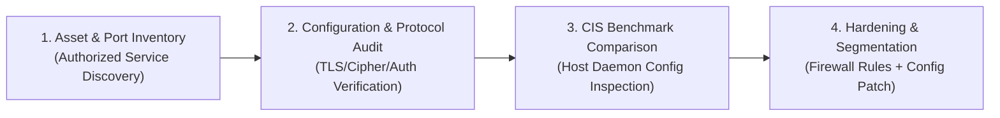
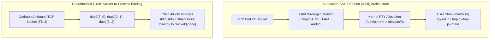
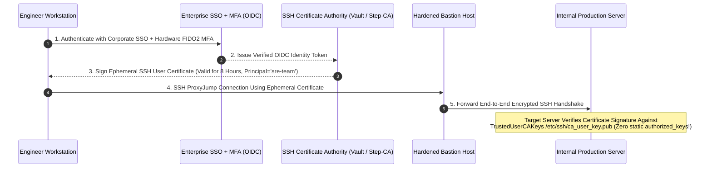
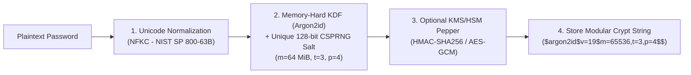
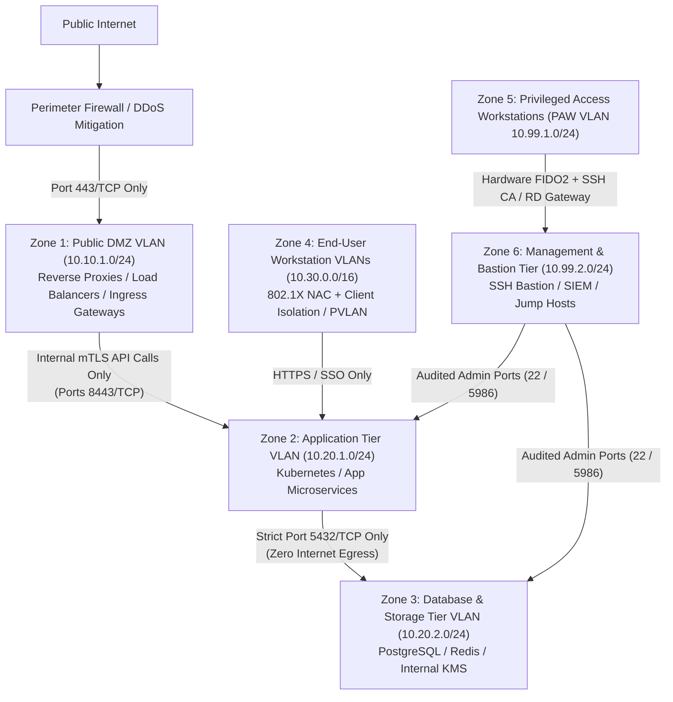
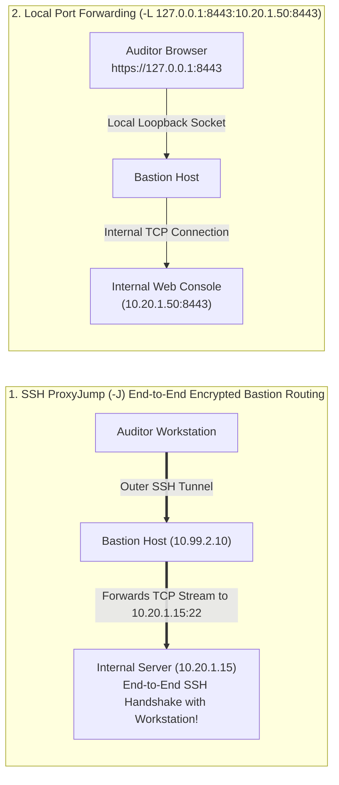

# PART VIII: ENTERPRISE INFRASTRUCTURE SECURITY AUDITING, CRYPTOGRAPHIC AUTHENTICATION & ZERO TRUST NETWORK ARCHITECTURE

---

## Chapter 36: Enterprise Infrastructure Security Auditing & Service Hardening Encyclopedia (CIS Benchmarks)

Enterprise networks rely on foundational application-layer and transport-layer protocols for file transfer, remote administration, electronic mail routing, directory services, and relational/in-memory databases. Many of these protocols were originally designed in the 1970s and 1980s for trusted academic networks without built-in encryption or strong mutual authentication.

This chapter provides a comprehensive, service-by-service architectural guide for **authorized enterprise security auditors and systems engineers**, detailing how each protocol operates, how to audit configurations using non-destructive inspection, common architectural misconfigurations, and industry-standard **Center for Internet Security (CIS) Benchmark** hardening configurations.

---

### 36.1 Methodology for Authorized Enterprise Infrastructure Auditing

An enterprise infrastructure security audit evaluates network services across four defense-in-depth dimensions:
1. **Network Exposure & Transport Encryption:** Is the service bound exclusively to required internal interfaces, and does it enforce TLS 1.2/1.3 or SSHv2 transport encryption?
2. **Authentication & Identity Binding:** Are anonymous/unauthenticated binds disabled, and is authentication integrated with centralized enterprise identity (Kerberos, mTLS, SSH Certificates, or OIDC)?
3. **Principle of Least Privilege (Execution Context & Access Control):** Does the daemon run under an unprivileged service account packaged inside a `systemd` sandbox or container, with strict read/write path restrictions?
4. **Protocol & Version Hygiene:** Are legacy protocol dialects (e.g., SMBv1, SNMPv1/v2c, SSHv1, TLS 1.0/1.1) disabled, and are vendor security patches applied?



---

### 36.2 File Transfer & Remote Administration Services (Ports 21 & 22)

#### 1. Port 21/TCP — File Transfer Protocol (FTP) vs. SFTP/FTPS
- **Protocol Architecture:** Standard FTP (RFC 959) uses a dual-channel TCP architecture: a **Control Channel** on Port 21/TCP for commands (`USER`, `PASS`, `LIST`, `RETR`, `STOR`, `PORT`, `PASV`) and a separate **Data Channel** (Port 20/TCP in Active Mode, or an ephemeral high port negotiated in Passive Mode).
- **Core Architectural Weaknesses of Legacy FTP:**
  1. **Cleartext Credentials & Data:** Standard FTP transmits `USER` and `PASS` commands and file contents in unencrypted ASCII/binary over the network, exposing credentials to passive packet capture on shared segments.
  2. **Anonymous Access Misconfigurations:** Leaving `anonymous_enable=YES` enabled on internal FTP servers often exposes configuration backups, source code archives, or writable directories (`anon_upload_enable=YES`).
  3. **FTP Bounce (`PORT` Command Forwarding):** The legacy `PORT` command allows a client to instruct the FTP server to establish its outbound data connection to a third-party IP address and port. If not restricted (`port_promiscuous`), the FTP server can be abused as an unintended TCP proxy into internal subnets.
- **CIS Benchmark Hardening & Modern Replacement:**
  - **Preferred Architecture:** Decommission legacy FTP (Port 21) entirely and migrate file transfers to **SFTP** (SSH File Transfer Protocol over Port 22) or HTTPS object storage APIs.
  - **If FTPS (FTP over Explicit TLS, RFC 4217) Must Be Maintained (`vsftpd.conf` Hardening):**
    ```ini
    # /etc/vsftpd.conf - CIS Hardened FTPS Configuration
    anonymous_enable=NO
    local_enable=YES
    write_enable=YES
    chroot_local_user=YES
    allow_writeable_chroot=NO

    # Enforce Explicit TLS for both Control and Data Channels
    ssl_enable=YES
    allow_anon_ssl=NO
    force_local_data_ssl=YES
    force_local_logins_ssl=YES
    ssl_tlsv1_2=YES
    ssl_sslv2=NO
    ssl_sslv3=NO
    require_ssl_reuse=YES
    ssl_ciphers=HIGH:!aNULL:!MD5:!3DES

    # Prevent FTP Bounce Attacks
    port_promiscuous=NO
    pasv_enable=YES
    pasv_min_port=50000
    pasv_max_port=50100
    ```

#### 2. Port 22/TCP — Secure Shell (SSHv2)
- **Protocol Architecture:** SSHv2 (RFC 4251–4254) provides an encrypted, integrity-protected transport layer (`SSH-TRANS`), an extensible authentication protocol (`SSH-USERAUTH` supporting public key, OpenSSH certificates, GSSAPI/Kerberos, FIDO2/U2F hardware keys, and keyboard-interactive MFA), and a multiplexed channel protocol (`SSH-CONN`).
- **Common Misconfigurations Identified in Audits:**
  1. **Permitting Root Login or Password Authentication on Internet-Facing Hosts:** Allowing `PermitRootLogin yes` and `PasswordAuthentication yes` exposes hosts to automated credential stuffing.
  2. **Legacy Cryptographic Algorithms:** Supporting SHA-1 key exchange (`diffie-hellman-group1-sha1`, `diffie-hellman-group14-sha1`), CBC-mode ciphers, or legacy `ssh-rsa` (SHA-1) signatures.
  3. **Unrestricted Agent Forwarding (`AllowAgentForwarding yes`) & TCP Forwarding:** If an administrator connects to a shared server with `ssh -A` (Agent Forwarding), any root user on that intermediate host can access the administrator's local SSH agent UNIX domain socket (`$SSH_AUTH_SOCK`) to sign authentication challenges during the active session.
- **CIS Benchmark Hardening (`/etc/ssh/sshd_config`):**
  ```ssh-config
  # /etc/ssh/sshd_config - CIS Level 2 Server Hardening Baseline
  Protocol 2
  Port 22

  # 1. Modern Cryptographic Primitives Only (Ed25519, ECDSA, AES-GCM, ChaCha20-Poly1305)
  HostKey /etc/ssh/ssh_host_ed25519_key
  HostKey /etc/ssh/ssh_host_rsa_key
  KexAlgorithms sntrup761x25519-sha512@openssh.com,curve25519-sha256,curve25519-sha256@libssh.org,diffie-hellman-group16-sha512,diffie-hellman-group18-sha512
  Ciphers chacha20-poly1305@openssh.com,aes256-gcm@openssh.com,aes128-gcm@openssh.com
  MACs hmac-sha2-512-etm@openssh.com,hmac-sha2-256-etm@openssh.com
  HostKeyAlgorithms ssh-ed25519,ssh-ed25519-cert-v01@openssh.com,rsa-sha2-512,rsa-sha2-256

  # 2. Authentication Controls
  PermitRootLogin no
  PubkeyAuthentication yes
  PasswordAuthentication no
  PermitEmptyPasswords no
  KbdInteractiveAuthentication no
  UsePAM yes
  AuthenticationMethods publickey

  # 3. Session, Forwarding & Surface Restrictions
  AllowAgentForwarding no
  AllowTcpForwarding no
  X11Forwarding no
  PermitTunnel no
  PermitUserEnvironment no
  MaxAuthTries 3
  MaxSessions 4
  LoginGraceTime 30
  ClientAliveInterval 300
  ClientAliveCountMax 2
  AllowGroups ssh-admins
  LogLevel VERBOSE
  ```

---

### 36.3 Mail Routing & Naming Services (Ports 25/465/587 & Port 53)

#### 1. Ports 25, 465, 587/TCP — Simple Mail Transfer Protocol (SMTP)
- **Protocol Architecture:** Port 25 is used for server-to-server Mail Transfer Agent (MTA) relay; Port 587 (STARTTLS) and Port 465 (Implicit TLS) are used for authenticated Mail Submission Agents (MSA).
- **Common Misconfigurations Identified in Audits:**
  1. **Open Mail Relay:** An MTA configured with overly broad `mynetworks` (in Postfix) accepts mail from arbitrary external IP addresses destined for external domains, allowing third parties to send spoofed messages through the organization's IP reputation.
  2. **User Enumeration via `VRFY` and `EXPN`:** Legacy SMTP verbs `VRFY` (verify mailbox existence) and `EXPN` (expand mailing list) reveal valid internal usernames prior to authentication.
  3. **Missing Domain Email Authentication (`SPF`, `DKIM`, `DMARC`) and MTA-STS:** Without strict SPF (`-all`), cryptographic DKIM signatures, and a DMARC enforcement policy (`p=reject`), external parties can spoof the organization's `From:` header domain.
- **Postfix CIS Hardening (`/etc/postfix/main.cf`):**
  ```ini
  # Disable VRFY command and hide internal banner details
  disable_vrfy_command = yes
  smtpd_banner = $myhostname ESMTP

  # Prevent Open Relay: Only relay for localhost and SASL-authenticated clients
  mynetworks_style = host
  smtpd_relay_restrictions = permit_mynetworks, permit_sasl_authenticated, reject_unauth_destination

  # Enforce Opportunistic/Mandatory TLS 1.2+
  smtpd_tls_security_level = may
  smtpd_tls_mandatory_protocols = !SSLv2, !SSLv3, !TLSv1, !TLSv1.1
  smtpd_tls_protocols = !SSLv2, !SSLv3, !TLSv1, !TLSv1.1
  smtpd_tls_auth_only = yes
  ```

#### 2. Port 53/UDP & 53/TCP — Domain Name System (DNS)
- **Protocol Architecture:** DNS uses Port 53/UDP for standard queries and Port 53/TCP for responses exceeding 512 bytes (or EDNS0 buffers) and **Zone Transfers (`AXFR` / `IXFR`)**.
- **Common Misconfigurations Identified in Audits:**
  1. **Unrestricted Zone Transfers (`AXFR`):** Zone transfers replicate an entire DNS zone file between primary and secondary nameservers. If `allow-transfer` is left open to `any`, anyone can query Port 53/TCP and retrieve the complete internal and external host inventory in a single request.
  2. **Open Recursive Resolver:** An authoritative DNS server that also allows arbitrary internet clients to make recursive queries (`allow-recursion { any; };`) is vulnerable to DNS cache poisoning and can be abused for DNS amplification reflection DDoS attacks.
  3. **Unauthenticated Dynamic DNS Updates (`nsupdate`):** Allowing dynamic zone updates based purely on IP subnet rather than cryptographic **TSIG** (Transaction Signature) or **GSS-TSIG** keys.
- **BIND9 CIS Hardening (`/etc/bind/named.conf.options` & Zone Config):**
  ```nginx
  options {
      directory "/var/cache/bind";
      version "not disclosed";

      // 1. Disable recursion on authoritative public nameservers
      recursion no;
      allow-recursion { none; };

      // 2. Deny zone transfers globally by default
      allow-transfer { none; };

      // 3. Enable DNSSEC validation
      dnssec-validation auto;
  };

  key "ns1-ns2-transfer-key" {
      algorithm hmac-sha256;
      secret "c3VwZXJzZWNyZXR0c2lna2V5Zm9yem9uZXRyYW5zZmVy==";
  };

  zone "enterprise.lk" {
      type master;
      file "/etc/bind/zones/db.enterprise.lk";
      // Require cryptographic TSIG key AND secondary nameserver IP for zone transfer
      allow-transfer { key "ns1-ns2-transfer-key"; };
      allow-update { none; };
  };
  ```

---

### 36.4 Network File System & Windows File Sharing (Ports 111/2049 & 135/139/445)

#### 1. Ports 111 & 2049/TCP/UDP — RPCbind & Network File System (NFS)
- **Protocol Architecture:** NFSv3 relies on `rpcbind` (Port 111) and `mountd` to map RPC program numbers to ports, while NFSv4 consolidates operations over Port 2049/TCP with optional Kerberos (`sec=krb5p`) authentication and encryption.
- **Critical Misconfigurations in `/etc/exports`:**
  1. **Wildcard Export Hosts (`*`):** Exporting shares to `*` instead of specific IP addresses allows any host on the network to mount the filesystem.
  2. **Disabling Root Squash (`no_root_squash`):** By default, NFS enforces `root_squash`, which maps UID `0` (`root`) requests coming from an NFS client down to the unprivileged `nobody` (`65534`) account on the NFS server. If an administrator configures `no_root_squash`, any client user who has local `root` on their workstation can mount the share and create `root`-owned SUID binaries (`chmod u+s`) or modify root-owned files on the server.
  3. **Using `sec=sys` (AUTH_SYS):** Legacy NFSv3 `sec=sys` trusts whatever numeric `UID` and `GID` integers the client machine sends in the RPC header without cryptographic proof of identity.
- **Hardened NFSv4 Configuration (`/etc/exports`):**
  ```ini
  # Export using NFSv4 with Kerberos cryptographic authentication + privacy (sec=krb5p),
  # enforcing root_squash (default) and nosuid/nodev on clients.
  /srv/nfs/shared 10.20.10.0/24(rw,sync,root_squash,no_subtree_check,sec=krb5p)
  ```

#### 2. Ports 135, 139 & 445/TCP — MSRPC, NetBIOS & Server Message Block (SMB)
- **Protocol Architecture:** SMB provides file sharing, printer sharing, and named pipe inter-process communication (`IPC$`) across Windows and Samba environments.
- **Critical Misconfigurations & Legacy Vulnerabilities:**
  1. **Legacy SMBv1 Enabled:** SMBv1 lacks modern message integrity and was the vector for critical remote code execution flaws such as MS17-010. SMBv1 must be completely removed across all Windows and Samba hosts.
  2. **Missing SMB Signing & SMB v3.1.1 Encryption:** If `RequireSecuritySignature` (SMB Signing) is not enforced, SMB connections on a local broadcast segment are vulnerable to **NTLM Relay** (where an intermediate host relays an incoming NTLMv2 authentication handshake to another server that does not require SMB signing).
  3. **Null Sessions & Anonymous Share Access:** Permitting unauthenticated (`AnonymousLogon`) enumeration of SAM accounts and shares over `IPC$`.
- **PowerShell & Group Policy Hardening for Windows SMB Servers:**
  ```powershell
  # 1. Completely disable and remove SMBv1 protocol support
  Disable-WindowsOptionalFeature -Online -FeatureName SMB1Protocol -NoRestart
  Set-SmbServerConfiguration -EnableSMB1Protocol $false -Force

  # 2. Enforce Mandatory SMB Packet Signing (Blocks NTLM Relay to SMB) and Encryption (SMBv3)
  Set-SmbServerConfiguration -RequireSecuritySignature $true -EnableSecuritySignature $true -Force
  Set-SmbServerConfiguration -EncryptData $true -RejectUnencryptedAccess $true -Force
  Set-SmbClientConfiguration -RequireSecuritySignature $true -EnableSecuritySignature $true -Force

  # 3. Disable Anonymous SAM and Share Enumeration (Registry Hardening)
  Set-ItemProperty -Path "HKLM:\SYSTEM\CurrentControlSet\Control\Lsa" -Name "RestrictAnonymous" -Value 1
  Set-ItemProperty -Path "HKLM:\SYSTEM\CurrentControlSet\Control\Lsa" -Name "RestrictAnonymousSAM" -Value 1
  ```

---

### 36.5 Network Monitoring & Directory Services (Port 161/UDP & Ports 389/636/3268)

#### 1. Port 161/UDP — Simple Network Management Protocol (SNMP)
- **Protocol Architecture:** SNMP allows network monitoring systems to query and modify Management Information Base (MIB) Object Identifiers (OIDs) on routers, switches, firewalls, and Linux/Windows servers.
- **Architectural Risks of SNMPv1 and SNMPv2c:**
  - SNMPv1 and SNMPv2c rely solely on a plaintext **Community String** (often left at factory defaults `public` for read-only and `private` for read-write) transmitted in cleartext over UDP.
  - Querying the Host Resources MIB (`1.3.6.1.2.1.25.4.2.1.2` / `hrSWRunName` and `hrSWRunParameters`) on a server with a readable community string exposes the full command-line arguments of every running process on the system, alongside network routing tables and interface configurations.
- **Hardened SNMPv3 Configuration (`/etc/snmp/snmpd.conf`):**
  - Disable SNMPv1 and SNMPv2c completely; enforce **SNMPv3** in `authPriv` mode (requiring `SHA-256`/`SHA-512` authentication and `AES-128`/`AES-256` payload encryption) bound to specific management station IP addresses.

#### 2. Ports 389, 636, 3268 & 3269/TCP — Lightweight Directory Access Protocol (LDAP / LDAPS)
- **Protocol Architecture:** Port 389 is standard LDAP (supporting cleartext simple binds or SASL/STARTTLS); Port 636 is LDAPS (LDAP over TLS); Ports 3268 and 3269 are Active Directory Global Catalog ports.
- **Common Misconfigurations Identified in Audits:**
  1. **Unauthenticated / Anonymous LDAP Binds:** Allowing anonymous LDAP queries (`ldapsearch -x`) permits unauthenticated callers to dump the entire organizational user list, group memberships, email addresses, and custom description attributes.
  2. **Cleartext Simple Binds (`LDAP` without TLS):** Applications authenticating users via LDAP Simple Bind over Port 389 without `STARTTLS` transmit Active Directory passwords in plaintext over the internal network.
  3. **Missing LDAP Signing and LDAP Channel Binding (Active Directory):** Without **LDAP Server Signing** (`LDAPServerIntegrity = 2`) and **LDAP Channel Binding** (`LdapEnforceChannelBinding = 2` — which cryptographically binds the outer TLS certificate channel to the inner SASL/Kerberos/NTLMv2 authentication token), Domain Controllers are vulnerable to NTLM-to-LDAP/LDAPS relay attacks.

---

### 36.6 Relational & In-Memory Database Services (Ports 1433, 3306, 5432, 6379, 27017)

Database engines must never be exposed directly to the public internet or general user workstations; they must reside in an isolated **Database Tier VLAN** reachable only by authorized application tier hosts.

| Database Service | Default Port | High-Risk Configuration Features to Audit | CIS Benchmark Hardening Controls |
| :--- | :--- | :--- | :--- |
| **Microsoft SQL Server (MSSQL)** | `1433/TCP` | 1. `xp_cmdshell` extended stored procedure enabled.<br/>2. `sa` account enabled with weak password (`Mixed Mode` auth).<br/>3. Excessive `IMPERSONATE` permissions or over-privileged Linked Servers.<br/>4. Unconstrained `xp_dirtree` / `xp_fileexist` UNC path outbound SMB calls. | 1. Disable `xp_cmdshell` (`sp_configure 'xp_cmdshell', 0`).<br/>2. Use Windows Authentication mode (`Integrated Security`); disable or rename `sa`.<br/>3. Run SQL Server service under a minimal virtual service account (`NT SERVICE\MSSQLSERVER`) and block outbound SMB (Port 445) at the host firewall. |
| **MySQL / MariaDB** | `3306/TCP` | 1. `local_infile = ON` (allowing clients to read arbitrary files).<br/>2. `secure_file_priv` set to `""` (empty string), allowing `SELECT ... INTO OUTFILE` to write files to arbitrary filesystem paths (such as web roots or plugin directories for UDF loading).<br/>3. `root@'%'` remote superuser logins permitted. | 1. Set `bind-address = 10.20.2.10` (internal DB VLAN only) and `require_secure_transport = ON`.<br/>2. Set `local_infile = OFF`.<br/>3. Set `secure_file_priv = /var/lib/mysql-files` (or `NULL` to disable import/export entirely).<br/>4. Restrict `root` strictly to `localhost` via UNIX socket authentication (`auth_socket`). |
| **PostgreSQL** | `5432/TCP` | 1. Permissive `pg_hba.conf` rules (`host all all 0.0.0.0/0 trust` or `md5`).<br/>2. Application database account granted `SUPERUSER` or `pg_read_server_files` / `pg_execute_server_program` roles (`COPY ... FROM PROGRAM`). | 1. Enforce `hostssl` with `scram-sha-256` or `cert` (mTLS) in `pg_hba.conf`.<br/>2. Never grant `SUPERUSER` or `pg_execute_server_program` to web application database roles; scope role permissions to specific schemas (`GRANT SELECT, INSERT, UPDATE ON ...`). |
| **Redis** | `6379/TCP` | 1. Bound to `0.0.0.0` without authentication (`protected-mode no`).<br/>2. Running `redis-server` as the `root` OS user (Historically allowed unauthenticated callers to use `CONFIG SET dir /root/.ssh` or `/var/spool/cron` and `BGSAVE` to write arbitrary files to disk). | 1. Bind strictly to `127.0.0.1` or internal VPC interface (`bind 127.0.0.1`).<br/>2. Use **Redis ACLs** (Redis 6+) to create least-privilege user accounts and disable dangerous administrative commands (`ACL SETUSER appuser on >StrongPass ~app:* +@read +@write -@admin -CONFIG -FLUSHALL -SAVE -BGSAVE -DEBUG -MODULE`).<br/>3. Run under dedicated unprivileged `redis` user with `ReadOnlyPaths=/` in `systemd`. |
| **MongoDB** | `27017/TCP` | 1. `security.authorization: disabled` (default when binding solely to localhost, dangerous if `net.bindIp: 0.0.0.0` is changed without enabling RBAC).<br/>2. Server-side JavaScript evaluation (`$where`) enabled when not needed. | 1. Enforce `security.authorization: enabled` with `SCRAM-SHA-256` or X.509 mTLS.<br/>2. Set `security.javascriptEnabled: false` in `/etc/mongod.conf` to disable server-side JavaScript execution.<br/>3. Bind only to internal private interfaces and enforce `net.tls.mode: requireTLS`. |

---

### 36.7 Windows Remote Management Services (Ports 3389 & 5985/5986)

#### 1. Port 3389/TCP & UDP — Remote Desktop Protocol (RDP)
- **Architectural Risks:** Exposing Port 3389 directly to the internet or flat internal workstation networks invites credential brute-forcing and session hijacking. On the other hand, when an administrator connects via standard RDP *to* a potentially untrusted workstation, standard RDP transmits the administrator's plaintext credentials into the remote host's LSASS memory unless **Restricted Admin Mode** or **Remote Credential Guard** is used.
- **Enterprise RDP Hardening Checklist:**
  1. **Never Expose Port 3389 to the Internet:** Require administrators to authenticate through a multi-factor **Remote Desktop Gateway (RD Gateway)** or Zero Trust bastion VPN.
  2. **Enforce Network Level Authentication (NLA):** Requires the client to complete CredSSP authentication *before* allocating a full graphical Windows session (`UserAuthentication = 1`).
  3. **Use Windows Defender Remote Credential Guard:** Keeps Kerberos tickets and credentials on the administrator's client machine rather than delegating them to the target server (`mstsc.exe /remoteGuard`).
  4. **Restrict Lateral Movement via `RestrictedAdmin` Policy:** Only allow designated Jump Hosts to initiate RDP connections to Tier-0/Tier-1 servers using Windows Firewall with Advanced Security (IPsec connection security rules).

#### 2. Ports 5985 (HTTP) & 5986 (HTTPS) — Windows Remote Management (WinRM / PowerShell Remoting)
- **Protocol Architecture:** WinRM implements WS-Management over HTTP/HTTPS for PowerShell Remoting (`Enter-PSSession`, `Invoke-Command`). Note that even over Port 5985 (HTTP), Kerberos and NTLMv2 encrypt the SOAP message payload (`AllowUnencrypted = false` by default), though HTTPS (Port 5986) provides full transport-layer TLS protection.
- **Enterprise WinRM Hardening Controls:**
  1. Disable basic authentication (`winrm set winrm/config/service/auth @{Basic="false"}`) and enforce Kerberosauthentication or HTTPS (Port 5986) with TLS certificate validation.
  2. Deploy **Just Enough Administration (JEA)** role capability files (`.psrc`) and session configurations (`.pssc`) so administrators connecting via WinRM execute inside a constrained, language-restricted (`NoLanguage` mode) virtual account (`WinRM Virtual Users`) capable of running only pre-approved cmdlets rather than full `LocalSystem` shells.

---

## Chapter 37: Remote Administration Protocols, Bastion Hosts & Secure Shell Management

Understanding how operating systems allocate interactive sessions, bind network sockets, manage pseudo-terminals (`PTY`), and mediate remote administration is essential for both **Blue Team Detection Engineers** (identifying unauthorized remote command channels on production servers) and **Infrastructure Architects** (designing zero-standing-privilege bastion hosts).

---

### 37.1 Operating System Socket & File Descriptor Mechanics

In POSIX operating systems (Linux, BSD, macOS), every network connection and open file is represented per-process by an integer **File Descriptor (FD)**:
- `FD 0`: Standard Input (`stdin`)
- `FD 1`: Standard Output (`stdout`)
- `FD 2`: Standard Error (`stderr`)

#### 1. Legitimate Daemons vs. Unauthorized Socket Redirection
When a legitimate remote administration daemon like `sshd` accepts an authenticated connection on Port 22:
1. The privileged monitor process verifies cryptographic authentication (`publickey` / SSH certificate).
2. It forks an unprivileged child process under the authenticated user's UID/GID (`setresgid()`, `setresuid()`).
3. It requests a **Pseudo-Terminal (`PTY`)** pair from the kernel (`/dev/ptmx` master and `/dev/pts/N` slave), records the login session in `/var/run/utmp` and `/var/log/wtmp` (visible via `w` and `last`), initializes PAM (`pam_systemd`, `pam_limits`, `pam_audit`), and attaches the user's shell (`/bin/bash`) to the PTY slave device.

By contrast, an **unauthorized direct socket-to-shell binding** (often created by misconfigured debug scripts or unauthorized remote processes) bypasses PAM, `/dev/ptmx`, and `utmp` logging by invoking the `dup2(socket_fd, 0/1/2)` system call directly before `execve("/bin/sh")`, wiring the raw TCP socket file descriptor directly to `stdin`, `stdout`, and `stderr` of a non-interactive shell process.



---

### 37.2 Auditing & Detecting Unauthorized Listeners and Socket-Bound Processes

Because POSIX operating systems expose every process's open file descriptors in the `/proc/<pid>/fd/` virtual filesystem, security auditors and Host Intrusion Detection Systems (HIDS) can deterministically identify any shell process whose standard input or output is wired directly to a network socket rather than a legitimate `/dev/pts/N` terminal.

#### 1. Inspecting `/proc/<pid>/fd/` and Socket Inodes
On a normal interactive SSH session, inspecting the shell's file descriptors (`ls -l /proc/<shell_pid>/fd`) shows links to a pseudo-terminal slave:
```text
lrwx------ 1 admin admin 64 Nov  2 10:00 0 -> /dev/pts/0
lrwx------ 1 admin admin 64 Nov  2 10:00 1 -> /dev/pts/0
lrwx------ 1 admin admin 64 Nov  2 10:00 2 -> /dev/pts/0
```
If a shell process instead has its `stdin` (`0`) or `stdout` (`1`) redirected directly to a TCP/UDP network socket (`dup2` redirection or `/dev/tcp`), `/proc/<pid>/fd` reveals a `socket:[inode]` symlink:
```text
lrwx------ 1 www-data www-data 64 Nov  2 10:05 0 -> socket:[482910]
lrwx------ 1 www-data www-data 64 Nov  2 10:05 1 -> socket:[482910]
lrwx------ 1 www-data www-data 64 Nov  2 10:05 2 -> socket:[482910]
```

#### 2. Defensive Audit Script: Detecting Socket-Bound Shells & Unauthorized Listeners (Python)
Below is a defensive Linux host auditing utility that scans `/proc` to identify any shell interpreter (`sh`, `bash`, `dash`, `zsh`, `ash`, `ksh`, `pwsh`) whose `FD 0`, `FD 1`, or `FD 2` is bound directly to a network socket, cross-referencing `/proc/net/tcp` and `/proc/net/tcp6` to report the exact local and remote IP:Port endpoints:

```python
#!/usr/bin/env python3
"""
Enterprise Linux Host Security Auditor:
Detects shell interpreters with stdin/stdout/stderr wired directly to network sockets
and enumerates all listening TCP sockets with their owning process lineages.
"""

import os
import pwd
import socket
import struct
from pathlib import Path

SHELL_BINARIES = {"sh", "bash", "dash", "zsh", "ksh", "csh", "tcsh", "fish", "pwsh"}


def parse_proc_net_tcp(proc_net_path: str = "/proc/net/tcp") -> dict[str, dict]:
    """Maps socket inode strings to local/remote IPv4 addresses and TCP states."""
    inode_map: dict[str, dict] = {}
    if not os.path.exists(proc_net_path):
        return inode_map

    with open(proc_net_path, "r", encoding="utf-8") as f:
        lines = f.readlines()[1:]  # Skip header

    for line in lines:
        parts = line.split()
        if len(parts) < 10:
            continue
        local_hex, remote_hex, state_hex, inode = parts[1], parts[2], parts[3], parts[9]

        def decode_addr(hex_str: str) -> str:
            ip_hex, port_hex = hex_str.split(":")
            ip_int = int(ip_hex, 16)
            ip_str = socket.inet_ntoa(struct.pack("<L", ip_int))
            port = int(port_hex, 16)
            return f"{ip_str}:{port}"

        inode_map[inode] = {
            "local_address": decode_addr(local_hex),
            "remote_address": decode_addr(remote_hex),
            "state_hex": state_hex,
        }
    return inode_map


def audit_socket_bound_shells() -> list[dict]:
    """Scans /proc/[pid]/fd/[0,1,2] for shell processes directly attached to network sockets."""
    socket_inodes = parse_proc_net_tcp("/proc/net/tcp")
    findings: list[dict] = []

    for entry in Path("/proc").iterdir():
        if not entry.name.isdigit():
            continue
        pid = entry.name
        try:
            comm = (entry / "comm").read_text(encoding="utf-8").strip()
            if comm not in SHELL_BINARIES:
                continue

            stat_info = entry.stat()
            username = pwd.getpwuid(stat_info.st_uid).pw_name
            cmdline = (entry / "cmdline").read_bytes().replace(b"\x00", b" ").decode("utf-8", errors="replace").strip()

            for fd_num in ("0", "1", "2"):
                fd_path = entry / "fd" / fd_num
                target = os.readlink(fd_path)
                if target.startswith("socket:[") and target.endswith("]"):
                    inode = target[8:-1]
                    net_info = socket_inodes.get(inode, {})
                    findings.append({
                        "pid": int(pid),
                        "user": username,
                        "process": comm,
                        "cmdline": cmdline,
                        "fd": fd_num,
                        "socket_inode": inode,
                        "local_endpoint": net_info.get("local_address", "unknown"),
                        "remote_endpoint": net_info.get("remote_address", "unknown"),
                    })
        except (PermissionError, FileNotFoundError, ProcessLookupError, KeyError):
            continue

    return findings


if __name__ == "__main__":
    alerts = audit_socket_bound_shells()
    if not alerts:
        print("[OK] No shell processes detected with direct network socket file descriptors.")
    else:
        print(f"[ALERT] Detected {len(alerts)} anomalous socket-bound shell descriptor(s):")
        for item in alerts:
            print(
                f"  PID={item['pid']} User={item['user']} Cmd='{item['cmdline']}' "
                f"FD={item['fd']} -> Inode={item['socket_inode']} "
                f"({item['local_endpoint']} <-> {item['remote_endpoint']})"
            )
```

---

### 37.3 Web Server Integrity & Runtime Sandboxing (Preventing Unauthorized Web Execution)

A primary objective of application server hardening is ensuring that even if a web application contains a file upload flaw, the web server process (`nginx`, `apache2`, `php-fpm`, `tomcat`, `node`) **cannot** write executable scripts to the document root or spawn child operating system shells (`/bin/sh`, `cmd.exe`, `powershell.exe`).

#### 1. Four-Pillar Defense Against Unauthorized Web Execution
1. **Immutable / Read-Only Web Roots (`ReadOnlyPaths`):**
   - In production deployments, application code directories (`/var/www/app`) must be owned by `root:root` with `0755` (directories) and `0644` (files) permissions, never writable by the `www-data` or `node` runtime user.
2. **Externalized Object Storage for User Uploads:**
   - Never store user-uploaded files inside the web server's local filesystem tree. Stream uploads directly to an isolated object storage bucket (e.g., Amazon S3, MinIO, Google Cloud Storage) served from a separate, sandboxed static domain (`https://usercontent-cdn.example.com`) with `Content-Disposition: attachment` and `X-Content-Type-Options: nosniff`.
3. **Disabling Dangerous Language Execution Functions (`php.ini` / JVM / Node.js):**
   - In PHP-FPM environments, explicitly disable OS process execution functions at the engine level in `php.ini`:
     ```ini
     disable_functions = exec,passthru,shell_exec,system,proc_open,popen,pcntl_exec,dl,show_source
     open_basedir = /var/www/app:/tmp
     allow_url_fopen = Off
     allow_url_include = Off
     ```
4. **Linux `systemd` Service Sandboxing & Seccomp System Call Filtering:**
   - Configure the web application service unit (`/etc/systemd/system/webapp.service`) so the kernel blocks child privilege escalation, makes the filesystem read-only, and restricts system calls:
     ```ini
     [Service]
     User=webapp
     Group=webapp
     NoNewPrivileges=true
     ProtectSystem=strict
     ProtectHome=true
     PrivateTmp=true
     PrivateDevices=true
     ProtectKernelTunables=true
     ProtectKernelModules=true
     ProtectControlGroups=true
     RestrictAddressFamilies=AF_INET AF_INET6 AF_UNIX
     RestrictNamespaces=true
     LockPersonality=true
     MemoryDenyWriteExecute=true
     ```

---

### 37.4 Modern Bastion Host & OpenSSH Certificate Authority Architecture

Managing static `~/.ssh/authorized_keys` files across hundreds of servers creates severe operational risks: SSH keys are rarely rotated, former employees' public keys remain on servers, and users copy private keys across machines.

The modern enterprise standard replaces static public keys with an **OpenSSH Certificate Authority (SSH CA)** (or identity-aware proxies like Teleport / HashiCorp Boundary):



#### Configuring OpenSSH Trusted User Certificates on Production Servers
1. **Generate the Offline User CA Key Pair (on an HSM or HashiCorp Vault):**
   ```bash
   ssh-keygen -t ed25519 -f ssh_user_ca -C "Enterprise-SSH-User-CA"
   ```
2. **Configure Production Servers (`/etc/ssh/sshd_config`) to Trust the User CA:**
   ```ssh-config
   # Trust certificates signed by the Enterprise User CA
   TrustedUserCAKeys /etc/ssh/ssh_user_ca.pub
   AuthorizedPrincipalsFile /etc/ssh/auth_principals/%u
   RevokedKeys /etc/ssh/revoked_keys
   ```
3. **Issue Short-Lived (8-Hour) Certificates Upon SSO Login:**
   ```bash
   # Sign engineer's public key valid only for 8 hours (-V +8h) and principal 'sre-admin'
   ssh-keygen -s ssh_user_ca \
     -I "alice@enterprise.lk-2026-11-02" \
     -n sre-admin \
     -V +8h \
     -O no-agent-forwarding \
     -O no-port-forwarding \
     -O no-x11-forwarding \
     alice_ed25519.pub
   ```
   - Notice the embedded certificate extensions (`-O no-agent-forwarding -O no-port-forwarding`): even if the target server's `sshd_config` permits forwarding, the cryptographic certificate itself restricts what capabilities that specific session may exercise, and the certificate automatically expires after 8 hours without touching the target server.

---

## Chapter 38: Cryptographic Password Storage, Hash Algorithms & Authentication Auditing

Even in organizations deploying Single Sign-On (SSO) and passkeys, password-based authentication remains a critical component of directory services, customer-facing web portals, database accounts, and administrative recovery consoles. If a database backup or directory snapshot is exposed, the security of every stored credential depends entirely on the **cryptographic key derivation function (KDF)** used to hash those passwords.

---

### 38.1 The Evolution of Password Hashing Algorithms

#### 1. Why Fast Cryptographic Hash Functions (`MD5`, `SHA-1`, `SHA-256`) Are Insecure for Passwords
General-purpose cryptographic hash functions such as `SHA-256` and `SHA-512` were designed to compute digests of large files and network packets as rapidly as possible using bitwise boolean operations (`XOR`, `AND`, bit rotations) that map directly onto GPU shader cores and ASIC hardware:
- A single modern consumer GPU (e.g., NVIDIA RTX 4090) can evaluate over **20 billion ($2 \times 10^{10}$) raw `SHA-256` hashes per second** and over **160 billion raw `MD5` or `NTLM` hashes per second**.
- Furthermore, **unsalted hashes** (`MD5(password)` or Windows `NTLM = MD4(UTF-16LE(password))`) are deterministic across all users: if two users choose the same password, their hash strings are identical, and precomputed time-memory trade-off tables (**Rainbow Tables**) can invert unsalted hashes in milliseconds.

#### 2. Salting vs. Peppering vs. Work-Factor Key Derivation
To defend against offline GPU/ASIC brute-force attacks, modern password storage combines three mechanisms:
1. **Unique Cryptographic Salt ($S$):** A 128-bit (16-byte) random value generated by a CSPRNG uniquely for *every single password* and stored alongside the hash in the database. Salting ensures that identical passwords produce completely different hashes and renders precomputed Rainbow Tables useless.
2. **Adjustable Computational & Memory Work Factors:** Instead of a single fast pass, Password-Based Key Derivation Functions (PBKDFs) intentionally slow down computation via tunable **CPU iteration counts** and **RAM memory hardness** (forcing the evaluator to allocate megabytes of fast RAM per hash attempt, starving massively parallel GPU cores of memory bandwidth).
3. **Cryptographic Pepper ($K$):** An optional 256-bit secret key stored *outside* the database (in an HSM, AWS KMS, or HashiCorp Vault) combined via `HMAC-SHA256(key=Pepper, msg=password)` prior to or after the memory-hard KDF. Even if an SQL injection or backup leak exposes the entire `users` table, the hashes cannot be tested offline without also compromising the KMS/HSM holding the Pepper.



---

### 38.2 Deep Comparison of Modern Password Hashing KDFs

| Algorithm | Cryptographic Primitive | CPU Tunable? | Memory-Hard (GPU/ASIC Resistant)? | Cache-Timing Side-Channel Resistant? | Current OWASP / NIST Recommendation |
| :--- | :--- | :--- | :--- | :--- | :--- |
| **MD5 / SHA-1 / SHA-256** | Merkle–Damgård fast hash | No | **No** ($< 1\text{ KB}$ registers) | Yes | **Strictly Prohibited** for passwords. |
| **NTLM** | Unsalted `MD4(UTF-16LE(password))` | No | **No** | Yes | Legacy Windows AD protocol; disable NTLMv1/NTLM where possible in favor of Kerberos. |
| **PBKDF2-HMAC-SHA256 / SHA512** | Iterative `HMAC-SHA2` (RFC 8018) | **Yes** (`iterations`) | **No** (Fits in GPU registers; vulnerable to GPU parallelization) | Yes | Acceptable only when **FIPS 140-3** compliance mandates NIST SP 800-132 (`iterations >= 600,000` for SHA-256). |
| **bcrypt** | Blowfish cipher key schedule (`Eksblowfish`) | **Yes** ($2^{\text{cost}}$ rounds) | **Minimal** (Uses $4\text{ KB}$ state; resists standard GPUs better than PBKDF2, but vulnerable to FPGAs) | No | Legacy safe fallback (`cost >= 12`). **Caveat:** Silently truncates passwords at **72 bytes**! |
| **scrypt** | `PBKDF2-HMAC-SHA256` + `ROMix` (`Salsa20/8`) (RFC 7914) | **Yes** ($N, r, p$) | **Yes** (Configurable megabytes of RAM) | No (Data-dependent memory indexing) | Strong memory-hard alternative (`N=2^17, r=8, p=1`). |
| **Argon2id** (RFC 9106) | Blake2b + Argon2 compression (`Argon2i` + `Argon2d` hybrid) | **Yes** (Time cost $t$, Parallelism $p$) | **Yes** (Memory cost $m$ in KiB) | **Yes** (First pass uses data-independent addressing `Argon2i`; subsequent passes use `Argon2d`) | **Primary Gold Standard (Winner of PHC / RFC 9106)**: Minimum `m = 19 MiB` (`19456 KiB`), `t = 2`, `p = 1` (or `m = 64 MiB, t = 3, p = 4`). |

---

### 38.3 Cryptographic Hash Format & Prefix Reference Encyclopedia

During authorized security audits, incident response investigations, and configuration reviews, engineers frequently inspect Modular Crypt Format (MCF) strings in `/etc/shadow`, database tables, or configuration files to determine whether weak algorithms are in use.

| Algorithm / Hash Type | Bit Length (Hex Chars) | Modular Crypt Prefix / Structural Signature | Architectural Context & Audit Notes |
| :--- | :--- | :--- | :--- |
| **MD5 (Raw)** | 128 bits (32 hex) | `^[a-f0-9]{32}$` | Unsalted legacy hash. Indistinguishable in length from raw NTLM/MD4 by regex alone; verify via schema context. |
| **NTLM (Windows SAM / NTDS.dit)** | 128 bits (32 hex) | `^[a-f0-9]{32}$` (often `aad3b435b51404eeaad3b435b51404ee:<ntlm>` when paired with empty LM hash) | Used in Windows SAM and Active Directory `unicodePwd`. Completely unsalted `MD4(UTF-16LE(pwd))`. |
| **NetNTLMv2 (NTLMv2 Challenge-Response)** | Variable | `username::DOMAIN:ServerChallenge:NTProofStr:Blob` | Network authentication challenge-response protocol (not stored in AD). Uses `HMAC-MD5` over server/client challenges, preventing precomputation. |
| **SHA-1 (Raw)** | 160 bits (40 hex) | `^[a-f0-9]{40}$` | Broken for collision resistance and far too fast for password storage. |
| **MySQL `caching_sha2_password`** | 256 bits | `$A$005$<20-byte-salt><sha256-digest>` | Modern MySQL 8.0+ default authentication plugin (5,000 SHA-256 iterations by default). |
| **PostgreSQL `SCRAM-SHA-256`** | 256 bits | `SCRAM-SHA-256$<iterations>:<base64-salt>$<StoredKey>:<ServerKey>` | Modern PostgreSQL 10+ challenge-response and storage format (RFC 7677). |
| **md5crypt (Legacy Linux)** | 128 bits | `$1$<salt>$<hash>` | Legacy `/etc/shadow` format (1,000 iterations). Obsolete; migrate to `yescrypt` or `sha512crypt`. |
| **sha256crypt / sha512crypt** | 256 / 512 bits | `$5$[rounds=N$]<salt>$<hash>` (SHA-256)<br/>`$6$[rounds=N$]<salt>$<hash>` (SHA-512) | Traditional Linux `/etc/shadow` format (default 5,000 rounds; increase `SHA_CRYPT_MIN_ROUNDS` to $\ge 100,000$ if used). |
| **bcrypt** | 184 bits (60 ASCII chars) | `$2a$<cost>$<22-char-salt><31-char-hash>` (also `$2b$`, `$2y$`) | Total string length is always 60 characters. Verify that `<cost>` is $\ge 12$. |
| **yescrypt (Modern Linux PAM)** | 256 bits | `$y$<params>$<salt>$<hash>` | Default in Debian 11+, Ubuntu 22.04+, Fedora, and RHEL 9+ `/etc/shadow`. Memory-hard upgrade over `sha512crypt`. |
| **Argon2id (RFC 9106)** | Configurable (typically 256 bits) | `$argon2id$v=19$m=65536,t=3,p=4$<b64-salt>$<b64-hash>` | Self-describing PHC string format encoding version (`v=19`), memory in KiB (`m`), iterations (`t`), parallelism (`p`), salt, and tag. |
| **Kerberos 5 AS-REP / TGS-REP** | Variable | `$krb5asrep$23$...` (RC4-HMAC etype 23)<br/>`$krb5tgs$18$...` (AES256-CTS-HMAC-SHA1-96 etype 18) | Etype `23` (`RC4-HMAC`) uses the raw NTLM hash as the key without salting; Etype `18` (`AES-256`) uses salted `PBKDF2-HMAC-SHA1` (4,096 rounds). Always disable RC4 (`etype 23`) in Active Directory! |

---

### 38.4 NIST SP 800-63B Digital Identity Guidelines & Modern Password Engineering

For decades, enterprise password policies forced users to include arbitrary character-class mixtures ("at least 1 uppercase, 1 symbol, 1 digit") and forced mandatory password resets every 60 to 90 days. Empirical research by NIST and academic institutions proved that those legacy rules **reduced** security by driving users to predictable patterns (`Summer2026!`, `Company@123`).

#### 1. Core Requirements of NIST SP 800-63B (Memorized Secrets)
1. **Prioritize Length Over Complexity Rules:**
   - Require a minimum length of **at least 8 characters** when paired with MFA, and **at least 15 characters** (passphrases) for single-factor or privileged accounts.
   - **Permit at least 64 characters** (including spaces and all printable Unicode characters) so users can use natural multi-word passphrases.
   - **Do NOT impose composition rules** (do not force mixtures of special characters/numbers).
2. **Eliminate Periodic Mandatory Password Expiration:**
   - **Do NOT require periodic 60/90-day password changes** in the absence of evidence of compromise. Force a password reset *only* when there is telemetry indicating a credential leak or compromise.
3. **Mandatory Screening Against Breached & Context-Specific Password Lists:**
   - Every registration and password-change workflow **must** check the candidate password against:
     1. Known breached password corpora (e.g., Have I Been Pwned / Pwned Passwords dataset).
     2. Dictionary words and repetitive/sequential strings (`12345678`, `aaaaaaaa`).
     3. Context-specific terms (the organization's name, product name, username, or email prefix).
4. **Unicode Normalization (`NFKC`) & No Truncation:**
   - Normalize passwords to Unicode **Normalization Form KC (`NFKC`)** before hashing so identical characters represented differently by different OS keyboards hash consistently, and never truncate passwords (note `bcrypt`'s 72-byte limit).

---

### 38.5 Production Implementation: Argon2id + Pepper + k-Anonymity Breach Screening (Python)

How can an application check whether a user's candidate password appears in a 900-million-entry breached password database without transmitting the user's plaintext password (or full hash) to an external third-party API?

The **k-Anonymity Range Model** (used by the Have I Been Pwned Pwned Passwords API and Cloudflare):
1. Compute the `SHA-1` hex digest (uppercase) of the candidate password locally.
2. Split the 40-character hex digest into a **5-character prefix** (`prefix = digest[:5]`) and a **35-character suffix** (`suffix = digest[5:]`).
3. Send **only the 5-character prefix** (`GET https://api.pwnedpasswords.com/range/{prefix}`). Because $16^5 = 1,048,576$ buckets exist for hundreds of millions of hashes, each 5-character prefix matches roughly 500–800 candidate suffixes ($k$-anonymity where $k \approx 500$), revealing zero information about which specific password is being checked.
4. Compare the returned list of 35-character suffixes locally in memory against `suffix`.

```python
"""
Enterprise Password Authentication & Auditing Module (NIST SP 800-63B & RFC 9106 Compliant)
Features:
  1. Unicode NFKC normalization (NIST SP 800-63B Section 5.1.1.2)
  2. Privacy-preserving k-Anonymity breached password screening
  3. HMAC-SHA256 KMS/HSM Pepper pre-hashing (eliminates length limits and protects DB dumps)
  4. Argon2id memory-hard hashing with transparent parameter upgrade check on login
"""

import hashlib
import hmac
import unicodedata
import urllib.request
from argon2 import PasswordHasher
from argon2.exceptions import VerifyMismatchError, VerificationError, InvalidHashError


class PasswordPolicyError(Exception):
    """Raised when a candidate password violates NIST SP 800-63B policy."""


class EnterprisePasswordManager:
    def __init__(self, kms_pepper_secret: bytes, min_length: int = 12, max_length: int = 128):
        if len(kms_pepper_secret) < 32:
            raise ValueError("KMS Pepper secret must be at least 256 bits (32 bytes).")
        self.kms_pepper_secret = kms_pepper_secret
        self.min_length = min_length
        self.max_length = max_length

        # OWASP / RFC 9106 Production Argon2id Parameters:
        # time_cost=3 iterations, memory_cost=65536 KiB (64 MiB), parallelism=4 threads
        self.ph = PasswordHasher(
            time_cost=3,
            memory_cost=65536,
            parallelism=4,
            hash_len=32,
            salt_len=16,
        )

    @staticmethod
    def _normalize(password: str) -> str:
        """Applies Unicode NFKC normalization per NIST SP 800-63B."""
        return unicodedata.normalize("NFKC", password)

    def _apply_pepper(self, normalized_password: str) -> bytes:
        """
        Computes HMAC-SHA256(key=kms_pepper, msg=normalized_password).
        This binds the hash to the external KMS secret and guarantees a fixed-length
        high-entropy input to the KDF without truncating long passphrases.
        """
        return hmac.new(
            self.kms_pepper_secret,
            normalized_password.encode("utf-8"),
            hashlib.sha256,
        ).digest()

    @staticmethod
    def check_k_anonymity_breach_corpus(normalized_password: str, min_breach_count: int = 1) -> int:
        """
        Queries the k-Anonymity Pwned Passwords Range API using ONLY the first 5 hex chars
        of the SHA-1 digest. Returns the number of times the password appeared in breaches.
        """
        sha1_hex = hashlib.sha1(normalized_password.encode("utf-8")).hexdigest().upper()
        prefix, suffix = sha1_hex[:5], sha1_hex[5:]

        req = urllib.request.Request(
            f"https://api.pwnedpasswords.com/range/{prefix}",
            headers={"User-Agent": "Enterprise-NIST-Password-Auditor/1.0", "Add-Padding": "true"},
        )
        with urllib.request.urlopen(req, timeout=3.0) as resp:
            body = resp.read().decode("utf-8")

        for line in body.splitlines():
            if ":" not in line:
                continue
            returned_suffix, count_str = line.strip().split(":", 1)
            if hmac.compare_digest(returned_suffix, suffix):
                count = int(count_str)
                return count if count >= min_breach_count else 0
        return 0

    def validate_and_hash_password(
        self, raw_password: str, context_terms: list[str] | None = None
    ) -> str:
        """Validates candidate password against NIST SP 800-63B rules and returns Argon2id hash."""
        normalized = self._normalize(raw_password)

        # 1. Length validation
        if len(normalized) < self.min_length:
            raise PasswordPolicyError(
                f"Password must be at least {self.min_length} characters long."
            )
        if len(normalized) > self.max_length:
            raise PasswordPolicyError(
                f"Password must not exceed {self.max_length} characters."
            )

        # 2. Context-specific terms check (username, email local-part, company name)
        lower_pwd = normalized.lower()
        for term in (context_terms or []):
            clean_term = term.strip().lower()
            if len(clean_term) >= 3 and clean_term in lower_pwd:
                raise PasswordPolicyError(
                    "Password must not contain your username, email, or organization name."
                )

        # 3. k-Anonymity Breached Password Screening
        breach_count = self.check_k_anonymity_breach_corpus(normalized)
        if breach_count > 0:
            raise PasswordPolicyError(
                f"This password has appeared in {breach_count:,} known data breaches. "
                "Please choose a unique passphrase."
            )

        # 4. Pepper + Argon2id Hash
        peppered_input = self._apply_pepper(normalized)
        return self.ph.hash(peppered_input)

    def verify_password(self, raw_password: str, stored_argon2_hash: str) -> tuple[bool, str | None]:
        """
        Verifies a password and checks whether the stored hash parameters need transparent
        re-hashing (e.g., if memory_cost was increased in configuration).
        Returns: (is_valid, new_hash_if_rehash_needed)
        """
        normalized = self._normalize(raw_password)
        peppered_input = self._apply_pepper(normalized)

        try:
            self.ph.verify(stored_argon2_hash, peppered_input)
        except (VerifyMismatchError, VerificationError, InvalidHashError):
            return (False, None)

        if self.ph.check_needs_rehash(stored_argon2_hash):
            upgraded_hash = self.ph.hash(peppered_input)
            return (True, upgraded_hash)

        return (True, None)
```

---

### 38.6 Defending Against Online Credential Stuffing & Password Spraying

Attackers rarely brute-force a single account with thousands of passwords on a modern enterprise network (which immediately triggers account lockout); instead, they use **Low-and-Slow Password Spraying** (testing one common seasonal password across 5,000 accounts) or **Credential Stuffing** (replaying leaked email/password pairs from third-party breaches).

#### Architectural Controls Against Online Authentication Attacks
1. **Avoid Trivial Account Lockout DoS (Use Progressive Exponential Backoff + Risk-Based Challenges):**
   - If an application permanently locks an account after 5 failed attempts, an unauthenticated party can intentionally lock out the CEO or entire customer base by submitting 5 failed logins per username.
   - Instead, combine **per-account exponential backoff delays**, **IP/ASN velocity rate-limiting**, and **known-device cookie binding** (allowing users logging in from a previously authenticated browser with a valid cryptographic device token to complete MFA even if an external IP is spraying their username).
2. **Enforce Phishing-Resistant Multi-Factor Authentication (FIDO2 / WebAuthn Passkeys):**
   - Traditional SMS OTPs and TOTP codes (RFC 6238) can be phished via real-time adversary-in-the-middle (AiTM) reverse proxies.
   - **FIDO2 / WebAuthn** cryptographically binds the authentication signature to the exact relying party origin (`rpId = "enterprise.lk"` and TLS channel binding), making credential stuffing and reverse-proxy phishing mathematically impossible.
3. **Active Directory Fine-Grained Password Policies (FGPP) & Smart Lockout:**
   - Use Active Directory **Password Settings Objects (PSOs)** to enforce 15+ character passphrases on privileged Tier-0/Tier-1 administrative accounts, deploy **Microsoft Entra Password Protection** on on-premises Domain Controllers to block seasonal/custom weak passwords at password-change time, and audit the Active Directory `NTDS.dit` database periodically in an isolated offline audit environment (`DSInternals` `Test-ADReplPasswordQuality`) to identify duplicate hashes, LM hashes, reversible encryption, or Kerberos AES key omissions.

---

## Chapter 39: Network Segmentation, Zero Trust Architecture, VPNs & SSH Port Forwarding

In legacy "castle-and-moat" enterprise networks, any host inside the corporate perimeter firewall could initiate TCP/UDP connections to any other internal subnet. Once a single workstation or DMZ server was compromised, flat Layer-2/Layer-3 routing allowed unimpeded lateral movement to Domain Controllers and production databases.

Modern network architecture replaces flat internal routing with **Defense-in-Depth Segmentation**, **Zero Trust Network Access (ZTNA)**, and **Cryptographically Audited Administrative Bastions**.

---

### 39.1 Enterprise Network Segmentation & Active Directory Tiering Architecture

#### 1. Multi-Zone Segmented Enterprise Topology
An enterprise network should be partitioned into distinct security zones enforced by stateful Next-Generation Firewalls (NGFWs) or routed VLAN Access Control Lists (ACLs) operating on a **Default-Deny** posture (both ingress and egress):



#### 2. The Active Directory Administrative Tier Model (Tier 0 / Tier 1 / Tier 2)
To prevent credential theft on a user workstation from escalating to Domain Admin compromise, enterprise identity infrastructure enforces strict **Credential and Session Isolation across Three Tiers**:
- **Tier 0 (Identity & Control Plane):** Domain Controllers, Entra Connect sync servers, PKI Certificate Authorities, HSMs, and hypervisor management planes. *Rule:* Tier 0 administrators must log in exclusively from dedicated hardware **Privileged Access Workstations (PAWs)** and must **never** log into Tier 1 servers or Tier 2 workstations (preventing Tier 0 Kerberos TGTs or NTLM hashes from ever residing in the LSASS memory of a lower-tier machine).
- **Tier 1 (Enterprise Servers & Applications):** ERP systems, application servers, file servers, database servers. Managed only by Tier 1 administrative accounts that cannot log into Tier 2 workstations.
- **Tier 2 (User Workstations & Devices):** End-user laptops, printers, VoIP phones. Enable **Private VLANs (PVLANs)** or host-based firewall rules blocking workstation-to-workstation traffic (`445/TCP`, `3389/TCP`, `5985/TCP`, `22/TCP`) so workstations cannot laterally connect to peer workstations.

---

### 39.2 Zero Trust Architecture (NIST SP 800-207) & Micro-Segmentation

**Zero Trust Architecture (ZTA)** (formalized in **NIST SP 800-207**) is built on the core tenet: **Never implicitly trust based on network location (IP address/subnet); always verify identity, device posture, and least-privilege context per request.**

#### 1. Core Architectural Components of NIST SP 800-207
1. **Policy Engine (PE):** Evaluates access requests against dynamic policies (user identity, FIDO2 MFA status, endpoint EDR health telemetry, OS patch level, time of day, and target sensitivity).
2. **Policy Administrator (PA):** Issues short-lived cryptographic session tokens or mTLS certificates when the Policy Engine grants access.
3. **Policy Enforcement Point (PEP):** The inline gateway, reverse proxy (e.g., BeyondCorp Identity-Aware Proxy), or service mesh sidecar (Envoy / Istio / Cilium eBPF) that terminates the connection and enforces the PA's decision.

#### 2. Host & Container Micro-Segmentation with eBPF / NetworkPolicies
Even inside the Application Tier VLAN (`10.20.1.0/24`), workloads should not have unrestricted access to one another. In Kubernetes or Linux environments, **Micro-Segmentation** enforces workload-to-workload rules using cryptographic workload identities (SPIFFE/SPIRE mTLS) and kernel eBPF policies:

```yaml
# Kubernetes Zero-Trust Default-Deny Ingress & Egress NetworkPolicy
# Applied to the 'production-payments' namespace
apiVersion: networking.k8s.io/v1
kind: NetworkPolicy
metadata:
  name: default-deny-all-traffic
  namespace: production-payments
spec:
  podSelector: {}
  policyTypes:
    - Ingress
    - Egress
---
# Explicitly permit ONLY 'checkout-service' to connect to 'ledger-db-proxy' on port 5432
apiVersion: networking.k8s.io/v1
kind: NetworkPolicy
metadata:
  name: allow-checkout-to-ledger-db
  namespace: production-payments
spec:
  podSelector:
    matchLabels:
      app: ledger-db-proxy
  policyTypes:
    - Ingress
  ingress:
    - from:
        - podSelector:
            matchLabels:
              app: checkout-service
      ports:
        - protocol: TCP
          port: 5432
```

---

### 39.3 Modern Enterprise VPNs (WireGuard vs. IPsec) & SSH Port Forwarding Architecture

When authorized security auditors, Site Reliability Engineers (SREs), or remote administrators assess internal subnets located behind a bastion host or segmented firewall, they use encrypted **VPN Tunnels** or **SSH Port Forwarding (`SSH-CONN` Channels)**.

#### 1. Comparing WireGuard, IPsec (IKEv2), and SSH Tunneling

| Feature | WireGuard (Linux Kernel VPN) | IPsec with IKEv2 | OpenSSH `ProxyJump` / Port Forwarding |
| :--- | :--- | :--- | :--- |
| **OSI Layer** | Layer 3 (Virtual Network Interface `wg0`) | Layer 3 (Network Layer ESP/AH) | Layer 4 / Layer 7 (TCP Stream / SOCKS5 Multiplexing) |
| **Cryptographic Suite** | Fixed modern suite (**Crypto-Versioning**): `Noise_IK`, `Curve25519`, `ChaCha20-Poly1305`, `BLAKE2s` | Negotiated suites (AES-GCM, Diffie-Hellman ECDH, RSA/ECDSA certificates) | SSHv2 (`Ed25519`, `curve25519-sha256`, `chacha20-poly1305@openssh.com`) |
| **Stealth & Attack Surface** | **Stealth UDP**: Does not respond to unauthenticated packets (invisible to port scans unless sender holds valid public/pre-shared key). ~4,000 lines of code. | Responds on UDP 500/4500 during IKE negotiation; large complex state machine. | Standard TCP Port 22 (can be wrapped behind port knocking, WireGuard, or Cloud IAP). |
| **Primary Enterprise Use Case** | High-speed site-to-site meshes, admin PAW-to-Bastion encrypted overlays (Tailscale/Headscale). | Hardware router-to-router site-to-site interconnects and compliance-mandated FIPS tunnels. | Granular per-TCP-connection administrative access and authorized internal subnet auditing through a Bastion Host. |

---

#### 2. How SSH Port Forwarding & `ProxyJump` Work in Authorized Audits and Administration
The SSHv2 connection protocol (RFC 4254) supports multiplexing multiple logical TCP channels over a single authenticated SSH connection:



1. **SSH `ProxyJump` (`-J` / `ProxyJump` Directive — Preferred Over Agent Forwarding):**
   - Instead of copying private keys onto a bastion host or enabling risky `AllowAgentForwarding`, `ProxyJump` instructs the local OpenSSH client to authenticate to the Bastion Host, request a `direct-tcpip` channel to the target server's Port 22 (`10.20.1.15:22`), and then perform an **end-to-end encrypted SSH handshake** directly between the engineer's workstation and the internal server through that channel. The Bastion Host never sees the engineer's private key or unencrypted session traffic.
   - **Hardened `~/.ssh/config` for Authorized Internal Auditing & SRE Access:**
     ```ssh-config
     Host bastion.enterprise.lk
         HostName 203.0.113.10
         User audit_sithum
         IdentityFile ~/.ssh/id_ed25519_sk
         IdentitiesOnly yes
         ForwardAgent no

     Host 10.20.*.*
         User audit_sithum
         ProxyJump bastion.enterprise.lk
         IdentityFile ~/.ssh/id_ed25519_sk
         IdentitiesOnly yes
         ForwardAgent no
         StrictHostKeyChecking yes
     ```

2. **Local Port Forwarding (`ssh -L [bind_address:]port:host:hostport`):**
   - Binds a local port on the administrator's loopback interface (`127.0.0.1:5432`) and forwards connections through the Bastion Host to a specific internal service (`10.20.2.10:5432`).
   - *Security Rule:* Always bind local port forwards explicitly to `127.0.0.1` (default unless `GatewayPorts yes` is set) so other machines on the administrator's local Wi-Fi/LAN cannot connect to the forwarded port.

3. **Dynamic Application-Level Port Forwarding (`ssh -D 127.0.0.1:1080` — SOCKS5 Proxy):**
   - Turns the local OpenSSH client into a loopback **SOCKS4/SOCKS5 proxy server** on `127.0.0.1:1080`. When an authorized auditor configures their web browser or assessment tool to use `socks5h://127.0.0.1:1080` (where the `h` in `socks5h` ensures DNS hostname resolution occurs on the internal network through the tunnel rather than leaking DNS queries externally), each TCP connection is dynamically multiplexed over the SSH session.

4. **Remote Port Forwarding (`ssh -R`) & Why Production Servers Must Restrict It:**
   - `ssh -R` binds a listening port on the *remote* SSH server and forwards incoming connections back to the client machine.
   - While occasionally used by developers in test environments, outbound `ssh -R` tunnels from an internal server to an external SSH server can bypass perimeter ingress firewalls entirely.
   - **Defensive Control:** Set `AllowTcpForwarding no` (or `AllowTcpForwarding local` on designated Bastion Hosts only, blocking `remote` forwarding) and `GatewayPorts no` in `/etc/ssh/sshd_config`, and enforce strict **Firewall Egress Filtering** so internal servers cannot initiate outbound SSH (Port 22) or arbitrary TCP connections to the public internet.

---

### 39.4 Firewall Egress Filtering & Detecting Unauthorized Network Tunnels (DNS / ICMP / HTTPS)

Most organizations carefully filter *inbound* connections at the perimeter firewall while allowing unrestricted *outbound* (egress) TCP, UDP, DNS, and ICMP traffic from internal subnets to `0.0.0.0/0`. This asymmetry allows unauthorized processes on internal hosts to establish outbound reverse tunnels over HTTPS (Port 443), SSH (Port 22), DNS (Port 53), or ICMP Echo payloads (`ping`).

#### 1. Enterprise Egress Filtering Architecture
1. **Default-Deny Outbound Traffic on Server & Database VLANs:**
   - Production application and database servers have zero legitimate need to initiate arbitrary outbound connections to the internet. Block all direct outbound internet traffic (`0.0.0.0/0`) at the subnet router/firewall.
   - Route required OS package updates and external webhook calls through an authenticated, TLS-inspecting **Forward Egress Proxy** (Squid / Envoy) restricted to an explicit domain allowlist.
2. **Eliminating Direct External DNS Resolution (Preventing DNS Tunneling):**
   - **How DNS Tunneling Works:** If an internal host cannot connect directly to external IP addresses, it may still encode data inside hexadecimal/Base32 subdomain labels (`<encoded-payload>.tunnel.external-domain.org`) and query the internal recursive DNS resolver, which dutifully forwards the `TXT`, `NULL`, or `CNAME` query to the external authoritative nameserver for `external-domain.org`.
   - **Defense 1:** Block all direct outbound Port 53 (UDP/TCP) and Port 853 (DNS-over-TLS) from internal hosts at the firewall; force all hosts to query only internal Active Directory / Unbound DNS resolvers.
   - **Defense 2 (Response Policy Zones & DNS Telemetry):** Configure internal DNS resolvers with **DNS Response Policy Zones (RPZ)** to block newly registered domains (NRDs), high-entropy subdomain labels (Shannon entropy $> 3.8$ bits/char with query lengths $> 50$ characters), and high-volume `TXT`/`NULL` queries to a single apex domain.
3. **Restricting ICMP at the Perimeter (Preventing ICMP Tunneling):**
   - Block outbound and inbound `ICMP Echo Request` (Type 8) and `ICMP Echo Reply` (Type 0) at the internet perimeter for internal server subnets, permitting only strictly necessary Path MTU Discovery (`ICMP Type 3, Code 4` / `ICMPv6 Packet Too Big`) with deep packet inspection checking that ICMP payload contents match standard OS diagnostic patterns.

---

### 39.5 Part VIII Academic Review Exercises

1. **Service Hardening & CIS Benchmarks (Chapter 36):** An enterprise audit reveals an internal Linux NFSv3 server exporting `/srv/backups *(rw,no_root_squash,insecure)` and a Windows file server with `EnableSMB1Protocol = True` and `RequireSecuritySignature = False`. Explain the exact architectural risks of each setting and write the remediated configuration files/commands.
2. **Linux Process & Socket Forensics (Chapter 37):** Explain the difference at the Linux kernel `/proc/<pid>/fd` level between an interactive shell spawned by `sshd` via `/dev/pts/N` versus an unauthorized process that invokes `dup2(socket_fd, 0)` prior to `execve("/bin/sh")`. How does `systemd` service sandboxing (`ProtectSystem=strict`, `NoNewPrivileges=true`) mitigate post-compromise impact?
3. **Cryptographic Password Storage (Chapter 38):** Calculate why a fast hash function like `SHA-256` (evaluated at $2 \times 10^{10}\text{ H/s}$ on a GPU) fails to protect an 8-character lowercase alphanumeric password ($36^8 \approx 2.82 \times 10^{12}$ combinations), and compare the time required when hashed with **Argon2id** (`m=64 MiB, t=3, p=4`, evaluated at $\sim 50\text{ H/s}$ per GPU). Why do we combine Argon2id with a KMS-stored HMAC Pepper?
4. **Zero Trust & Network Segmentation (Chapter 39):** Compare `ssh -A` (SSH Agent Forwarding) with `ssh -J` (`ProxyJump`) when administering an internal database server through a DMZ Bastion Host. Why is `ProxyJump` combined with short-lived OpenSSH User Certificates (`TrustedUserCAKeys`) dramatically more secure if the Bastion Host is ever compromised?

---

## Appendix VIII-A: Complete Enterprise Service Hardening Configurations & Automated Compliance Scripts (Chapters 36 & 37)

This appendix provides complete, drop-in configuration baselines and automated Python/Bash compliance verification scripts aligned with CIS Benchmarks for PostgreSQL, Redis, MySQL, OpenLDAP/Active Directory, and Linux `nftables` host firewalls.

---

### A.1 CIS Hardened Database Configuration Files (Chapter 36 Deep Dive)

#### 1. Hardened PostgreSQL 16 Configuration (`postgresql.conf` & `pg_hba.conf`)
```ini
# /etc/postgresql/16/main/postgresql.conf - CIS Hardened Baseline

# 1. Network Binding & Transport Security
listen_addresses = '10.20.2.10'          # Bind strictly to internal DB VLAN interface
port = 5432
max_connections = 100
ssl = on
ssl_cert_file = '/etc/ssl/postgres/server.crt'
ssl_key_file = '/etc/ssl/postgres/server.key'
ssl_ca_file = '/etc/ssl/postgres/enterprise-root-ca.crt'
ssl_min_protocol_version = 'TLSv1.3'     # Enforce TLS 1.3 only
password_encryption = 'scram-sha-256'    # Never use legacy md5 password storage

# 2. Comprehensive Audit Logging (pgAudit & Standard Logging)
logging_collector = on
log_destination = 'csvlog'
log_directory = 'log'
log_filename = 'postgresql-%Y-%m-%d_%H%M%S.log'
log_file_mode = 0600
log_connections = on
log_disconnections = on
log_duration = off
log_error_verbosity = default
log_hostname = off
log_line_prefix = '%m [%p] %q%u@%d/%a '
log_statement = 'ddl'                    # Log all schema/role modifications (CREATE/ALTER/DROP/GRANT)
shared_preload_libraries = 'pgaudit'
pgaudit.log = 'write, ddl, role'
```

```text
# /etc/postgresql/16/main/pg_hba.conf - Host-Based Authentication Baseline
# TYPE  DATABASE        USER            ADDRESS                 METHOD          OPTIONS

# Local OS administrative access strictly via peer UNIX domain socket for 'postgres' user
local   all             postgres                                peer

# Reject all unencrypted non-SSL TCP connections immediately
hostnossl all           all             0.0.0.0/0               reject
hostnossl all           all             ::/0                    reject

# Allow application microservice subnet over TLS 1.3 with SCRAM-SHA-256 and client cert verification
hostssl app_production  app_svc_user    10.20.1.0/24            scram-sha-256   clientcert=verify-full

# Deny everything else explicitly
host    all             all             0.0.0.0/0               reject
```

#### 2. Hardened Redis 7+ Configuration (`/etc/redis/redis.conf` & `users.acl`)
```ini
# /etc/redis/redis.conf - CIS & Enterprise Hardening Baseline

# 1. Network & TLS Isolation
bind 10.20.2.25 127.0.0.1
protected-mode yes
port 0                                   # Disable unencrypted TCP port 6379 completely!
tls-port 6379                            # Enable TLS-only listener on port 6379
tls-cert-file /etc/redis/tls/redis.crt
tls-key-file /etc/redis/tls/redis.key
tls-ca-cert-file /etc/redis/tls/ca.crt
tls-auth-clients yes                     # Require mutual TLS (mTLS) client certificates
tls-protocols "TLSv1.3"

# 2. Disable Default User & Load External ACL Policy
aclfile /etc/redis/users.acl

# 3. Process & Filesystem Safety
daemonize no
supervised systemd
dir /var/lib/redis
```

```text
# /etc/redis/users.acl - Principle of Least Privilege Redis ACLs
# 1. Disable the default unauthenticated user completely
user default off nopass ~* -@all

# 2. Application service account: can only access keys prefixed with "session:*" or "rl:*",
#    and is strictly blocked from running @admin, @dangerous, CONFIG, BGSAVE, SAVE, MODULE, or LUA DEBUG
user app_service on #8f9d2a7e4c1b3f6a9e0d8c7b6a5f4e3d2c1b0a9f8e7d6c5b4a3f2e1d0c9b8a7f ~session:* ~rl:* +@read +@write +@scripting -@admin -@dangerous
```

#### 3. Hardened MySQL 8.0 Configuration (`/etc/mysql/mysql.conf.d/mysqld.cnf`)
```ini
[mysqld]
user                    = mysql
bind-address            = 10.20.2.15
port                    = 3306
require_secure_transport = ON
tls_version             = TLSv1.3

# Prevent arbitrary client/server file reads and writes
local_infile            = OFF
secure_file_priv        = NULL
symbolic-links          = 0
skip_show_database      = ON
default_authentication_plugin = caching_sha2_password

# Password Validation Component Enforcement
validate_password.policy = STRONG
validate_password.length = 15
```

---

### A.2 Automated Linux CIS Benchmark & SSH Configuration Auditor (Python)

During enterprise security audits, manually reading `/etc/ssh/sshd_config`, `/etc/exports`, and `/etc/sysctl.conf` across hundreds of hosts is error-prone. Below is an automated, non-destructive **CIS Benchmark Configuration Auditor** in Python that parses active daemon configurations and reports non-compliant directives:

```python
#!/usr/bin/env python3
"""
Enterprise Linux CIS Configuration Auditor (Non-Destructive Compliance Scanner)
Audits:
  1. /etc/ssh/sshd_config against CIS Level 2 SSH Server Benchmark
  2. /etc/exports against NFS security invariants (root_squash, wildcard hosts)
  3. Kernel network hardening parameters (/proc/sys/net/ipv4/*)
"""

import os
from pathlib import Path


REQUIRED_SSHD_DIRECTIVES: dict[str, str] = {
    "permitrootlogin": "no",
    "passwordauthentication": "no",
    "permitemptypasswords": "no",
    "kbdinteractiveauthentication": "no",
    "allowagentforwarding": "no",
    "allowtcpforwarding": "no",
    "x11forwarding": "no",
    "permittunnel": "no",
    "permituserenvironment": "no",
    "loglevel": "verbose",
}

REQUIRED_SYSCTL_PARAMS: dict[str, str] = {
    "net.ipv4.ip_forward": "0",
    "net.ipv4.conf.all.send_redirects": "0",
    "net.ipv4.conf.default.send_redirects": "0",
    "net.ipv4.conf.all.accept_source_route": "0",
    "net.ipv4.conf.all.accept_redirects": "0",
    "net.ipv4.conf.all.secure_redirects": "0",
    "net.ipv4.conf.all.log_martians": "1",
    "net.ipv4.icmp_echo_ignore_broadcasts": "1",
    "net.ipv4.tcp_syncookies": "1",
    "kernel.randomize_va_space": "2",
    "fs.suid_dumpable": "0",
}


def audit_sshd_config(config_path: str = "/etc/ssh/sshd_config") -> list[str]:
    findings: list[str] = []
    if not os.path.exists(config_path):
        return [f"[INFO] {config_path} not present on host."]

    parsed: dict[str, str] = {}
    with open(config_path, "r", encoding="utf-8", errors="replace") as f:
        for raw_line in f:
            line = raw_line.split("#", 1)[0].strip()
            if not line:
                continue
            parts = line.split(None, 1)
            if len(parts) == 2:
                key, val = parts[0].lower(), parts[1].lower()
                # In OpenSSH sshd_config, the FIRST encountered directive takes precedence
                if key not in parsed:
                    parsed[key] = val

    for directive, expected_val in REQUIRED_SSHD_DIRECTIVES.items():
        actual_val = parsed.get(directive)
        if actual_val != expected_val:
            findings.append(
                f"[CIS-SSH-FAIL] Directive '{directive}' is '{actual_val}' "
                f"(Expected: '{expected_val}')"
            )
    return findings


def audit_nfs_exports(exports_path: str = "/etc/exports") -> list[str]:
    findings: list[str] = []
    if not os.path.exists(exports_path):
        return []

    with open(exports_path, "r", encoding="utf-8", errors="replace") as f:
        for line_num, raw_line in enumerate(f, start=1):
            line = raw_line.split("#", 1)[0].strip()
            if not line:
                continue
            if "no_root_squash" in line:
                findings.append(
                    f"[CIS-NFS-CRITICAL] Line {line_num} in {exports_path} contains 'no_root_squash': {line}"
                )
            if "*(rw" in line or " *(" in line:
                findings.append(
                    f"[CIS-NFS-HIGH] Line {line_num} in {exports_path} exports share to wildcard '*' host: {line}"
                )
            if "insecure" in line:
                findings.append(
                    f"[CIS-NFS-MEDIUM] Line {line_num} in {exports_path} permits unprivileged ports (>1024) via 'insecure': {line}"
                )
    return findings


def audit_kernel_sysctl() -> list[str]:
    findings: list[str] = []
    for param, expected in REQUIRED_SYSCTL_PARAMS.items():
        proc_path = Path("/proc/sys") / param.replace(".", "/")
        if not proc_path.exists():
            continue
        try:
            actual = proc_path.read_text(encoding="utf-8").strip()
            if actual != expected:
                findings.append(
                    f"[CIS-SYSCTL-FAIL] Kernel parameter '{param}' is '{actual}' (Expected: '{expected}')"
                )
        except PermissionError:
            continue
    return findings


if __name__ == "__main__":
    all_issues = (
        audit_sshd_config()
        + audit_nfs_exports()
        + audit_kernel_sysctl()
    )
    if not all_issues:
        print("[PASS] All checked SSH, NFS, and Kernel sysctl parameters match CIS baseline.")
    else:
        print(f"Found {len(all_issues)} compliance deviation(s):")
        for issue in all_issues:
            print("  " + issue)
```

---

## Appendix VIII-B: DNS Tunneling Entropy Detector & Zero-Trust `nftables` Firewall Ruleset (Chapter 39)

### B.1 Detecting Covert DNS Tunneling via Shannon Entropy & Query Telemetry

As examined in Section 39.4, unauthorized DNS tunneling tools encode binary C2 or exfiltration payloads into hexadecimal (`[0-9a-f]`), Base32 (`[a-z2-7]`), or Base64URL subdomain queries such as:
`4a6f686e446f655365637265745061796c6f6164313233.c2.external-tunnel.org`

Legitimate human-readable hostnames (`mail`, `api-gateway`, `portal`, `cdn01`) have **low character length** and **low Shannon entropy**, whereas encrypted or Base32/Hex-encoded tunnel payloads exhibit:
1. High character length in the leftmost subdomain labels ($L > 40$ characters).
2. High **Shannon Entropy** ($H(X) > 3.8$ bits per character):
   $$H(X) = -\sum_{i=1}^{n} P(x_i) \log_2 P(x_i)$$
3. High count of distinct subdomain queries per minute directed to a single parent eTLD+1 domain.

Below is a production-ready **DNS Query Entropy & Tunneling Anomaly Detector** in Python for SOC engineers and Blue Team network auditors:

```python
#!/usr/bin/env python3
"""
SOC Blue-Team DNS Tunneling & Exfiltration Anomaly Detector
Calculates Shannon Entropy, label length, and numeric/hex ratios on DNS queries
to detect covert DNS tunneling (TXT/NULL/CNAME/A payload encoding).
"""

import math
from collections import Counter, defaultdict


def calculate_shannon_entropy(text: str) -> float:
    """Computes Shannon entropy H(X) in bits per character."""
    if not text:
        return 0.0
    length = len(text)
    counts = Counter(text)
    return -sum((count / length) * math.log2(count / length) for count in counts.values())


class DnsTunnelingDetector:
    def __init__(
        self,
        entropy_threshold: float = 3.8,
        subdomain_length_threshold: int = 36,
        unique_subdomains_per_domain_limit: int = 50,
    ):
        self.entropy_threshold = entropy_threshold
        self.subdomain_length_threshold = subdomain_length_threshold
        self.unique_subdomains_per_domain_limit = unique_subdomains_per_domain_limit
        self.domain_query_history: dict[str, set[str]] = defaultdict(set)

    @staticmethod
    def split_qname(qname: str) -> tuple[str, str]:
        """
        Splits a full DNS query name (e.g. 'a8f9c2b1...data.tunnel.example.com.')
        into (subdomain_part, base_domain).
        """
        clean = qname.rstrip(".").lower()
        labels = clean.split(".")
        if len(labels) <= 2:
            return ("", clean)
        base_domain = ".".join(labels[-2:])
        subdomain_part = ".".join(labels[:-2])
        return (subdomain_part, base_domain)

    def inspect_query(self, client_ip: str, qname: str, qtype: str) -> dict | None:
        subdomain, base_domain = self.split_qname(qname)
        if not subdomain:
            return None

        # Remove dots between nested labels when measuring payload length and entropy
        compact_sub = subdomain.replace(".", "")
        sub_len = len(compact_sub)
        entropy = calculate_shannon_entropy(compact_sub)

        self.domain_query_history[base_domain].add(compact_sub)
        unique_count = len(self.domain_query_history[base_domain])

        reasons: list[str] = []
        if sub_len >= self.subdomain_length_threshold and entropy >= self.entropy_threshold:
            reasons.append(
                f"High-entropy long subdomain (len={sub_len}, H={entropy:.2f} bits/char)"
            )
        if qtype in {"TXT", "NULL", "SRV", "CNAME"} and sub_len >= 28:
            reasons.append(f"Unusual record type ({qtype}) with long subdomain label")
        if unique_count >= self.unique_subdomains_per_domain_limit:
            reasons.append(
                f"Excessive unique subdomain queries ({unique_count}) to single apex domain '{base_domain}'"
            )

        if reasons:
            return {
                "alert": "POTENTIAL_DNS_TUNNELING",
                "client_ip": client_ip,
                "qname": qname,
                "qtype": qtype,
                "base_domain": base_domain,
                "subdomain_length": sub_len,
                "shannon_entropy": round(entropy, 3),
                "unique_subdomains_seen": unique_count,
                "reasons": reasons,
            }
        return None


if __name__ == "__main__":
    detector = DnsTunnelingDetector()

    sample_queries = [
        ("10.20.1.15", "api.enterprise.lk", "A"),
        ("10.20.1.15", "mail.google.com", "AAAA"),
        (
            "10.20.1.44",
            "5a65726f54727573744e6574776f726b41756469745061636b65743031.ns1.external-dns.org",
            "TXT",
        ),
    ]

    for ip, qname, qtype in sample_queries:
        alert = detector.inspect_query(ip, qname, qtype)
        if alert:
            print(f"[SOC-ALERT] {alert}")
        else:
            print(f"[BENIGN] {qname} ({qtype})")
```

---

### B.2 Zero-Trust Host Firewall Configuration with Linux `nftables` (Default-Deny Ingress & Egress)

To enforce micro-segmentation and strict egress filtering directly on a production Linux application server (`10.20.1.15`), the following `/etc/nftables.conf` ruleset implements a **stateful default-deny policy for both inbound (`input`) and outbound (`output`) traffic**:
1. **Inbound (`input`):** Permits only SSH (`22/TCP`) from the Management Bastion Subnet (`10.99.2.0/24`) and HTTPS (`8443/TCP`) from the DMZ Reverse Proxy Subnet (`10.10.1.0/24`).
2. **Outbound (`output`):** Permits only PostgreSQL (`5432/TCP`) to `10.20.2.10`, Redis TLS (`6379/TCP`) to `10.20.2.25`, DNS (`53/UDP` & `53/TCP`) to the internal DNS resolver (`10.99.2.53`), and NTP (`123/UDP`) to the internal time server (`10.99.2.123`). Any unauthorized outbound connection attempt (such as an outbound shell, unauthorized SSH tunnel, or ICMP tunnel) is logged and dropped immediately by the kernel.

```nft
#!/usr/sbin/nft -f
# /etc/nftables.conf - Zero-Trust Application Server Host Firewall (Ingress + Egress Default-Deny)

flush ruleset

table inet enterprise_filter {
    # Define trusted internal infrastructure IP sets
    set bastion_hosts {
        type ipv4_addr
        flags interval
        elements = { 10.99.2.0/24 }
    }

    set dmz_reverse_proxies {
        type ipv4_addr
        flags interval
        elements = { 10.10.1.0/24 }
    }

    set internal_dns_resolvers {
        type ipv4_addr
        elements = { 10.99.2.53, 10.99.2.54 }
    }

    chain input {
        type filter hook input priority filter; policy drop;

        # 1. Accept loopback traffic and established/related stateful replies
        iif "lo" accept
        ct state vmap { established : accept, related : accept, invalid : drop }

        # 2. Permit rate-limited ICMPv4/v6 strictly for Path MTU Discovery (Type 3 Code 4)
        ip protocol icmp icmp type destination-unreachable limit rate 10/second accept

        # 3. Permit SSH (Port 22) ONLY from Hardened Management Bastion Subnet
        ip saddr @bastion_hosts tcp dport 22 ct state new accept

        # 4. Permit Application mTLS Traffic (Port 8443) ONLY from DMZ Reverse Proxies
        ip saddr @dmz_reverse_proxies tcp dport 8443 ct state new accept

        # 5. Log and drop all other unexpected inbound packets
        limit rate 5/minute log prefix "[NFT-INGRESS-DROP] " flags all counter drop
    }

    chain forward {
        # This host is an application server, NOT a router; drop all forwarded packets
        type filter hook forward priority filter; policy drop;
    }

    chain output {
        type filter hook output priority filter; policy drop;

        # 1. Accept loopback traffic and established/related stateful replies
        oif "lo" accept
        ct state vmap { established : accept, related : accept, invalid : drop }

        # 2. Permit DNS queries ONLY to Internal Enterprise DNS Resolvers (Blocks external DNS tunneling)
        ip daddr @internal_dns_resolvers udp dport 53 ct state new accept
        ip daddr @internal_dns_resolvers tcp dport 53 ct state new accept

        # 3. Permit NTP time sync ONLY to Internal Stratum-2 NTP Server
        ip daddr 10.99.2.123 udp dport 123 ct state new accept

        # 4. Permit Outbound Database & Cache Connections ONLY to Designated Tier-3 Hosts
        ip daddr 10.20.2.10 tcp dport 5432 ct state new accept
        ip daddr 10.20.2.25 tcp dport 6379 ct state new accept

        # 5. Permit Outbound Package Updates ONLY via Internal Squid/Envoy Egress Proxy
        ip daddr 10.99.2.80 tcp dport 3128 ct state new accept

        # 6. Log and drop all unauthorized outbound connections (Blocks unauthorized reverse connections!)
        limit rate 10/minute log prefix "[NFT-EGRESS-ALERT] " flags all counter drop
    }
}
```

---

## Appendix VIII-C: Solutions Guide to Part VIII Review Exercises, WireGuard Bastion Mesh & Master Port Auditing Encyclopedia

This appendix provides the detailed architectural and mathematical solutions to the review exercises in Section 39.5, a complete WireGuard VPN Bastion Mesh configuration, an Active Directory Kerberos & LDAP hardening guide, and a comprehensive Enterprise Port & Protocol Auditing Encyclopedia.

---

### C.1 Detailed Solutions Guide for Part VIII Academic Review Exercises

#### Solution to Exercise 1: Remediating NFSv3 and Windows SMB Misconfigurations
1. **Architectural Risks of `/srv/backups *(rw,no_root_squash,insecure)`:**
   - **Wildcard Host (`*`):** Any machine on any routable network segment can mount `/srv/backups` without IP restriction.
   - **Read-Write (`rw`) + `no_root_squash`:** Because `no_root_squash` disables UID `0` mapping to `nobody` (`65534`), any user who has local `root` privileges on their own laptop can mount `/srv/backups`, copy `/bin/bash` onto the share as `root:root`, set the SUID permission bit (`chmod 4755`), or overwrite backup archives and cron scripts on the NFS server.
   - **`insecure` Option:** Permits NFS requests originating from unprivileged source TCP/UDP ports ($> 1024$), allowing non-root processes on client machines to craft raw RPC packets directly.
   - **Remediated `/etc/exports` Configuration (NFSv4 + Kerberos Privacy):**
     ```ini
     /srv/backups 10.20.2.0/24(ro,sync,root_squash,no_subtree_check,sec=krb5p,secure)
     ```
2. **Architectural Risks of `EnableSMB1Protocol = True` and `RequireSecuritySignature = False`:**
   - **SMBv1 Enabled:** Exposes the Windows server to legacy SMBv1 kernel buffer pool overflows (such as MS17-010) and downgrade attacks that strip modern SMBv3 cryptographic capabilities.
   - **SMB Signing Disabled (`RequireSecuritySignature = False`):** Allows an adversary on the local subnet to intercept an incoming NTLMv2 authentication attempt and relay it over Port 445/TCP to execute commands or access file shares on the unsigned SMB server without cracking the password hash.

---

#### Solution to Exercise 2: Linux Kernel `/proc/<pid>/fd` Forensics & `systemd` Sandboxing
1. **Kernel File Descriptor Differences (`sshd` PTY vs. Direct Socket `dup2`):**
   - When `sshd` creates an authorized interactive session, it allocates a pseudo-terminal pair (`/dev/ptmx` and `/dev/pts/N`). The child shell's file descriptors `0`, `1`, and `2` in `/proc/<pid>/fd/` resolve to character device symlinks (`/dev/pts/0`), while the `sshd` user-session process holds the network socket on a higher file descriptor (e.g., `FD 3 -> socket:[inode]`) and relays encrypted SSH channel packets between the socket and `/dev/ptmx`.
   - When an unauthorized process invokes `dup2(socket_fd, 0); dup2(socket_fd, 1); dup2(socket_fd, 2);` before `execve("/bin/sh")`, the shell process itself holds `socket:[inode]` directly on file descriptors `0`, `1`, and `2`, and has no controlling terminal (`tty` column in `ps aux` shows `?`).
2. **How `systemd` Sandboxing Mitigates Impact:**
   - `ProtectSystem=strict` mounts the entire `/` filesystem hierarchy read-only inside an isolated mount namespace (`CLONE_NEWNS`) for that service, preventing the process from writing files anywhere outside explicitly listed `ReadWritePaths=`.
   - `NoNewPrivileges=true` sets the Linux kernel `PR_SET_NO_NEW_PRIVS` bit on the process and all future children, ensuring that `execve()` can never grant additional privileges via SUID/SGID binaries or file capabilities.

---

#### Solution to Exercise 3: Mathematical Analysis of Fast Hashes vs. Argon2id + KMS Pepper
1. **Brute-Force Search Space for an 8-Character Lowercase Alphanumeric Password (`[a-z0-9]`):**
   $$\text{Keyspace } |\mathcal{K}| = 36^8 = 2,821,109,907,456 \approx 2.82 \times 10^{12} \text{ candidates}$$
2. **Time to Exhaust Keyspace on a Single GPU ($2 \times 10^{10}\text{ H/s}$ for Raw `SHA-256`):**
   $$T_{\text{SHA-256}} = \frac{2.8211 \times 10^{12}}{2 \times 10^{10}\text{ H/s}} \approx 141.05 \text{ seconds } (\approx 2.35 \text{ minutes})$$
   On an 8-GPU rig, the entire 8-character `[a-z0-9]` keyspace is exhausted in under **18 seconds**!
3. **Time to Exhaust Keyspace with Argon2id (`m = 64 MiB, t = 3, p = 4` at $\sim 50\text{ H/s}$ per GPU):**
   - Because each hash evaluation requires $64\text{ MiB}$ of dedicated memory bandwidth across 3 passes, a GPU becomes bottlenecked by VRAM bandwidth and latency, dropping throughput by a factor of $400,000,000\times$:
   $$T_{\text{Argon2id}} = \frac{2.8211 \times 10^{12}}{50\text{ H/s}} \approx 5.64 \times 10^{10} \text{ seconds } \approx 1,788 \text{ years}$$
4. **Role of the KMS-Stored HMAC Pepper:**
   - Even with Argon2id, a user who chooses a very common dictionary password (`password123`) could be compromised if an attacker runs a small 1,000-word dictionary against a leaked SQL database dump. By computing $\text{HMAC-SHA256}(\text{key}=\text{KMS\_Pepper}, \text{msg}=\text{password})$ *before* Argon2id—where `KMS_Pepper` never leaves the Hardware Security Module or Cloud KMS—an attacker who steals only the SQL database dump cannot evaluate **even a single dictionary guess** offline without also compromising the KMS key.

---

#### Solution to Exercise 4: `ssh -A` (Agent Forwarding) vs. `ssh -J` (`ProxyJump`) + SSH Certificates
1. **Why `ssh -A` (Agent Forwarding) Is Dangerous on Shared Bastions:**
   - When an engineer runs `ssh -A bastion`, `sshd` creates a UNIX domain socket in `/tmp/ssh-XXXX/agent.pid` on the Bastion Host and sets `$SSH_AUTH_SOCK` to point to it. Anyone with `root` access (or the same UID) on the Bastion Host can connect to that UNIX socket and ask the engineer's local workstation SSH agent to sign authentication challenges for any server in the enterprise—impersonating the engineer without ever extracting their private key file.
2. **Why `ssh -J` (`ProxyJump`) Eliminates Bastion Key Exposure:**
   - With `ssh -J bastion internal-db`, the Bastion Host merely forwards an opaque TCP byte stream (`direct-tcpip` channel) to `internal-db:22`. The engineer's workstation performs a second, end-to-end encrypted SSH key exchange and authentication handshake directly with `internal-db`. Even a malicious `root` user on the Bastion Host sees only encrypted ciphertext and has zero access to the engineer's SSH agent socket.

---

### C.2 Enterprise WireGuard Bastion VPN Configuration (Chapter 39 Deep Dive)

When authorized security auditors or SREs connect from a Privileged Access Workstation (PAW) to the Management Bastion Zone (`10.99.2.0/24`), deploying a **WireGuard** VPN listener provides cryptographic mutual authentication at Layer 3 before TCP Port 22 is even reachable (`sshd` listens solely on the internal WireGuard interface `10.99.2.1:22`, invisible to the public internet).

#### 1. Bastion Server Configuration (`/etc/wireguard/wg0.conf`)
```ini
[Interface]
# Internal WireGuard Bastion Tunnel IP
Address = 10.99.2.1/24
ListenPort = 51820
PrivateKey = <BASTION_SERVER_CURVE25519_PRIVATE_KEY>
SaveConfig = false

# Harden packet forwarding: only allow traffic to internal management interface
PostUp = nft add rule inet enterprise_filter input iifname "wg0" tcp dport 22 accept
PostDown = nft flush chain inet enterprise_filter input

# Authorized Engineer PAW #1 (Alice - SRE Lead)
[Peer]
PublicKey = <ALICE_PAW_CURVE25519_PUBLIC_KEY>
# Optional Post-Quantum Resistance: 256-bit symmetric PresharedKey mixed into HKDF
PresharedKey = <SYMMETRIC_256_BIT_PSK>
# Strictly pin Alice's peer tunnel to a single /32 IP (prevents IP spoofing inside tunnel)
AllowedIPs = 10.99.2.10/32
```

#### 2. Engineer PAW Client Configuration (`/etc/wireguard/wg0.conf`)
```ini
[Interface]
Address = 10.99.2.10/32
PrivateKey = <ALICE_PAW_CURVE25519_PRIVATE_KEY>
DNS = 10.99.2.53

[Peer]
PublicKey = <BASTION_SERVER_CURVE25519_PUBLIC_KEY>
PresharedKey = <SYMMETRIC_256_BIT_PSK>
Endpoint = 203.0.113.10:51820
# Route ONLY internal management subnet traffic (10.99.2.0/24) through the bastion tunnel
AllowedIPs = 10.99.2.0/24
PersistentKeepalive = 25
```

---

### C.3 Active Directory Kerberos, NTLM & LDAP Hardening Baseline (Chapters 36 & 38 Deep Dive)

In enterprise Windows Active Directory environments, lateral movement and offline ticket cracking frequently exploit legacy authentication backward-compatibility settings. Below is the complete Group Policy & PowerShell hardening script for Tier-0 Domain Controllers:

```powershell
<#
.SYNOPSIS
    Enterprise Active Directory & Domain Controller Cryptographic Hardening Script
    Enforces:
      1. Kerberos AES-256-CTS-HMAC-SHA1-96 only (Disables RC4-HMAC etype 23 to mitigate Kerberoasting)
      2. NTLMv2 Only (LMCompatibilityLevel = 5, rejecting LM and NTLMv1)
      3. Mandatory LDAP Server Signing and LDAP Channel Binding (Blocks NTLM-to-LDAP Relay)
      4. Protected Users Security Group Enrollment for Tier-0 Admins
#>

# 1. Disable DES, 3DES, and RC4-HMAC (etype 23) for Kerberos; Enforce AES-128 / AES-256 + Future Encryption Types
#    Value 0x7ffffff8 (2147483640) enables AES128_HMAC_SHA1, AES256_HMAC_SHA1, and Future types only.
$KerbRegPath = "HKLM:\SOFTWARE\Microsoft\Windows\CurrentVersion\Policies\System\Kerberos\Parameters"
if (-not (Test-Path $KerbRegPath)) {
    New-Item -Path $KerbRegPath -Force | Out-Null
}
Set-ItemProperty -Path $KerbRegPath -Name "SupportedEncryptionTypes" -Value 0x7ffffff8 -Type DWord

# 2. Enforce LanMan Authentication Level 5: Send NTLMv2 response only; refuse LM & NTLMv1
$LsaRegPath = "HKLM:\SYSTEM\CurrentControlSet\Control\Lsa"
Set-ItemProperty -Path $LsaRegPath -Name "LmCompatibilityLevel" -Value 5 -Type DWord
Set-ItemProperty -Path $LsaRegPath -Name "NoLMHash" -Value 1 -Type DWord

# 3. Enable LSASS RunAsPPL (Protected Process Light) to prevent non-PPL processes from reading LSASS memory
Set-ItemProperty -Path $LsaRegPath -Name "RunAsPPL" -Value 1 -Type DWord

# 4. Disable WDigest Cleartext Password Caching in Memory
$WDigestPath = "HKLM:\SYSTEM\CurrentControlSet\Control\SecurityProviders\WDigest"
Set-ItemProperty -Path $WDigestPath -Name "UseLogonCredential" -Value 0 -Type DWord

# 5. Enforce Mandatory LDAP Signing (2 = Require Signing) and LDAP Channel Binding (2 = Always)
$NTDSPath = "HKLM:\SYSTEM\CurrentControlSet\Services\NTDS\Parameters"
Set-ItemProperty -Path $NTDSPath -Name "LDAPServerIntegrity" -Value 2 -Type DWord
Set-ItemProperty -Path $NTDSPath -Name "LdapEnforceChannelBinding" -Value 2 -Type DWord

# 6. Enable AES-256 Kerberos Encryption on All Service Accounts and Add Tier-0 Admins to 'Protected Users'
#    Members of 'Protected Users' cannot authenticate with NTLM, cannot use DES/RC4 Kerberos,
#    and do not cache credentials on workstations.
Import-Module ActiveDirectory
Get-ADUser -Filter 'adminCount -eq 1' | ForEach-Object {
    Set-ADUser -Identity $_ -KerberosEncryptionType AES256
    Add-ADGroupMember -Identity "Protected Users" -Members $_ -ErrorAction SilentlyContinue
}
```

---

### C.4 Master Enterprise Network Port & Service Auditing Encyclopedia (Part VIII Summary)

The table below serves as a consolidated reference for network security auditors reviewing perimeter and internal VLAN firewall rulebases during an authorized enterprise assessment:

| Port / Protocol | Service Name | Default Transport Security | Primary Audit Verification Checks | Target Hardened State |
| :--- | :--- | :--- | :--- | :--- |
| `20/21 TCP` | **FTP** | Cleartext (None) | Check if anonymous login (`anonymous_enable`) is active; check if cleartext `USER`/`PASS` is accepted. | Decommission Port 21; migrate to **SFTP (`22/TCP`)** or **FTPS (`TLSv1.3`)** with `chroot_local_user=YES`. |
| `22 TCP` | **SSH** | Encrypted (`SSHv2`) | Inspect `sshd_config` for `PermitRootLogin`, `PasswordAuthentication`, `AllowAgentForwarding`, and weak KEX/Ciphers. | Enforce `Ed25519` keys / **OpenSSH Certificates**, `PasswordAuthentication no`, `AllowTcpForwarding no`, and `ProxyJump` bastion access. |
| `25/465/587 TCP` | **SMTP / Submission** | Opportunistic / Explicit TLS | Verify MTA is not an Open Relay (`reject_unauth_destination`); verify `VRFY`/`EXPN` disabled; check DNS `SPF`, `DKIM`, `DMARC`. | Disable `VRFY`; require SASL auth + `TLSv1.2+` on Port 587/465; publish `DMARC p=reject` and `MTA-STS`. |
| `53 UDP/TCP` | **DNS** | Cleartext (Do53) / DoT (`853`) | Test whether authoritative server permits `AXFR` zone transfers to untrusted IPs or open recursion (`allow-recursion`). | Restrict `allow-transfer` with cryptographic **TSIG** keys; disable recursion on authoritative servers; enable **DNSSEC** & **RPZ**. |
| `88 UDP/TCP` | **Kerberos v5** | Encrypted Tickets | Audit supported encryption types (`etype 23` RC4-HMAC vs `etype 18` AES-256); check for accounts with `DONT_REQ_PREAUTH`. | Require Kerberos Pre-Authentication on all accounts; disable RC4 (`etype 23`); enforce `AES256-CTS-HMAC-SHA1-96` and 15+ char SPN passwords. |
| `111 / 2049 TCP/UDP` | **RPCbind / NFS** | Cleartext (`AUTH_SYS`) or `krb5p` | Inspect `/etc/exports` for wildcard `*` hosts, `no_root_squash`, and `sec=sys` UID spoofing exposure. | Upgrade to **NFSv4** (`2049/TCP` only, disable `rpcbind` 111); enforce `root_squash` and Kerberos encryption (`sec=krb5p`). |
| `135/139/445 TCP` | **MSRPC / NetBIOS / SMB** | Configurable (`SMBv3` Encryption) | Check if legacy **SMBv1** is enabled; check if **SMB Signing** (`RequireSecuritySignature`) and encryption are required; check null sessions. | Remove SMBv1 feature completely; enforce mandatory SMB Signing & SMBv3.1.1 encryption; block Port 445 across workstation VLANs and perimeter. |
| `161/162 UDP` | **SNMP** | Cleartext (`v1`/`v2c`) or `v3 authPriv` | Check if SNMPv1/v2c is enabled with default community strings (`public`/`private`). | Disable SNMPv1/v2c completely; enforce **SNMPv3 `authPriv`** (`SHA-256` + `AES-256`) restricted to management VLAN IPs. |
| `389/636/3268 TCP` | **LDAP / LDAPS** | Cleartext / STARTTLS / TLS | Check if anonymous LDAP binds (`ldapsearch -x`) return directory objects; verify LDAP Signing and Channel Binding on DCs. | Block anonymous binds; require **LDAPS (`TLSv1.2+`)** with `LDAPServerIntegrity = 2` and `LdapEnforceChannelBinding = 2`. |
| `1433 TCP` | **Microsoft SQL Server** | Configurable TLS | Audit `xp_cmdshell` state, `sa` login status, Mixed Mode auth, Linked Server privileges, and service account privileges. | Disable `xp_cmdshell`; enforce Windows/Kerberos authentication + TLS; isolate in Database Tier VLAN with outbound SMB blocked. |
| `3306 TCP` | **MySQL / MariaDB** | Configurable TLS | Audit `local_infile`, `secure_file_priv`, `require_secure_transport`, and remote `root@'%'` accounts. | Enforce `require_secure_transport=ON`, `local_infile=OFF`, `secure_file_priv=NULL`, and `caching_sha2_password`. |
| `3389 TCP/UDP` | **RDP** | TLS + CredSSP (NLA) | Verify Port 3389 is not internet-exposed; verify Network Level Authentication (NLA) and Remote Credential Guard. | Place behind MFA **RD Gateway** or Zero Trust VPN; enforce NLA, `RestrictedAdmin` / **Remote Credential Guard**, and PAW source IP filtering. |
| `5432 TCP` | **PostgreSQL** | Configurable TLS (`hostssl`) | Inspect `pg_hba.conf` for `trust` or `md5` methods; check application role privileges (`SUPERUSER`, `pg_execute_server_program`). | Enforce `hostssl` with `scram-sha-256` and `clientcert=verify-full`; apply strict least-privilege schema grants and `pgAudit`. |
| `5985/5986 TCP` | **WinRM (PowerShell)** | Kerberos/NTLM or HTTPS (`5986`) | Check if Basic or unencrypted auth is enabled; verify administrative tiering and Just Enough Administration (JEA). | Enforce HTTPS (`5986`) + Kerberos authentication; restrict to Jump Host subnet; enforce **JEA** constrained endpoints. |
| `6379 TCP` | **Redis** | Cleartext by default (`tls-port` optional) | Check if bound to `0.0.0.0` without authentication; check if `CONFIG`, `BGSAVE`, `MODULE`, `LUA` are unrestricted. | Disable cleartext port (`port 0`), enable `tls-port 6379` with mTLS, disable `default` user, and restrict commands via **Redis ACLs**. |
| `27017 TCP` | **MongoDB** | Configurable TLS | Verify `security.authorization: enabled` and `security.javascriptEnabled: false` in `mongod.conf`. | Enforce `SCRAM-SHA-256` or X.509 mTLS, disable server-side JS evaluation, and isolate inside the Database Tier VLAN. |
